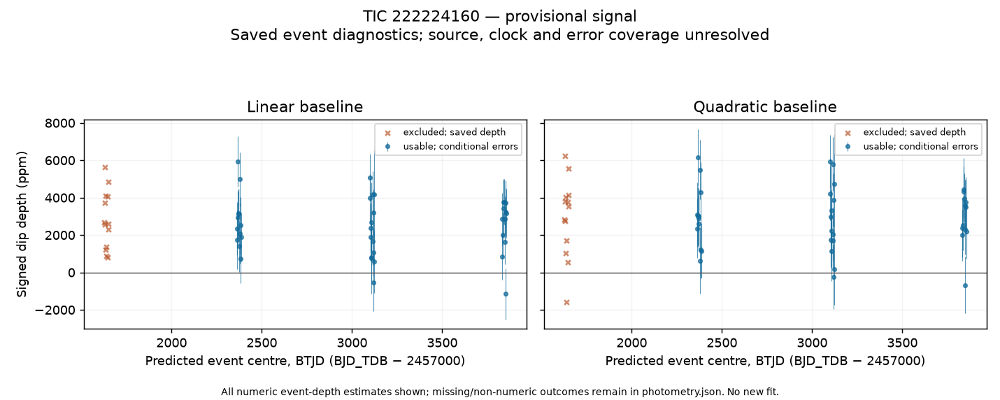

# TIC 222224160 / S01

## Current vetting status

Assessed 2026-10-11T20:12:12.430670Z. **Progress: screening; scientific assessment: unclassified**.

Initial screen: **incomplete**. Warning flags: external_adverse_report. No initial warning does not establish a planet candidate.

[Dated measurements, catalogue matches and source/physical outcomes](evidence/vetting-findings.json) · [Structured status](vetting.json) · [Category definitions](../../docs/classification.md).

## Matching external aperture report

Reviewed 2026-10-11T12:27:23Z. Eumemic reports this TIC at 1.639224000 days as **likely nearby FP** ([pinned table row](https://github.com/eumemic/exoplanets/blob/f3dd74abec5879661d76bcfcae2ce6744ba18aad/results_public/candidates_allsky.csv#L1811)). Reported rationale: Detailed classification rationale not published in the row.

All 38 tested saved nominal centres agree within 0.035 transit durations. The external epoch uncertainty/covariance is absent, so timing agreement is not uncertainty-qualified. The aperture report is recorded as previously reported; source identity, astrophysical disposition and discovery priority remain independent and unresolved.

[Raw report, probabilities, event residuals and limits](evidence/external-report.json). External FPP/NFPP values are their conditional model results, not our measurements. Supplementary status: no_per_signal_files_in_snapshot.

Attribution: Eumemic, exoplanets; source results/tables/figures CC BY 4.0. Copied source files are unmodified.

## Diagnostic figures

Saved signed local profiles; all numeric events, including negative depths. Failures and excluded clock products remain in the context. Display-bin error bars are uncalibrated white standard errors.

All event pages: [events-01.png](evidence/figures/events-01.png), [events-02.png](evidence/figures/events-02.png), [events-03.png](evidence/figures/events-03.png).

[Plot context](evidence/figures/plot-context.json) · [Saved plot vectors](evidence/figures/plot-data.npz) · [Rendering methods](../../docs/diagnostic-figures.md).

**Provisional unclassified transit-like signal.** Source attribution and timing consistency are unresolved.
Binary, blend and instrumental explanations remain open. This is a dated evidence record, not a verified planet.

Diagnostic period: 1.6392196401 ± 6.76e-06 d.
Epoch: BJD_TDB 2458626.79075869 ± 0.00682 d.
Duration: 3.5962 ± 0.255 h (conditional error).
Linear-baseline depth: 2547.2 ± 221.5 ppm,
from 38 usable events in 3 sectors.
Errors are conditional diagnostic estimates.

Both saved baseline orders give positive aggregate dips. The minimum conditional depth/error
over sector leaveouts is 9.24; it is not a false-alarm probability.
Odd/even depth contrast: 1.27 conditional error units. The saved odd/even diagnostic supplies no definitive classification.
The [photometry](evidence/photometry.json) retains unusable events, alternate reductions,
phase controls and timestamp-withheld products. [Robustness](evidence/robustness.json),
[timing](evidence/timing-summary.json) and [alternative signals](evidence/alternative-summary.json)
retain adverse evidence, signed secondary/odd-even/harmonic probes and failures. Strong
secondary or odd/even differences can favour a binary explanation; those probes have not
been calibrated into a definitive classification.

The immutable discovery seed and adopted diagnostic hypothesis are in [settings](analysis-settings.json).
The aperture TIC is not an established physical host; The catalogue Gaia association is recorded below; the physical host remains unresolved.
Read [novelty limits](NOVELTY.md) and [reproduction coverage](REPRODUCIBILITY.md).

## Catalogue stellar context

The [pinned TIC/Gaia context](evidence/stellar-catalogue.json) supplies aperture-star Teff, radius, mass, TESS magnitude and distance with catalogue uncertainties. The structured host block marks the physical host and dilution unresolved; these are catalogue values, not a planet-radius inference. Gaia association: associated.

## Conditional duration uncertainty

The saved trapezoid duration now has a conditional error of 0.25464 hours. [Full shape covariance and exact replay](evidence/shape-uncertainty.json) retain the model, rank/bound checks and uncertainty limitations. This is a local Gaussian fit error with uncalibrated coverage. Physical transit geometry remains unfitted.
