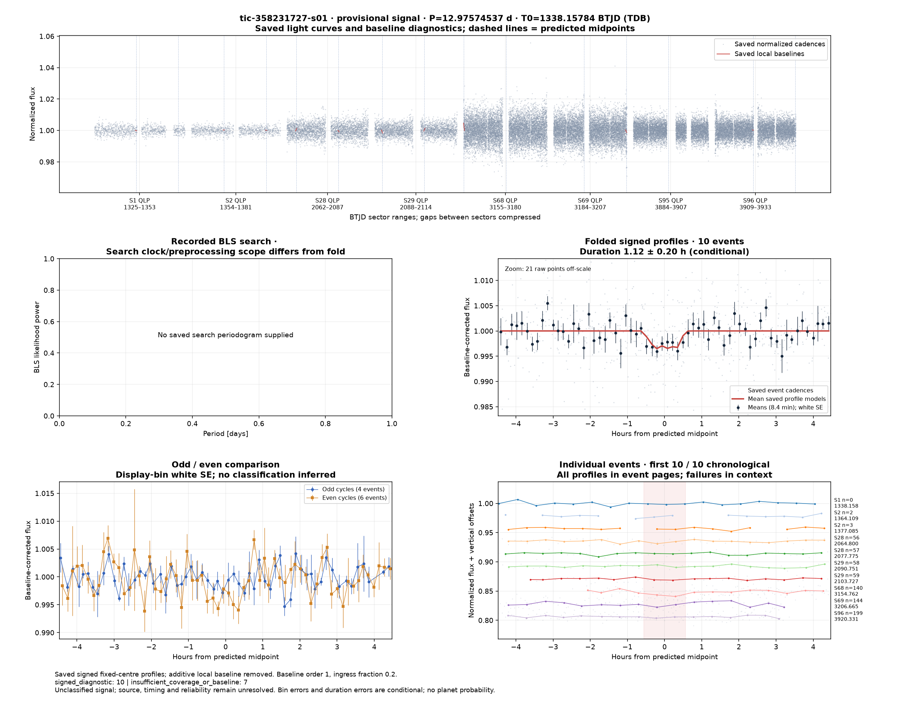

# TIC 358231727 / S01

## Diagnostic figures

Saved signed local profiles; all numeric events, including negative depths. Failures and excluded clock products remain in the context. Display-bin error bars are uncalibrated white standard errors.

[Plot context](evidence/figures/plot-context.json) · [Saved plot vectors](evidence/figures/plot-data.npz) · [Rendering methods](../../docs/diagnostic-figures.md).

**Provisional unclassified transit-like signal.** Source attribution and timing consistency are unresolved.
Binary, blend and instrumental explanations remain open. This is a dated evidence record, not a verified planet.

Diagnostic period: 12.9757453730 ± 5.33e-05 d.
Epoch: BJD_TDB 2458338.15784013 ± 0.00756 d.
Duration: 1.1184 h (uncertainty unavailable).
Linear-baseline depth: 1866.9 ± 576.0 ppm,
from 7 usable events in 5 sectors.
Errors are conditional diagnostic estimates.

Both saved baseline orders give positive aggregate dips. The minimum conditional depth/error
over sector leaveouts is 2.03; it is not a false-alarm probability.
Odd/even depth contrast: -0.829 conditional error units. The saved odd/even diagnostic supplies no definitive classification.
The [photometry](evidence/photometry.json) retains unusable events, alternate reductions,
phase controls and timestamp-withheld products. [Robustness](evidence/robustness.json),
[timing](evidence/timing-summary.json) and [alternative signals](evidence/alternative-summary.json)
retain adverse evidence, signed secondary/odd-even/harmonic probes and failures. Strong
secondary or odd/even differences can favour a binary explanation; those probes have not
been calibrated into a definitive classification.

The immutable discovery seed and adopted diagnostic hypothesis are in [settings](analysis-settings.json).
The aperture TIC is not an established physical host; the Gaia DR3 catalogue association is separate from attribution of the dip.
Read [novelty limits](NOVELTY.md) and [reproduction coverage](REPRODUCIBILITY.md).

## Catalogue stellar context

The [pinned TIC/Gaia context](evidence/stellar-catalogue.json) supplies aperture-star Teff, radius, mass, TESS magnitude and distance with catalogue uncertainties. The structured host block marks the physical host and dilution unresolved; these are catalogue values, not a planet-radius inference. Gaia association: associated.

## Conditional duration uncertainty

The saved trapezoid duration now has a conditional error of 0.202161 hours. [Full shape covariance and exact replay](evidence/shape-uncertainty.json) retain the model, rank/bound checks and uncertainty limitations. This is a local Gaussian fit error with uncalibrated coverage. Physical transit geometry remains unfitted.

## Run 6 follow-up

Fresh checks use 8 timing-qualified primary sectors, with one reduction per sector. Diagnostic warning flags: no_saved_pixel_competitor, period_cluster_13d, weak_qualified_sector_dip. [Detailed results and missing checks](evidence/vetting-findings.json). These descriptive flags do not assign a planet probability. The initial screen remains incomplete and source attribution unresolved.
