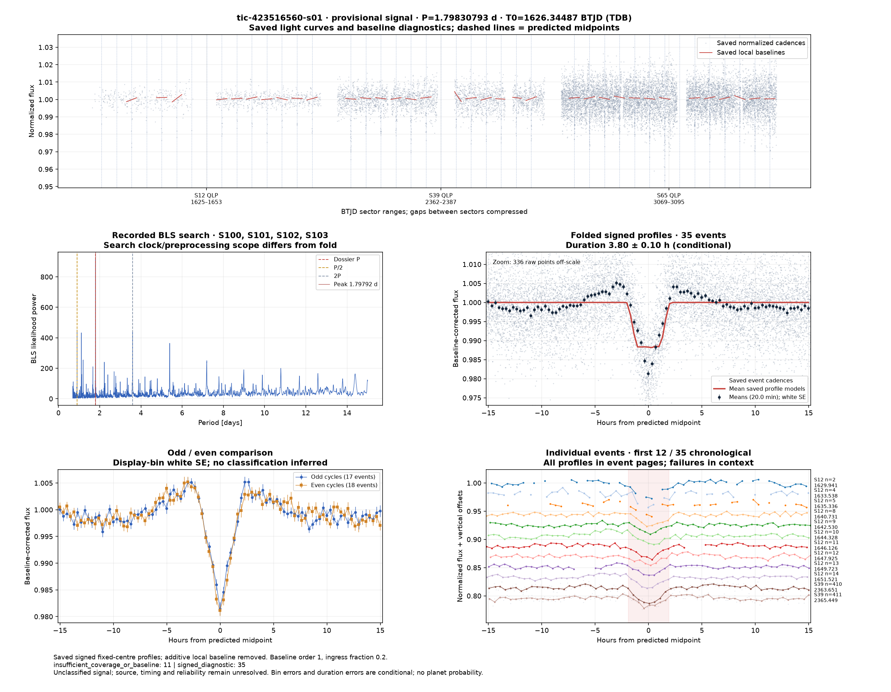
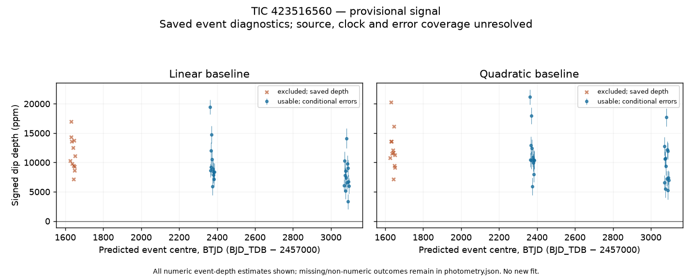

# TIC 423516560 / S01

## Diagnostic figures

Saved signed local profiles; all numeric events, including negative depths. Failures and excluded clock products remain in the context. Display-bin error bars are uncalibrated white standard errors.

All event pages: [events-01.png](evidence/figures/events-01.png), [events-02.png](evidence/figures/events-02.png).

[Plot context](evidence/figures/plot-context.json) · [Saved plot vectors](evidence/figures/plot-data.npz) · [Rendering methods](../../docs/diagnostic-figures.md).

**Provisional unclassified transit-like signal.** Source attribution and timing consistency are unresolved.
Binary, blend and instrumental explanations remain open. This is a dated evidence record, not a verified planet.

Diagnostic period: 1.7983079261 ± 5.15e-06 d.
Epoch: BJD_TDB 2458626.34487126 ± 0.00309 d.
Duration: 3.7993 h (uncertainty unavailable).
Linear-baseline depth: 8675.1 ± 270.4 ppm,
from 25 usable events in 2 sectors.
Errors are conditional diagnostic estimates.

Both saved baseline orders give positive aggregate dips. The minimum conditional depth/error
over sector leaveouts is 19.8; it is not a false-alarm probability.
Odd/even depth contrast: -3.94 conditional error units. The saved odd/even diagnostic exceeds its recorded three-error-unit flag; a binary or alternating-depth explanation needs particular attention.
The [photometry](evidence/photometry.json) retains unusable events, alternate reductions,
phase controls and timestamp-withheld products. [Robustness](evidence/robustness.json),
[timing](evidence/timing-summary.json) and [alternative signals](evidence/alternative-summary.json)
retain adverse evidence, signed secondary/odd-even/harmonic probes and failures. Strong
secondary or odd/even differences can favour a binary explanation; those probes have not
been calibrated into a definitive classification.

The immutable discovery seed and adopted diagnostic hypothesis are in [settings](analysis-settings.json).
The aperture TIC is not an established physical host; Gaia DR3 association is deliberately null.
Read [novelty limits](NOVELTY.md) and [reproduction coverage](REPRODUCIBILITY.md).

## Catalogue stellar context

The [pinned TIC/Gaia context](evidence/stellar-catalogue.json) supplies aperture-star Teff, radius, mass, TESS magnitude and distance with catalogue uncertainties. The structured host block marks the physical host and dilution unresolved; these are catalogue values, not a planet-radius inference. Gaia association: associated.

## Conditional duration uncertainty

The saved trapezoid duration now has a conditional error of 0.100252 hours. [Full shape covariance and exact replay](evidence/shape-uncertainty.json) retain the model, rank/bound checks and uncertainty limitations. This is a local Gaussian fit error with uncalibrated coverage. Physical transit geometry remains unfitted.
