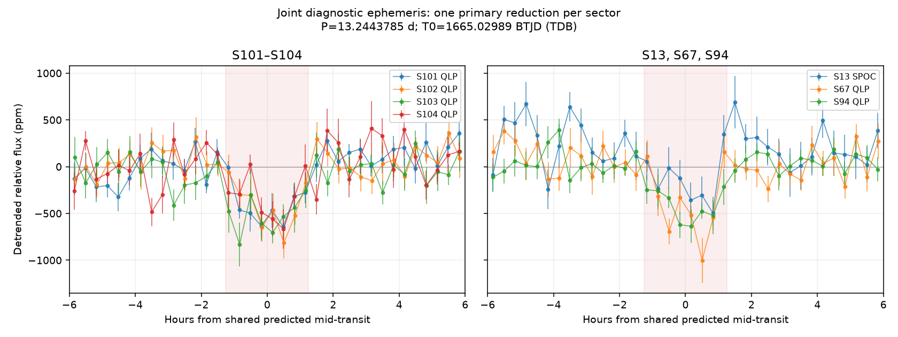
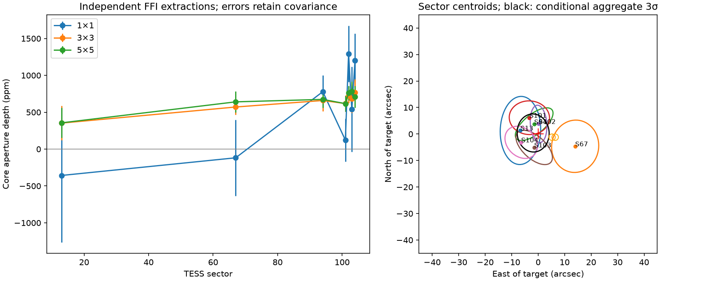
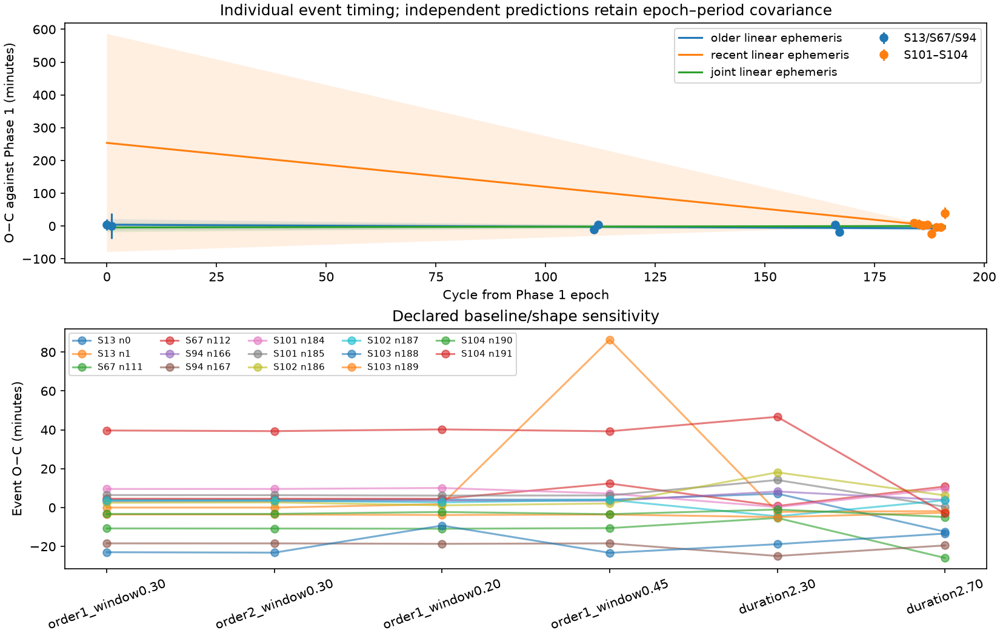

# TIC 464547401 / S01

## Diagnostic figures

Historical Phase 1 view. QLP clock assumptions remain unresolved; see later timing evidence. Display-bin error bars are uncalibrated white standard errors.

All event pages: [events-01.png](evidence/figures/events-01.png).

[Plot context](evidence/figures/plot-context.json) · [Saved plot vectors](evidence/figures/plot-data.npz) · [Rendering methods](../../docs/diagnostic-figures.md).

**Unclassified transit-like signal. Public evidence dossier, analysis dated 2026-10-10.**
The label S01 is local to this catalogue. No official TOI/cTOI or confirmed-planet designation
is claimed. First disclosure was the GitHub push recorded at **2026-10-10 17:54:43 UTC**;
the [receipt](publication-receipt.json) identifies the initial public snapshot and timestamp basis.
No versioned release or DOI has been issued yet.

| Assessment | Status | Interpretation |
|---|---|---|
| Source localisation | **unresolved** | Conditional centroids favour the target; close/unresolved sources are not robustly excluded. |
| Timing consistency | **unresolved** | Older/recent agreement depends on baseline/shape assumptions. |
| Novelty | No match in checked sources | Dated authoritative checks found no matching entry; discovery priority is not established. |

The [machine specification](candidate.json) identifies TIC 464547401, TYC 9078-80-1,
Gaia DR3 6435059343942224256 and 2MASS J19021501-6521326. TIC/SPOC J2000 coordinates are
RA 285.562511°, Dec −65.359019°; proper motion is accounted for separately in pixel comparisons.

| Diagnostic quantity | Estimate |
|---|---:|
| Period | 13.24437854 ± 0.00002972 d |
| Midpoint | BJD_TDB 2458665.02989 ± 0.00494 d |
| Equivalent TESS epoch | BTJD 1665.02989; offset 2457000 d, TDB |
| Duration | 2.512 ± 0.138 h |
| Local box-window depth | 477 ± 27 ppm |
| Primary observations | S13 SPOC; S67, S94, S101–S104 QLP; 14 covered events |

These are conditional diagnostic fits, not a physical transit or planetary inference. The
specification's epoch/period errors and covariance come from the same 128-repetition block
bootstrap. Alternative formal covariances remain in the original evidence; do not substitute
them while retaining larger bootstrap marginal errors. Depth is measured separately.

The [19 predefined robustness comparisons](evidence/phase1/analysis/robustness.csv) retain
sector removals, trend windows/methods, alternate reductions and quality cuts. The
[covered-event table](evidence/phase1/analysis/events.csv) and
[all 192 baseline-cycle predictions](evidence/phase1/analysis/all_baseline_predictions.csv)
preserve poor coverage and the negative global BLS contribution of the second S13 event.
Overlapping reductions replace one another; they are not additional independent observations.
The initial search period (13.243879140 d), historical supplied refinement (13.244391 d) and
audited joint ephemeris are distinct in the [preserved results](evidence/phase1/analysis/ephemerides.json).

Seven usable FFI sectors weakly favour the target, with conditional aggregate offset east
−1.88 ± 2.01″ and north +0.39 ± 2.39″. Low signal-to-noise, PRF/background assumptions and
unresolved companions prevent a calibrated exclusion of alternatives. Two close Gaia sources
remain scientifically relevant. Paired 3×3 versus 5×5 aperture depths differ by at most 1.21
paired errors; one-pixel depths vary. These shared-photon comparisons are not independent
confirmations. Pixel footprint hits S66/S93 place the target outside CCD science rows and
are excluded. [Input identities and hashes](inputs.json), [contaminants](evidence/phase2/analysis/contaminants.csv)
and all seven difference-image plots are retained.

Independent free-shape older (S13/S67/S94) and recent (S101–S104) fits give periods
13.24440799 ± 0.00004504 and 13.24275463 ± 0.00067813 d. Their difference is −142.9 ± 58.7 s,
or 2.43 conditional sigma. Predictions at cycle 167 differ by 44.6 ± 19.7 min with full covariance.
Shared-shape alternatives disagree by 0.10–1.67 sigma; default event-removal comparisons stay
below 1.73 sigma. This is retrospective cross-validation. It does not establish timing
variations, a unique stable ephemeris or an instrumental explanation.

S13's second event depends strongly on its local baseline. SPOC PDCSAP depths are 271 ± 128 ppm
(linear) versus 472 ± 129 ppm (quadratic); QLP SAP gives 366 ± 145 versus 627 ± 154 ppm.
The linear raw-SAP timing fit reaches a bound and fails. One first-event QLP sample is flagged
and excluded. The documented star-tracker anomaly overlaps the far baseline after the first
transit, rather than the transit itself. QLP lacks the spacecraft-time correction needed for
anomaly-window counts; that check is unavailable, not a zero-event pass.

Catalogue mass/radius densities near 2.6 g/cm³ are compatible with the duration at b ≈ 0.73
under a circular orbit, negligible transiting-object mass and assumed radius ratio 0.022.
Shared catalogue inputs, eccentricity, host identity and dilution limit this comparison.
It is not an independent planetary validation or a unique transit density measurement.

The original historical figure is preserved privately, but exact historical input hashes/runtime
were absent: bitwise reconstruction of that original figure remains unresolved. Audited
Phase 1/2 reruns matched respectively 14 and 40 non-report outputs byte for byte in the
preserved project; the [Phase 1](evidence/phase1/reproducibility/comparison.json) and
[Phase 2](evidence/phase2/reproducibility/comparison.json) comparison certificates identify
the preserved outputs. The public draft contains exported evidence, not the complete numerical
runtime/input capsule. See [reproducibility](REPRODUCIBILITY.md), [novelty](NOVELTY.md) and
the [SHA256 evidence manifest](evidence-manifest.json). Physical fits, aliases/secondaries,
injection recovery and search-calibrated false alarms are not established by these audits.
