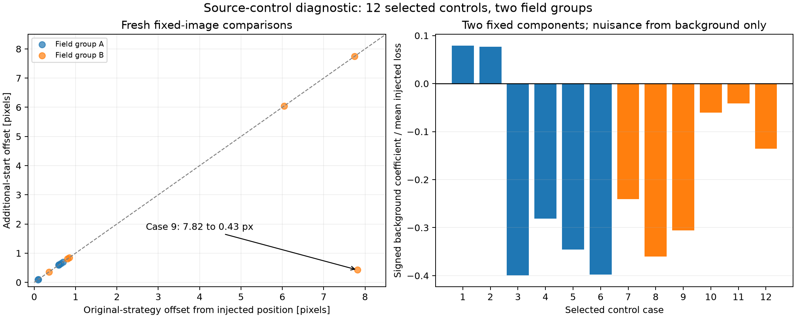

# Source-control review — 11 October 2026

Supplement version **1.0.0**. This reviews the source-vetting method using twelve
shifted injection controls in two anonymous field groups. It leaves the existing
dossiers, scientific assessments and dated screen/browsing counts unchanged.

[Recorded comparisons, units and receipt hashes](../reviews/source-control-review-2026-10-11-v1.json).

The workload deliberately selects eight historical nominal-ellipse misses and four
historical inclusions from matched-PRF controls. Target identities and per-target
signal specifications are excluded from this method-level export.
It is a failure-enriched diagnostic, not a representative validation population.
The new trials have fresh declared bootstrap draws and weights; their results are
not exact replays of the old uncertainty ellipses. Repeated sources, phases and
PRF widths share photons, so the counts are not independent error-rate trials.

The existing fitter already selects a starting point from a coarse grid. Additional
local fits around the known injected position use the same fixed image, error map,
positive-dimming constraint and signed background plane. They correct one large
fresh centroid offset: **7.82→0.43 pixels** for control9. That case was a historical
nominal inclusion, illustrating why that label alone does not certify a good fit.
Other offsets remain largely unchanged. More starting points alone do not solve the
source-method problem.

Paired background-only and injected images verify that the imposed dimming was
added as the declared PRF: the largest departure from a positive scalar multiple
was at numerical roundoff level in the retained experiment. This checks injection
arithmetic, not uncertainty coverage or physical source interpretation.

A two-component projected diagnostic fixes the injected position and a nuisance
position estimated from the background-only image. Ten of twelve background fits
have a negative signed coefficient at the injected position. Their net coefficients
become positive after injection, but positivity constraints change the inferred
component increment. These coefficients describe the conditional projected model;
they do not identify isolated stellar brightening or establish an astrophysical cause.

Unconstrained linear fits recover the imposed component increment to numerical
precision. That is an algebraic identity when the template is in a full-rank basis,
not evidence of successful detection, source exclusion or calibrated confidence.
The data-selected nuisance position, diagonal weights, fixed registration/PRF and
clock assumptions require further testing.

The next method experiment needs joint source/variability/noise controls and a
representative holdout evaluation. Keep these results as method-quality limitations,
with **source attribution unresolved**. No false-positive verdict, candidate promotion
or planet probability follows from this review.

Public reproducibility for this supplement is **evidence inspection only**. The
saved measurements and figure are inspectable; a public numerical capsule for these
source controls has not been supplied. The [separate exposure-integration package](exposure-integration-review-2026-10-11.md)
reproduces its own selected-input diagnostic and does not cover this experiment.
