# Candidate diagnostics — page 1

[Gallery index](README.md). Each image opens its full-resolution PNG.

| | | |
|---|---|---|
| [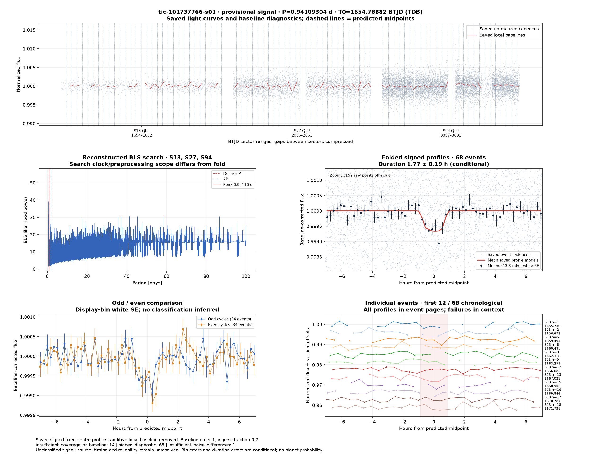](../candidates/tic-101737766-s01/evidence/figures/diagnostic.png) [tic-101737766-s01](../candidates/tic-101737766-s01/README.md) |  [tic-101909456-s01](../candidates/tic-101909456-s01/README.md) | [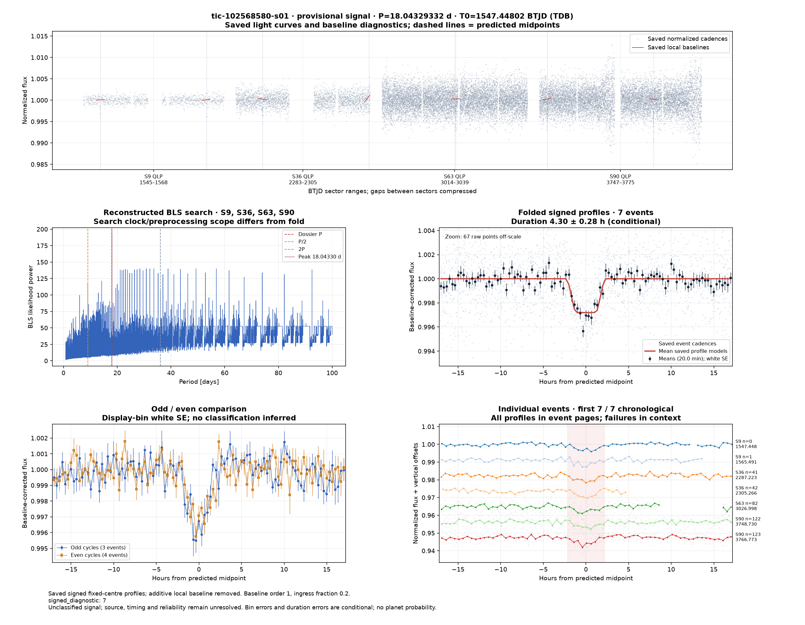](../candidates/tic-102568580-s01/evidence/figures/diagnostic.png) [tic-102568580-s01](../candidates/tic-102568580-s01/README.md) |
| [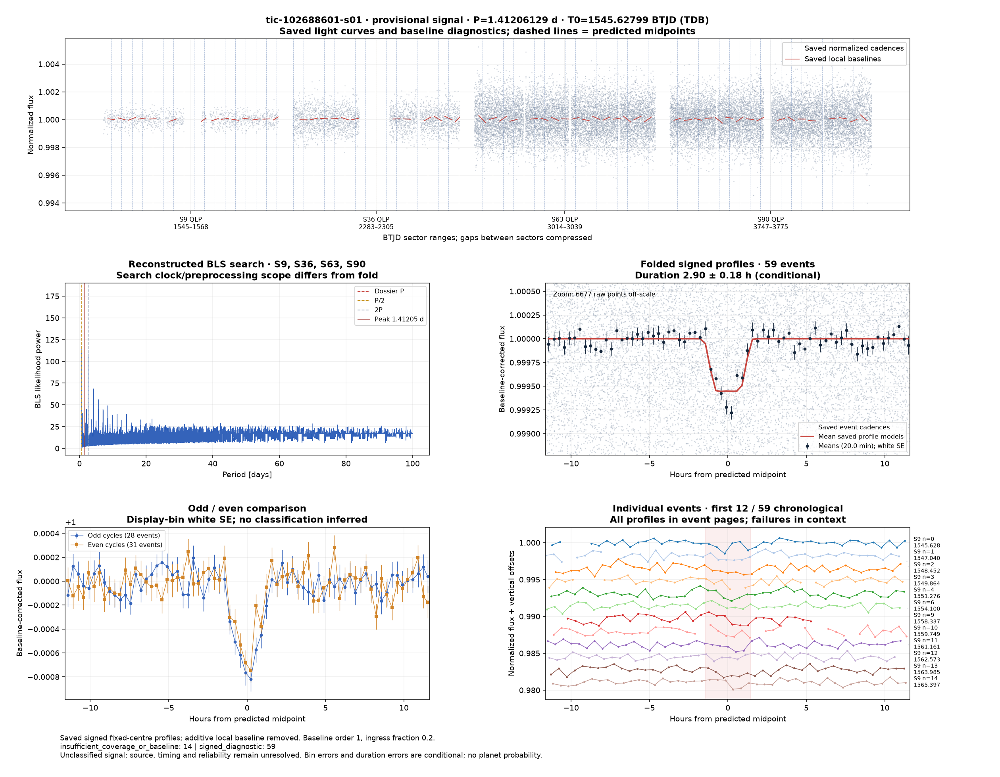](../candidates/tic-102688601-s01/evidence/figures/diagnostic.png) [tic-102688601-s01](../candidates/tic-102688601-s01/README.md) |  [tic-103065229-s01](../candidates/tic-103065229-s01/README.md) | [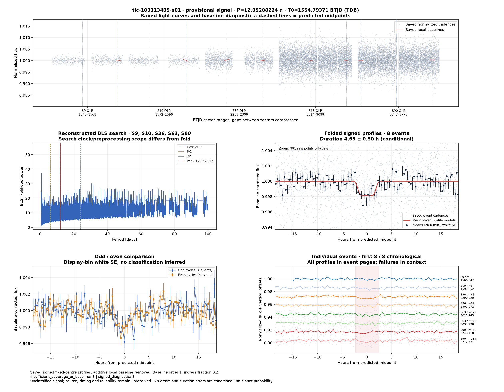](../candidates/tic-103113405-s01/evidence/figures/diagnostic.png) [tic-103113405-s01](../candidates/tic-103113405-s01/README.md) |
|  [tic-106146535-s01](../candidates/tic-106146535-s01/README.md) | [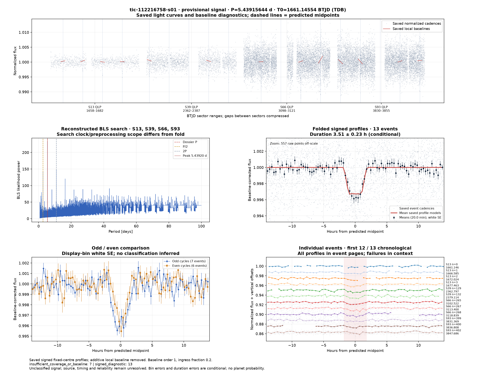](../candidates/tic-112216758-s01/evidence/figures/diagnostic.png) [tic-112216758-s01](../candidates/tic-112216758-s01/README.md) |  [tic-117942905-s01](../candidates/tic-117942905-s01/README.md) |
| [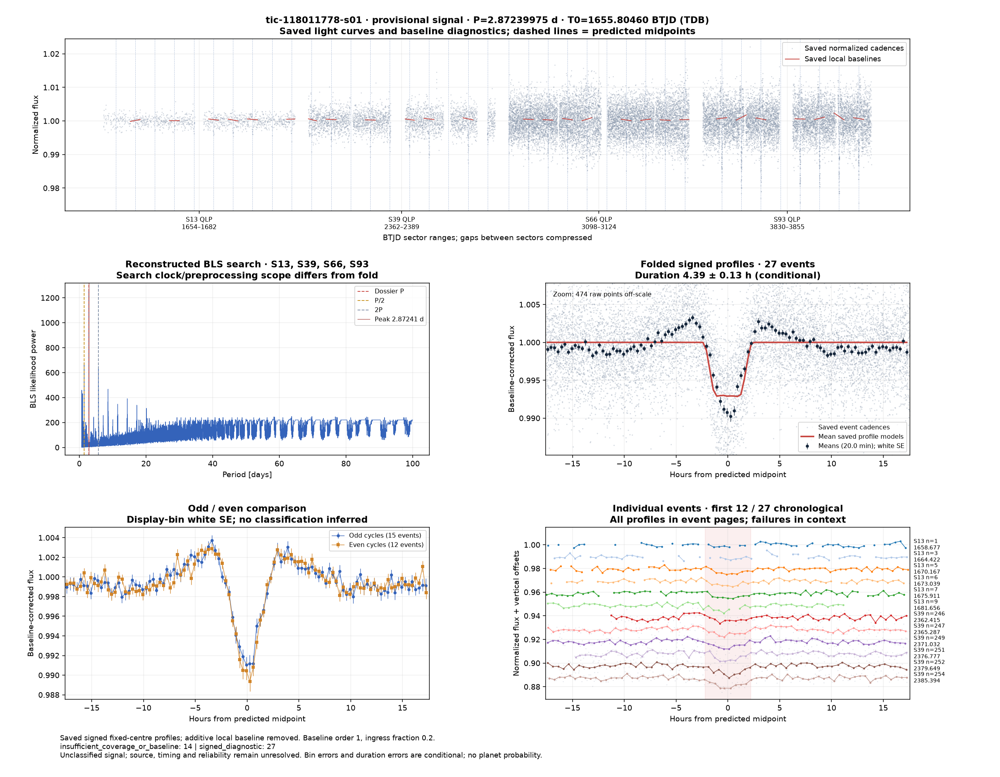](../candidates/tic-118011778-s01/evidence/figures/diagnostic.png) [tic-118011778-s01](../candidates/tic-118011778-s01/README.md) | [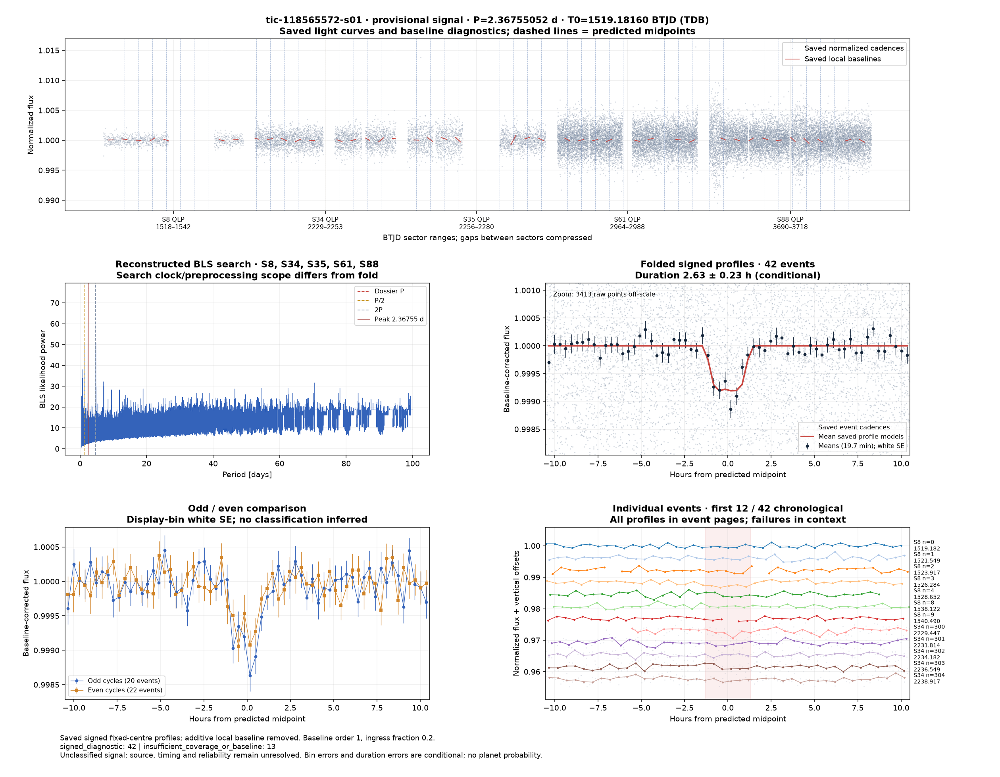](../candidates/tic-118565572-s01/evidence/figures/diagnostic.png) [tic-118565572-s01](../candidates/tic-118565572-s01/README.md) |  [tic-119870339-s01](../candidates/tic-119870339-s01/README.md) |
|  [tic-119926654-s01](../candidates/tic-119926654-s01/README.md) | [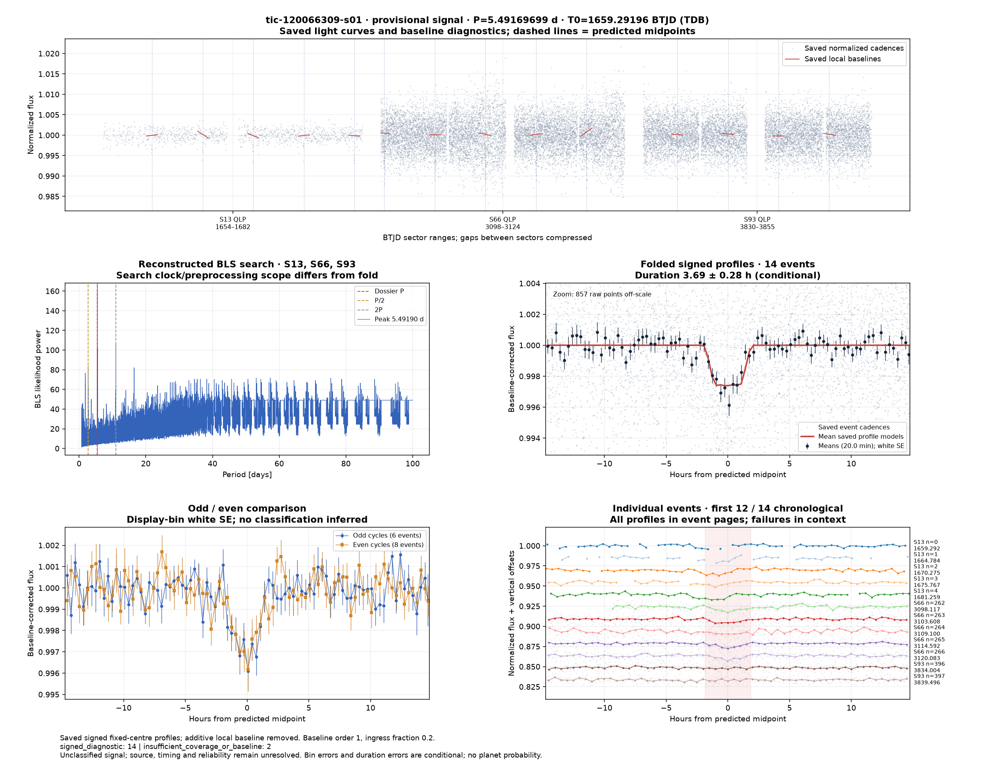](../candidates/tic-120066309-s01/evidence/figures/diagnostic.png) [tic-120066309-s01](../candidates/tic-120066309-s01/README.md) |  [tic-120660805-s01](../candidates/tic-120660805-s01/README.md) |
| [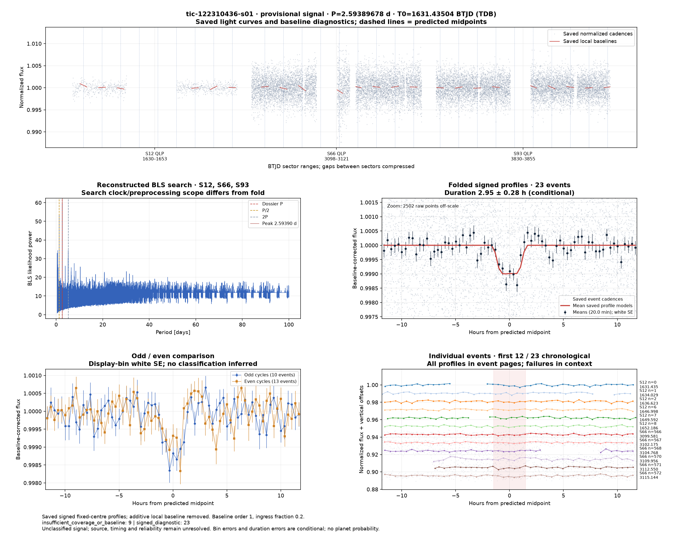](../candidates/tic-122310436-s01/evidence/figures/diagnostic.png) [tic-122310436-s01](../candidates/tic-122310436-s01/README.md) |  [tic-122854005-s01](../candidates/tic-122854005-s01/README.md) |  [tic-124257344-s01](../candidates/tic-124257344-s01/README.md) |
| [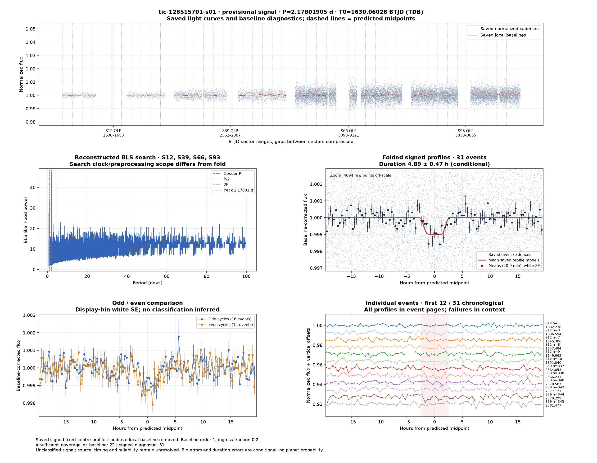](../candidates/tic-126515701-s01/evidence/figures/diagnostic.png) [tic-126515701-s01](../candidates/tic-126515701-s01/README.md) | [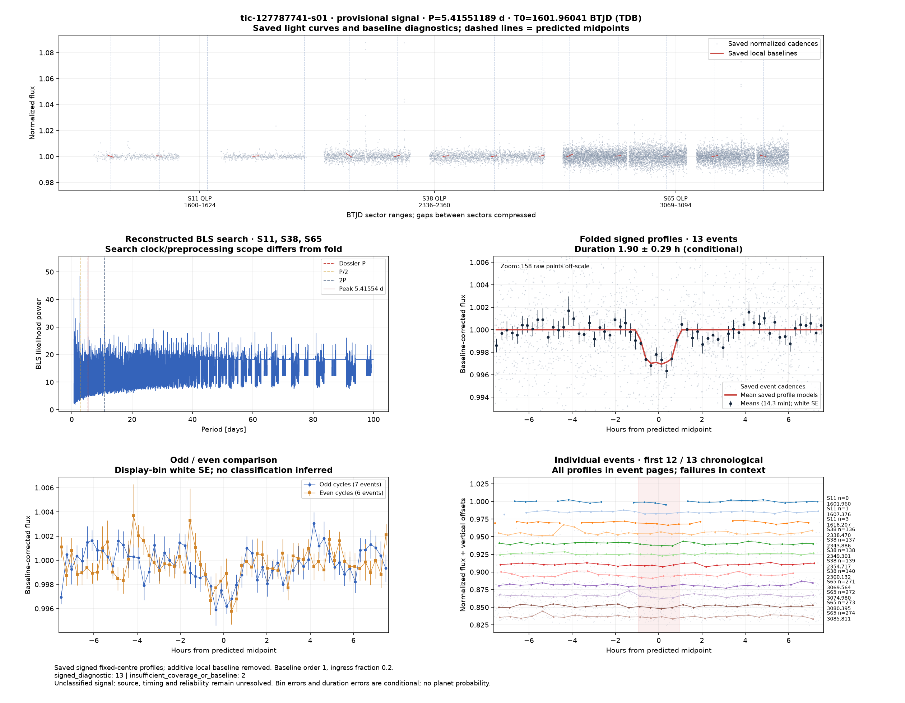](../candidates/tic-127787741-s01/evidence/figures/diagnostic.png) [tic-127787741-s01](../candidates/tic-127787741-s01/README.md) |  [tic-128833851-s01](../candidates/tic-128833851-s01/README.md) |
|  [tic-129418447-s01](../candidates/tic-129418447-s01/README.md) | [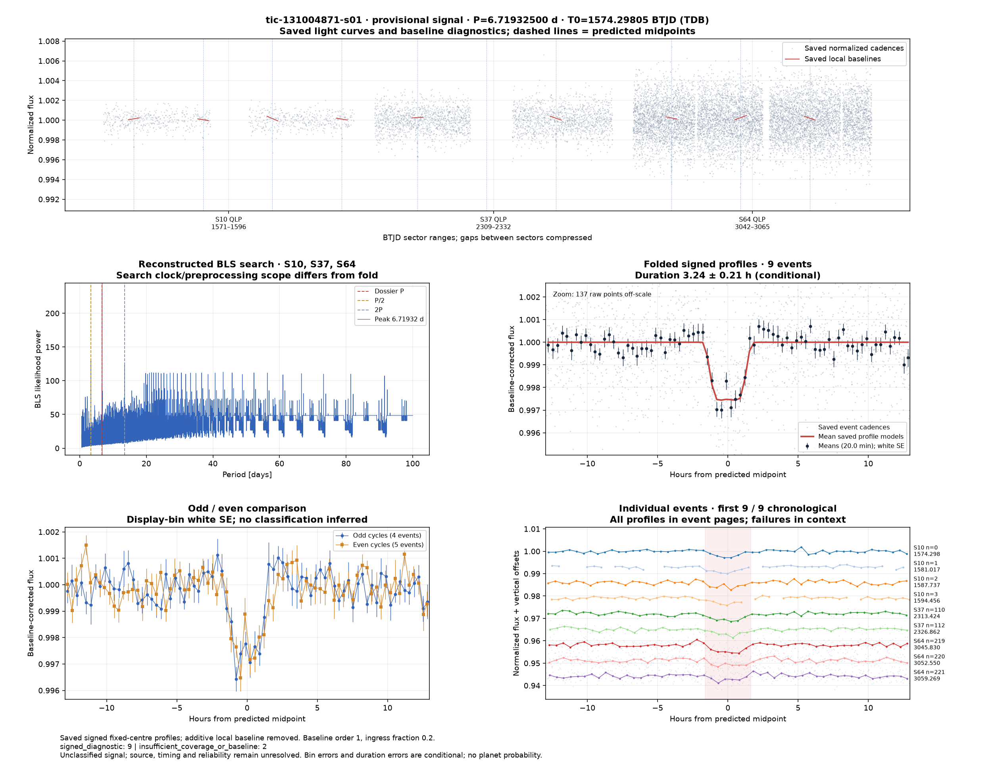](../candidates/tic-131004871-s01/evidence/figures/diagnostic.png) [tic-131004871-s01](../candidates/tic-131004871-s01/README.md) |  [tic-132066001-s01](../candidates/tic-132066001-s01/README.md) |
