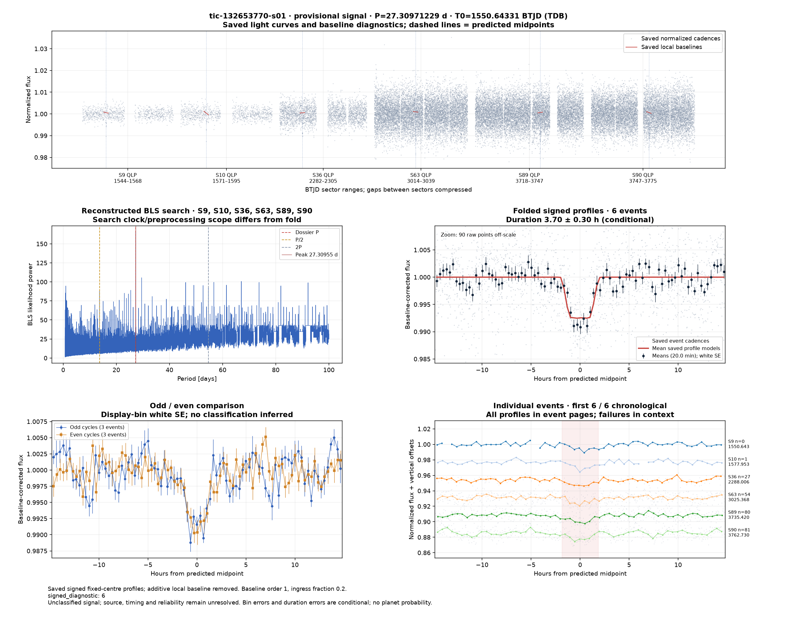
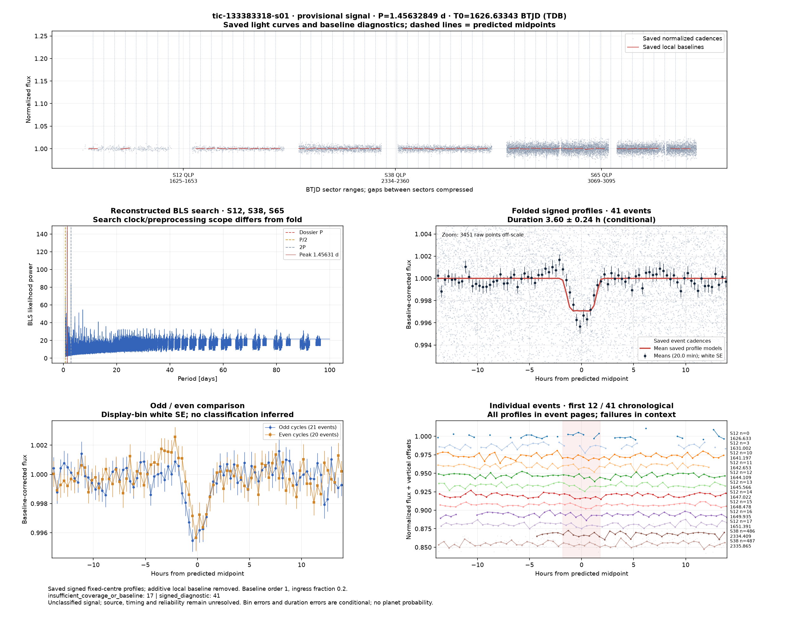
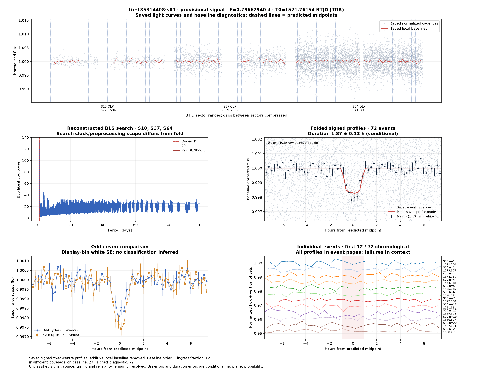
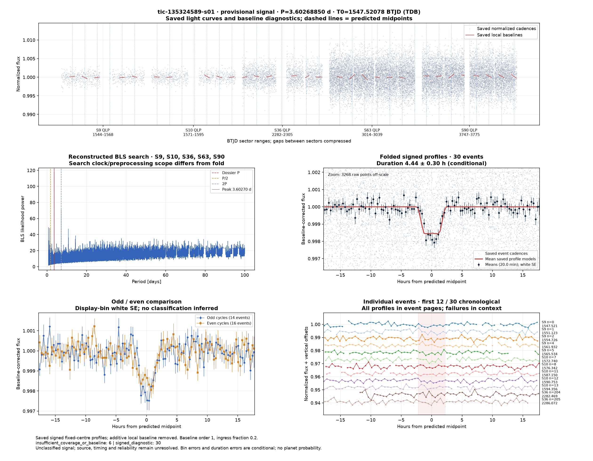
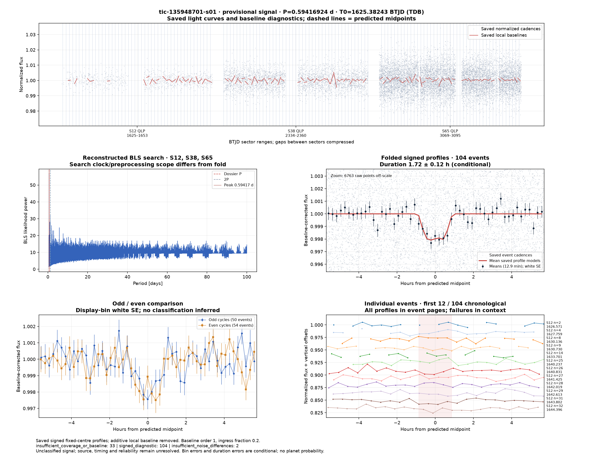
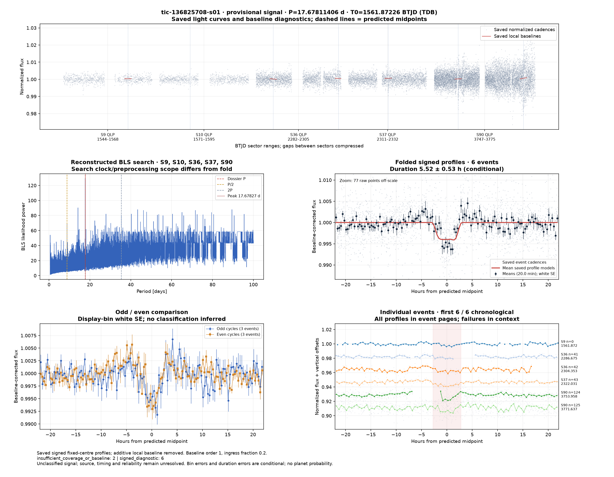
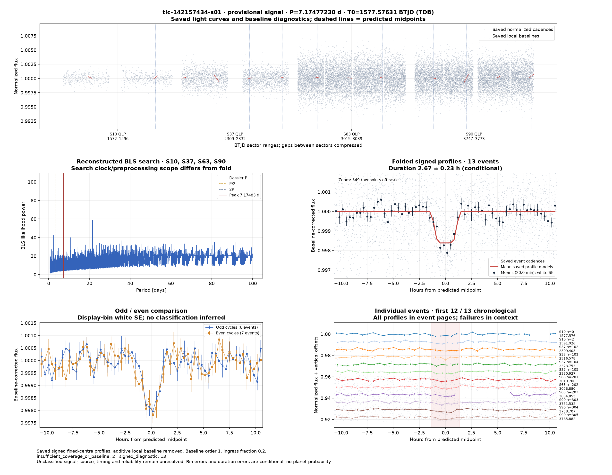
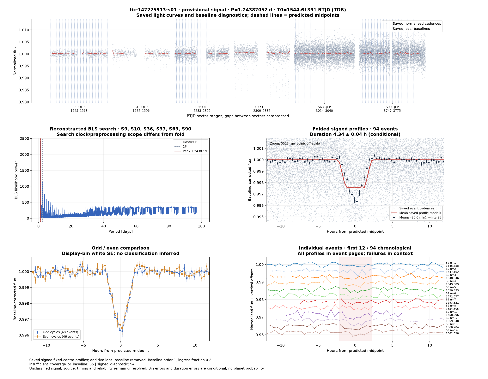

# Candidate diagnostics — page 2

[Gallery index](README.md). Each image opens its full-resolution PNG.

| | | |
|---|---|---|
|  [tic-132653770-s01](../candidates/tic-132653770-s01/README.md) |  [tic-133383318-s01](../candidates/tic-133383318-s01/README.md) |  [tic-134412679-s01](../candidates/tic-134412679-s01/README.md) |
|  [tic-135314408-s01](../candidates/tic-135314408-s01/README.md) |  [tic-135315597-s01](../candidates/tic-135315597-s01/README.md) |  [tic-135324589-s01](../candidates/tic-135324589-s01/README.md) |
|  [tic-135948701-s01](../candidates/tic-135948701-s01/README.md) |  [tic-136825708-s01](../candidates/tic-136825708-s01/README.md) |  [tic-136908573-s01](../candidates/tic-136908573-s01/README.md) |
|  [tic-140175607-s01](../candidates/tic-140175607-s01/README.md) |  [tic-1402031-s01](../candidates/tic-1402031-s01/README.md) |  [tic-141939616-s01](../candidates/tic-141939616-s01/README.md) |
|  [tic-142157434-s01](../candidates/tic-142157434-s01/README.md) |  [tic-143896115-s01](../candidates/tic-143896115-s01/README.md) |  [tic-144003599-s01](../candidates/tic-144003599-s01/README.md) |
|  [tic-144313460-s01](../candidates/tic-144313460-s01/README.md) |  [tic-145814691-s01](../candidates/tic-145814691-s01/README.md) |  [tic-146612375-s01](../candidates/tic-146612375-s01/README.md) |
|  [tic-146998411-s01](../candidates/tic-146998411-s01/README.md) |  [tic-146999712-s01](../candidates/tic-146999712-s01/README.md) |  [tic-147024543-s01](../candidates/tic-147024543-s01/README.md) |
|  [tic-147275913-s01](../candidates/tic-147275913-s01/README.md) |  [tic-147540892-s01](../candidates/tic-147540892-s01/README.md) |  [tic-148599787-s01](../candidates/tic-148599787-s01/README.md) |
