# Candidate diagnostics — page 2

[Gallery index](README.md). Each image opens its full-resolution PNG.

| | | |
|---|---|---|
| [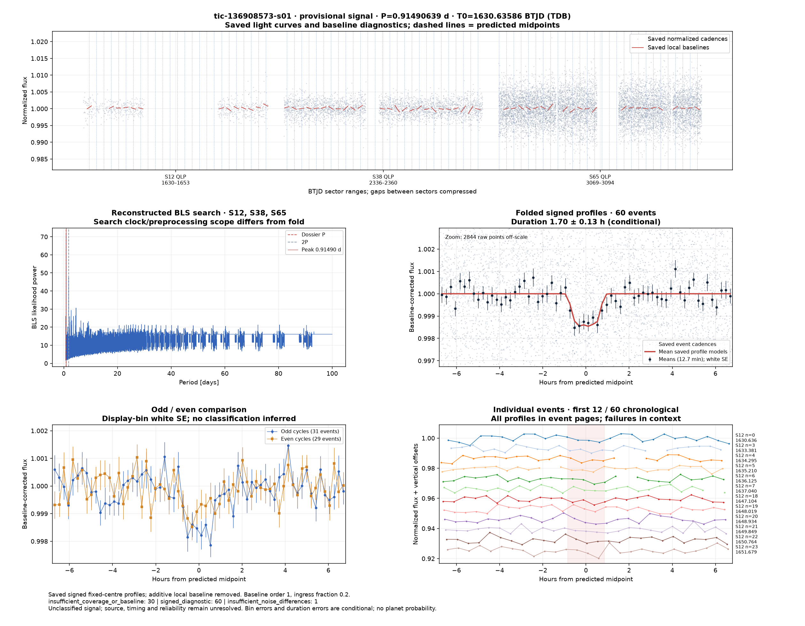](../candidates/tic-136908573-s01/evidence/figures/diagnostic.png) [tic-136908573-s01](../candidates/tic-136908573-s01/README.md) |  [tic-140175607-s01](../candidates/tic-140175607-s01/README.md) | [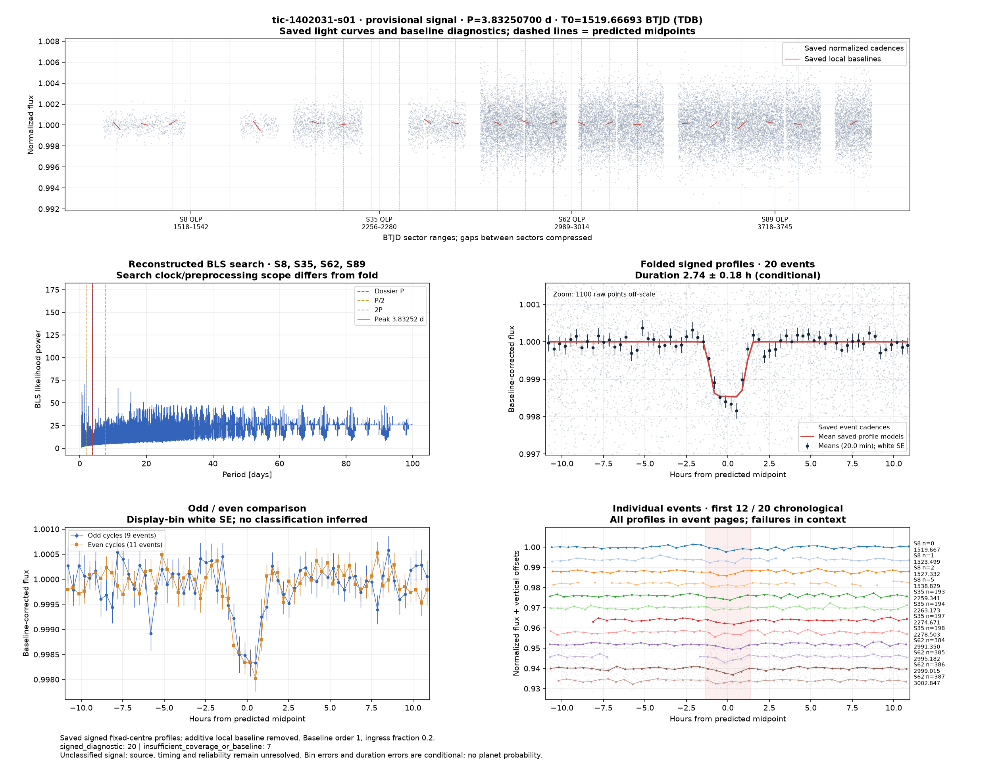](../candidates/tic-1402031-s01/evidence/figures/diagnostic.png) [tic-1402031-s01](../candidates/tic-1402031-s01/README.md) |
|  [tic-141939616-s01](../candidates/tic-141939616-s01/README.md) |  [tic-143896115-s01](../candidates/tic-143896115-s01/README.md) |  [tic-144003599-s01](../candidates/tic-144003599-s01/README.md) |
| [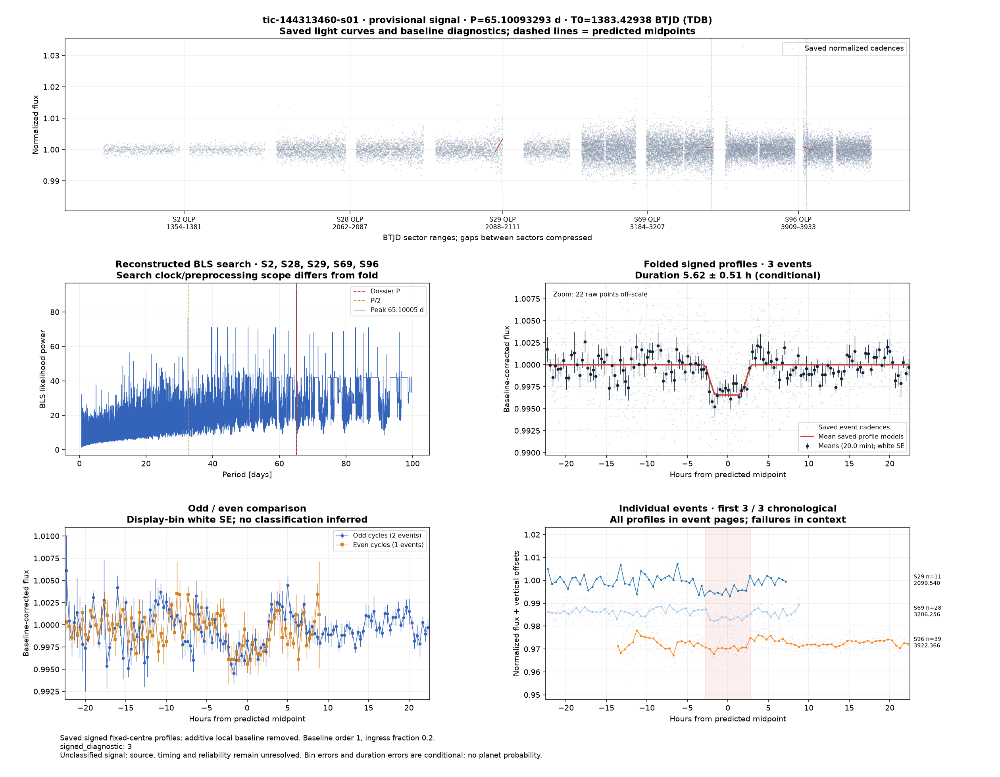](../candidates/tic-144313460-s01/evidence/figures/diagnostic.png) [tic-144313460-s01](../candidates/tic-144313460-s01/README.md) |  [tic-145814691-s01](../candidates/tic-145814691-s01/README.md) |  [tic-146612375-s01](../candidates/tic-146612375-s01/README.md) |
|  [tic-146998411-s01](../candidates/tic-146998411-s01/README.md) | [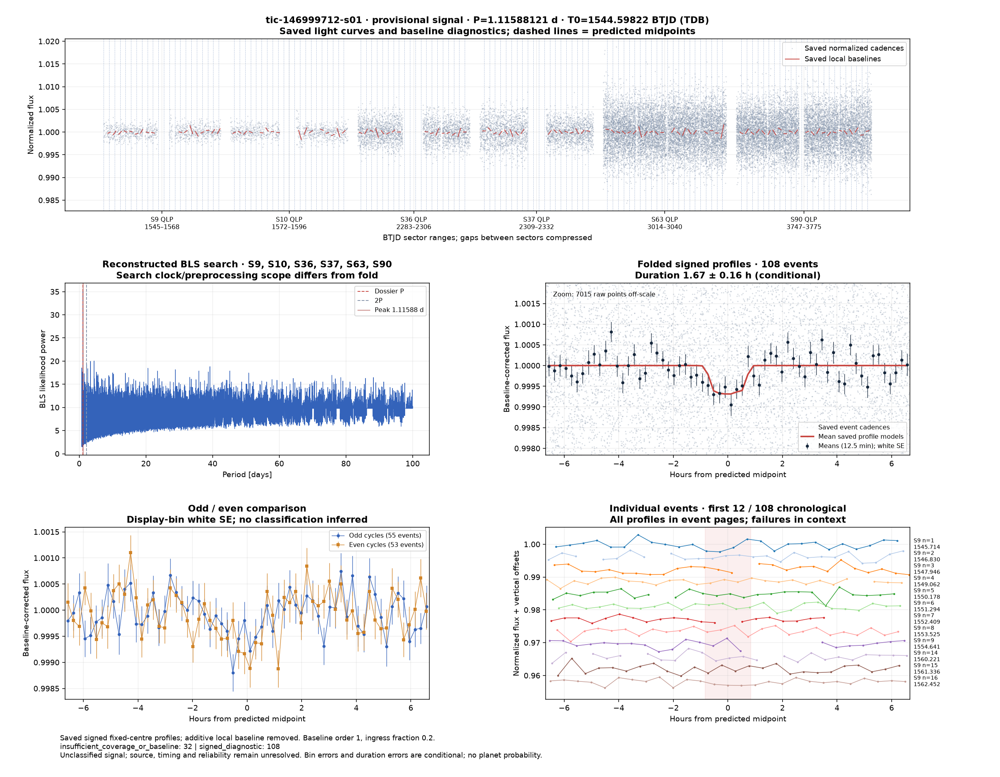](../candidates/tic-146999712-s01/evidence/figures/diagnostic.png) [tic-146999712-s01](../candidates/tic-146999712-s01/README.md) |  [tic-147024543-s01](../candidates/tic-147024543-s01/README.md) |
| [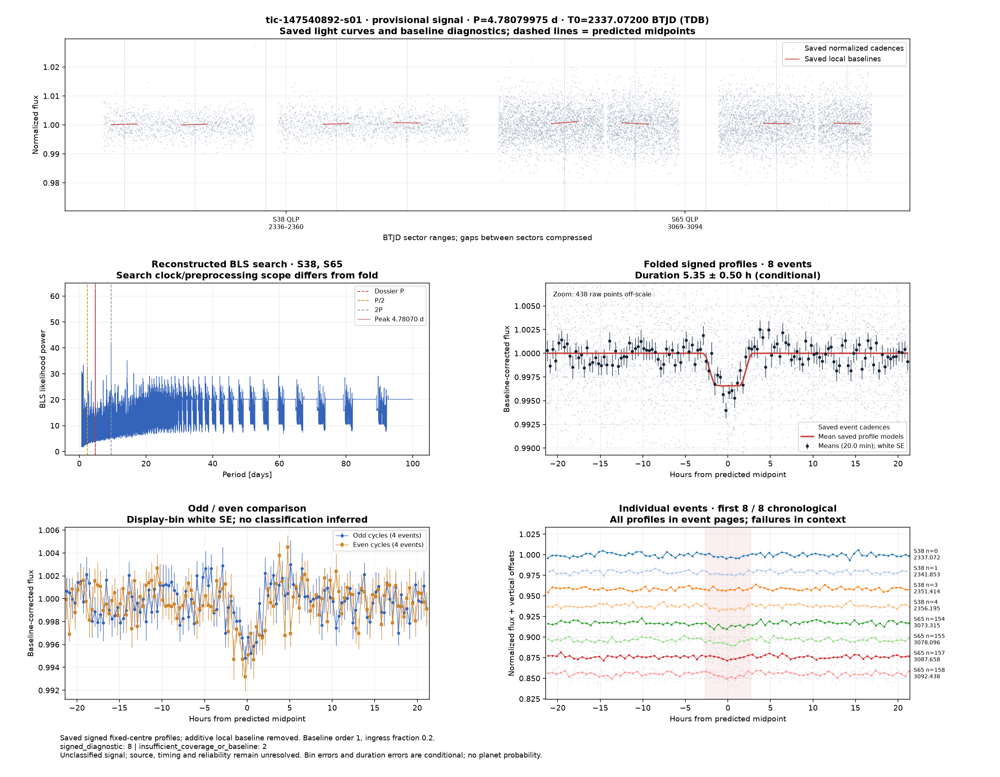](../candidates/tic-147540892-s01/evidence/figures/diagnostic.png) [tic-147540892-s01](../candidates/tic-147540892-s01/README.md) | [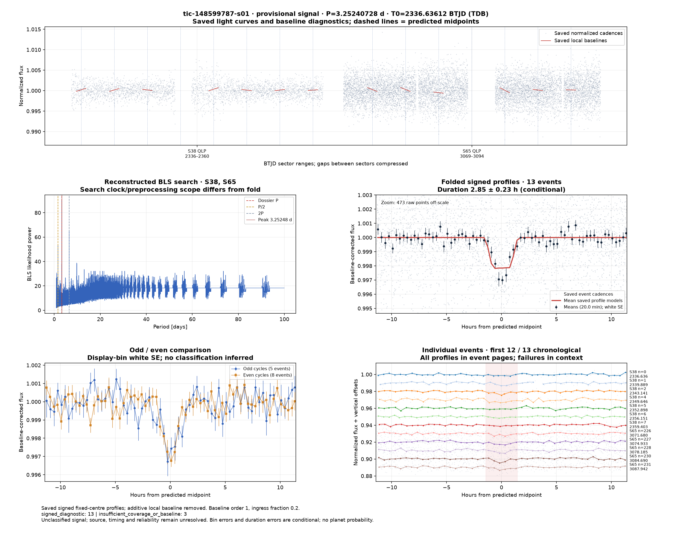](../candidates/tic-148599787-s01/evidence/figures/diagnostic.png) [tic-148599787-s01](../candidates/tic-148599787-s01/README.md) |  [tic-148952208-s01](../candidates/tic-148952208-s01/README.md) |
|  [tic-149640591-s01](../candidates/tic-149640591-s01/README.md) | [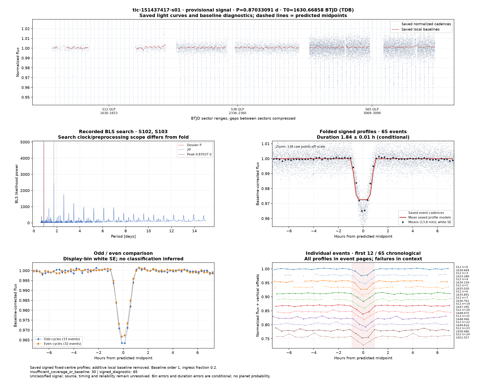](../candidates/tic-151437417-s01/evidence/figures/diagnostic.png) [tic-151437417-s01](../candidates/tic-151437417-s01/README.md) | [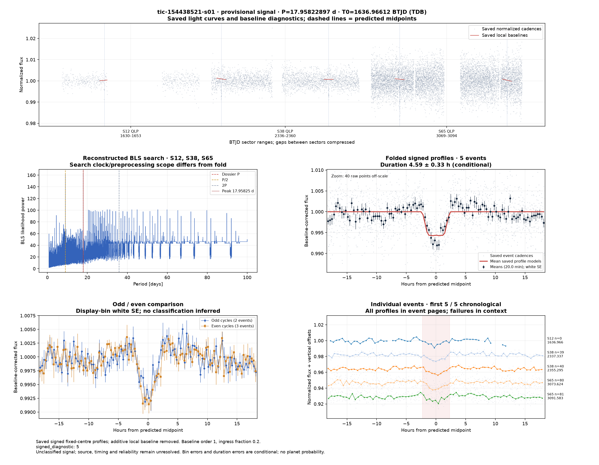](../candidates/tic-154438521-s01/evidence/figures/diagnostic.png) [tic-154438521-s01](../candidates/tic-154438521-s01/README.md) |
| [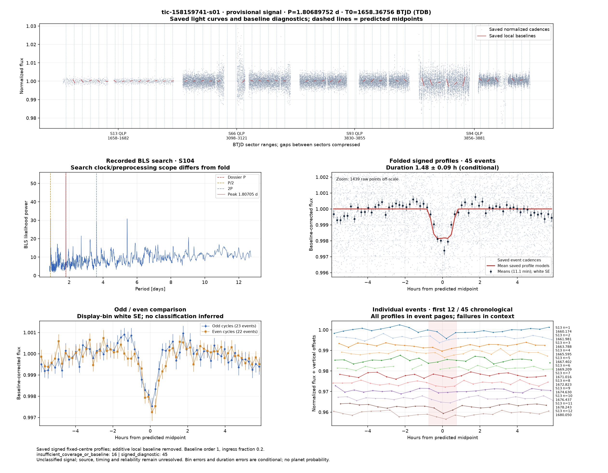](../candidates/tic-158159741-s01/evidence/figures/diagnostic.png) [tic-158159741-s01](../candidates/tic-158159741-s01/README.md) | [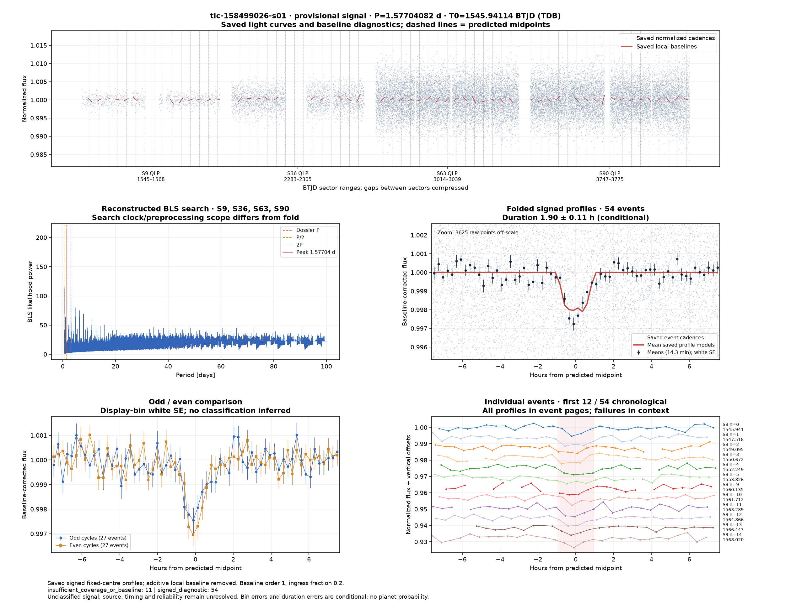](../candidates/tic-158499026-s01/evidence/figures/diagnostic.png) [tic-158499026-s01](../candidates/tic-158499026-s01/README.md) | [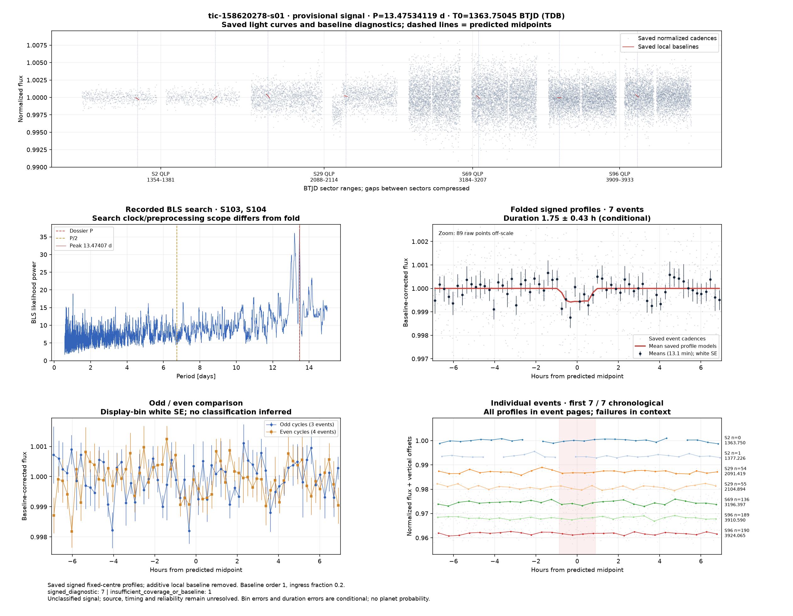](../candidates/tic-158620278-s01/evidence/figures/diagnostic.png) [tic-158620278-s01](../candidates/tic-158620278-s01/README.md) |
| [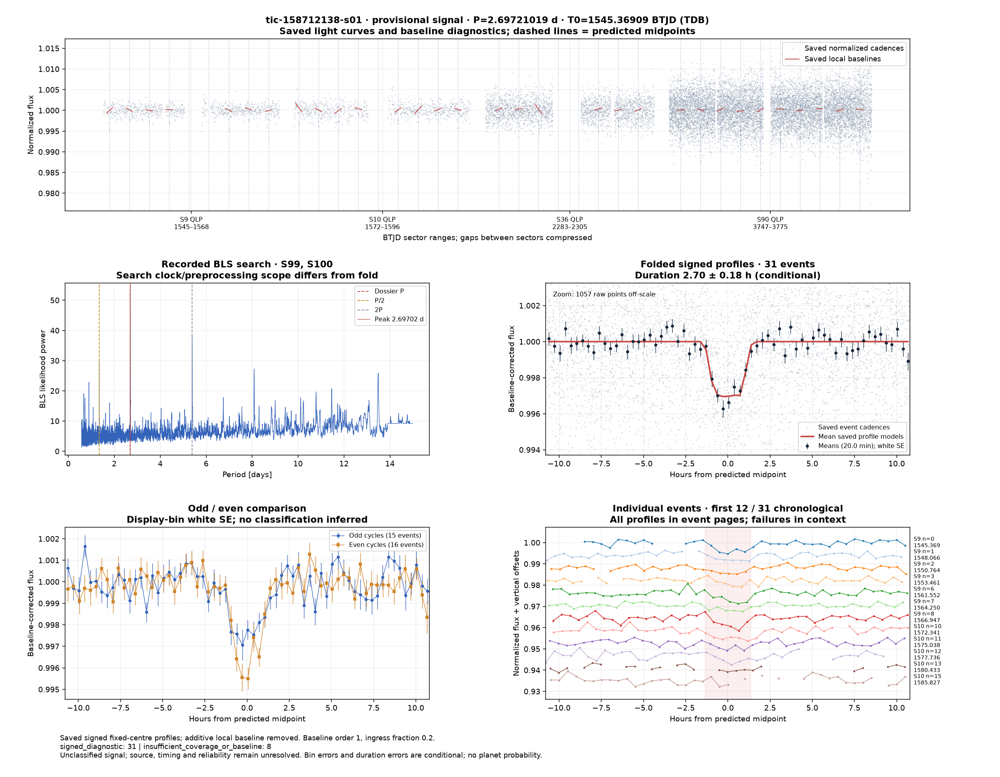](../candidates/tic-158712138-s01/evidence/figures/diagnostic.png) [tic-158712138-s01](../candidates/tic-158712138-s01/README.md) | [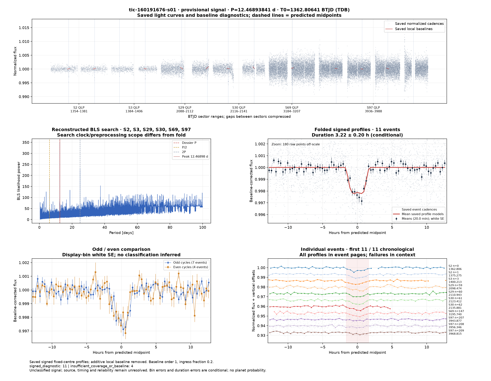](../candidates/tic-160191676-s01/evidence/figures/diagnostic.png) [tic-160191676-s01](../candidates/tic-160191676-s01/README.md) |  [tic-161357250-s01](../candidates/tic-161357250-s01/README.md) |
