# Candidate diagnostics — page 3

[Gallery index](README.md). Each image opens its full-resolution PNG.

| | | |
|---|---|---|
| [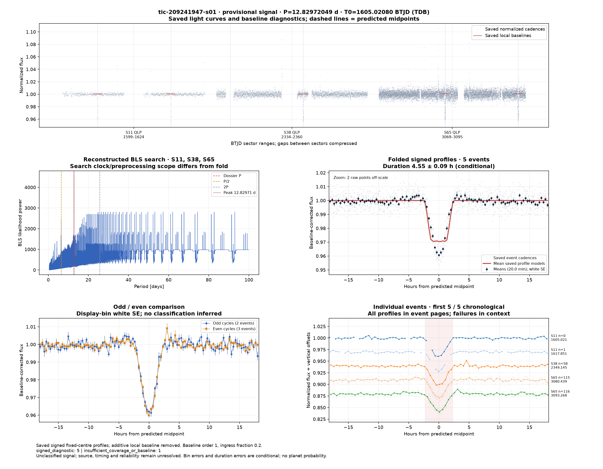](../candidates/tic-209241947-s01/evidence/figures/diagnostic.png) [tic-209241947-s01](../candidates/tic-209241947-s01/README.md) |  [tic-215091718-s01](../candidates/tic-215091718-s01/README.md) |  [tic-216669784-s01](../candidates/tic-216669784-s01/README.md) |
|  [tic-216780294-s01](../candidates/tic-216780294-s01/README.md) |  [tic-21694454-s01](../candidates/tic-21694454-s01/README.md) | [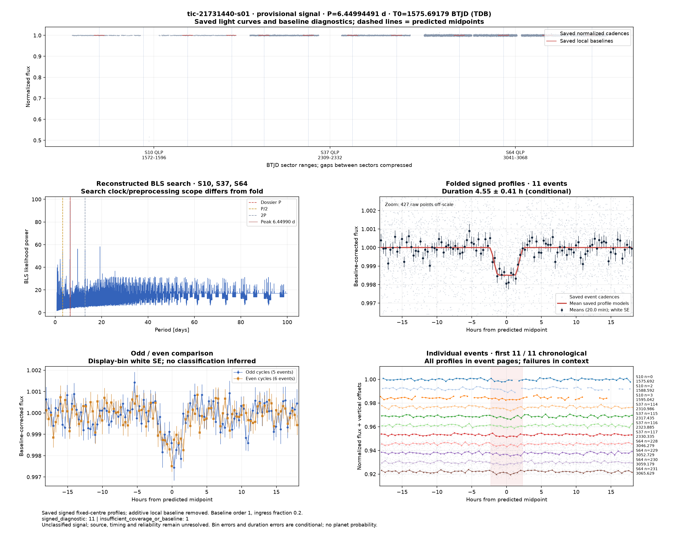](../candidates/tic-21731440-s01/evidence/figures/diagnostic.png) [tic-21731440-s01](../candidates/tic-21731440-s01/README.md) |
|  [tic-219382845-s01](../candidates/tic-219382845-s01/README.md) |  [tic-219452141-s01](../candidates/tic-219452141-s01/README.md) | [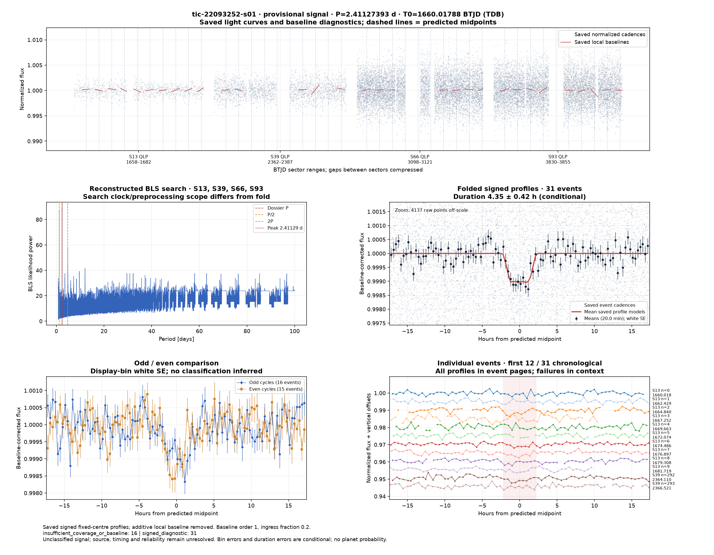](../candidates/tic-22093252-s01/evidence/figures/diagnostic.png) [tic-22093252-s01](../candidates/tic-22093252-s01/README.md) |
| [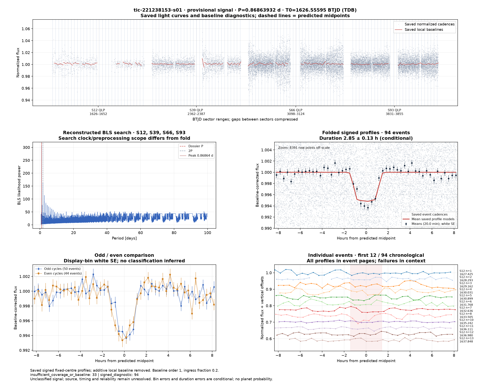](../candidates/tic-221238153-s01/evidence/figures/diagnostic.png) [tic-221238153-s01](../candidates/tic-221238153-s01/README.md) |  [tic-221425588-s01](../candidates/tic-221425588-s01/README.md) |  [tic-222224160-s01](../candidates/tic-222224160-s01/README.md) |
| [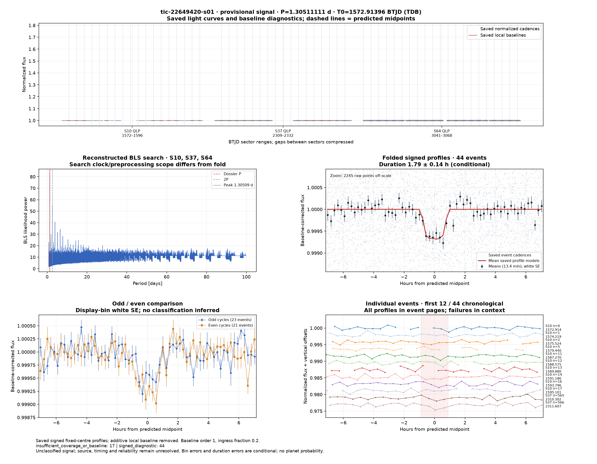](../candidates/tic-22649420-s01/evidence/figures/diagnostic.png) [tic-22649420-s01](../candidates/tic-22649420-s01/README.md) |  [tic-23205275-s01](../candidates/tic-23205275-s01/README.md) |  [tic-23205280-s01](../candidates/tic-23205280-s01/README.md) |
|  [tic-243500407-s01](../candidates/tic-243500407-s01/README.md) |  [tic-245101439-s01](../candidates/tic-245101439-s01/README.md) | [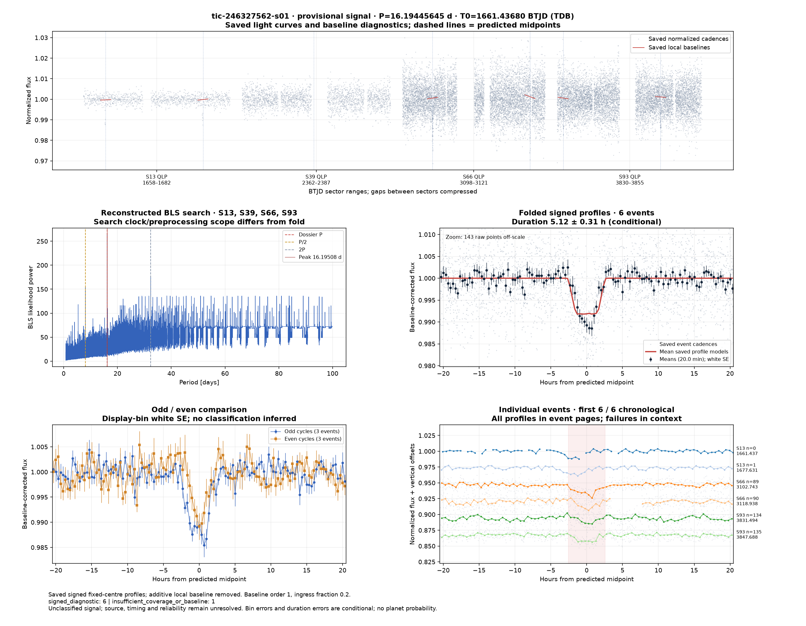](../candidates/tic-246327562-s01/evidence/figures/diagnostic.png) [tic-246327562-s01](../candidates/tic-246327562-s01/README.md) |
|  [tic-246469763-s01](../candidates/tic-246469763-s01/README.md) | [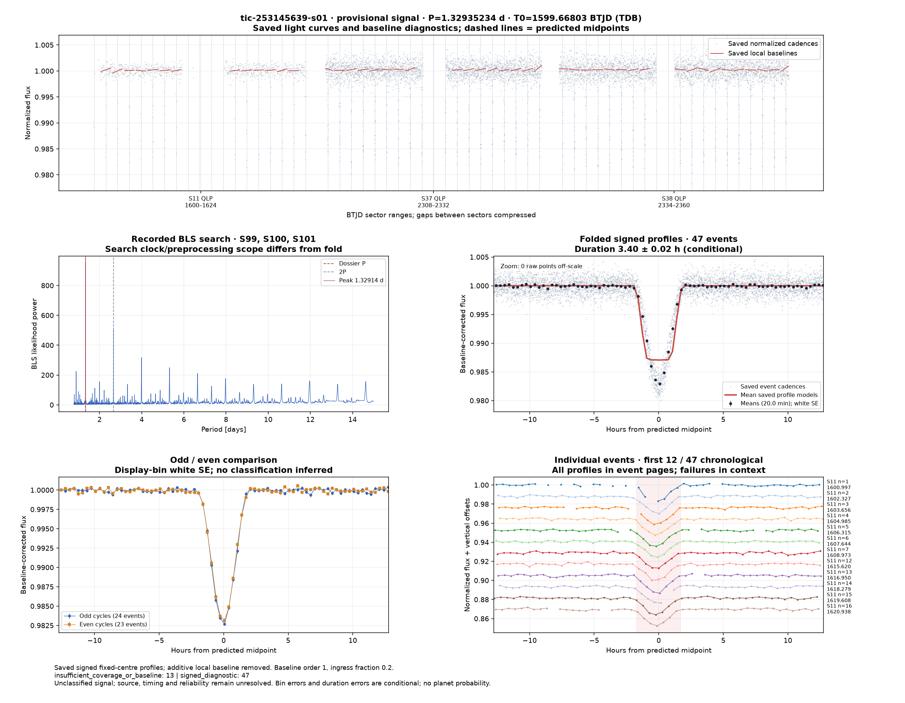](../candidates/tic-253145639-s01/evidence/figures/diagnostic.png) [tic-253145639-s01](../candidates/tic-253145639-s01/README.md) | [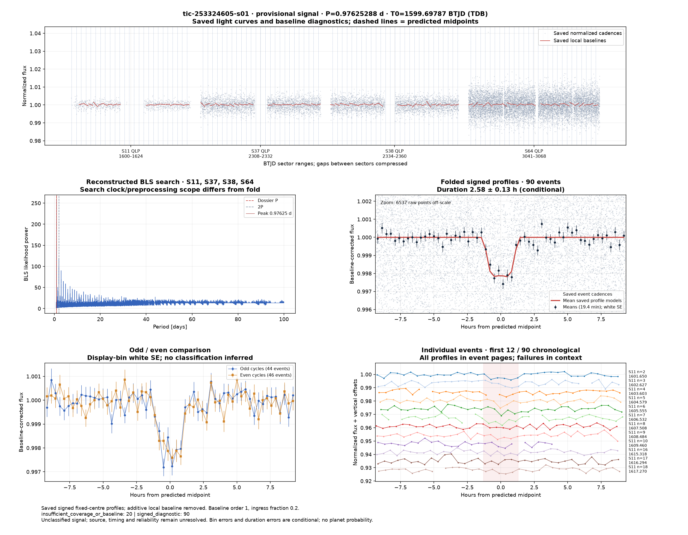](../candidates/tic-253324605-s01/evidence/figures/diagnostic.png) [tic-253324605-s01](../candidates/tic-253324605-s01/README.md) |
| [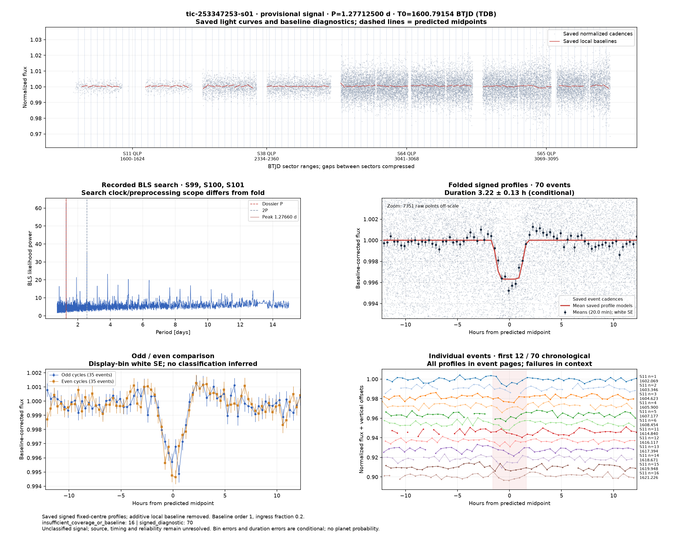](../candidates/tic-253347253-s01/evidence/figures/diagnostic.png) [tic-253347253-s01](../candidates/tic-253347253-s01/README.md) | [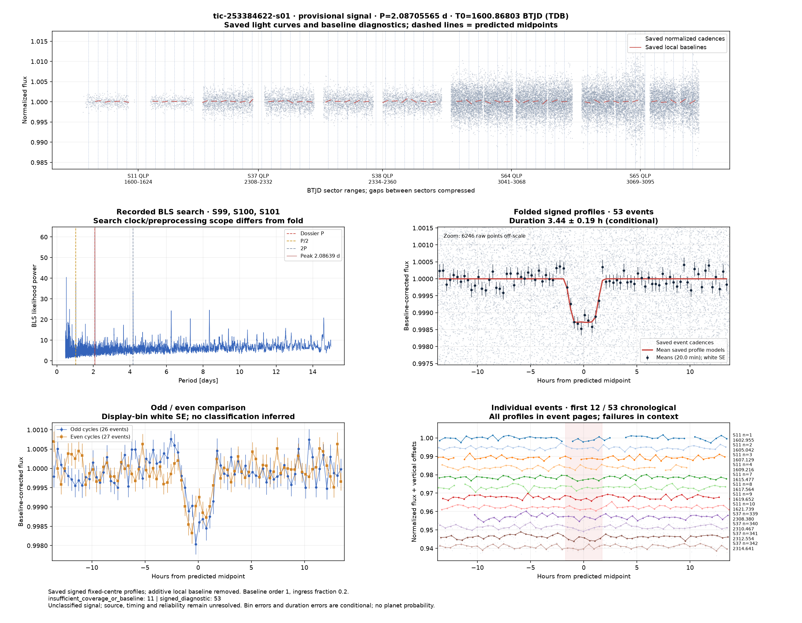](../candidates/tic-253384622-s01/evidence/figures/diagnostic.png) [tic-253384622-s01](../candidates/tic-253384622-s01/README.md) | [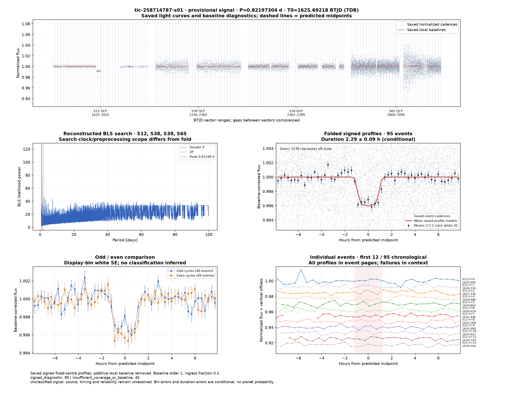](../candidates/tic-258714787-s01/evidence/figures/diagnostic.png) [tic-258714787-s01](../candidates/tic-258714787-s01/README.md) |
