# Candidate diagnostics — page 3

[Gallery index](README.md). Each image opens its full-resolution PNG.

| | | |
|---|---|---|
| [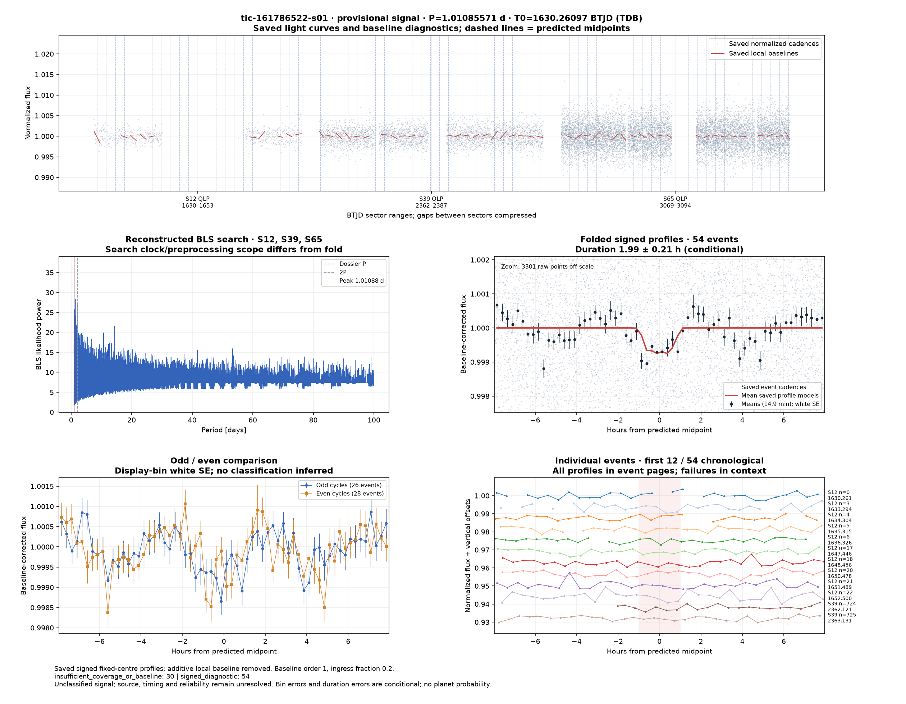](../candidates/tic-161786522-s01/evidence/figures/diagnostic.png) [tic-161786522-s01](../candidates/tic-161786522-s01/README.md) | [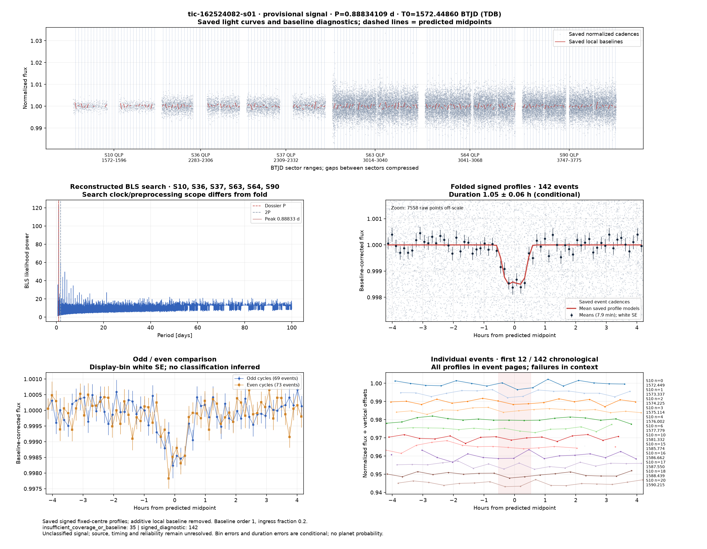](../candidates/tic-162524082-s01/evidence/figures/diagnostic.png) [tic-162524082-s01](../candidates/tic-162524082-s01/README.md) | [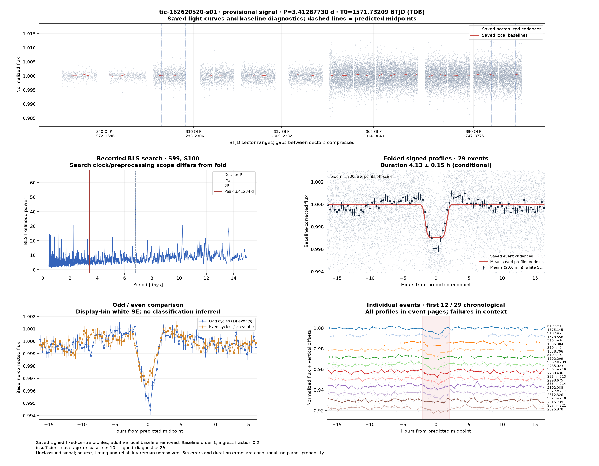](../candidates/tic-162620520-s01/evidence/figures/diagnostic.png) [tic-162620520-s01](../candidates/tic-162620520-s01/README.md) |
| [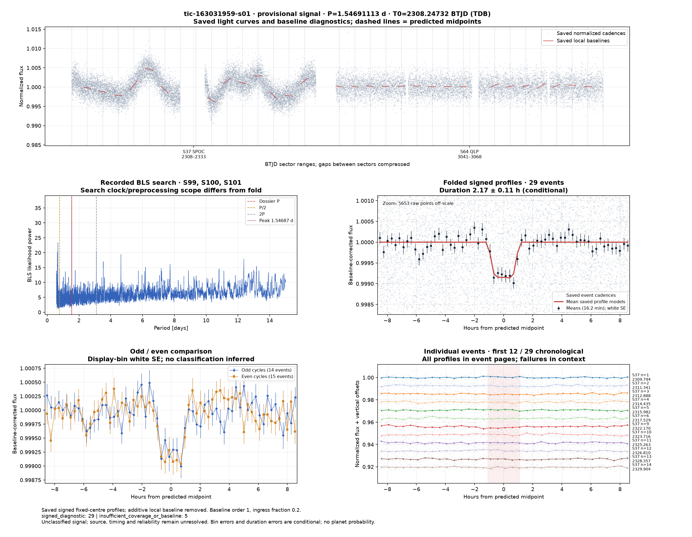](../candidates/tic-163031959-s01/evidence/figures/diagnostic.png) [tic-163031959-s01](../candidates/tic-163031959-s01/README.md) | [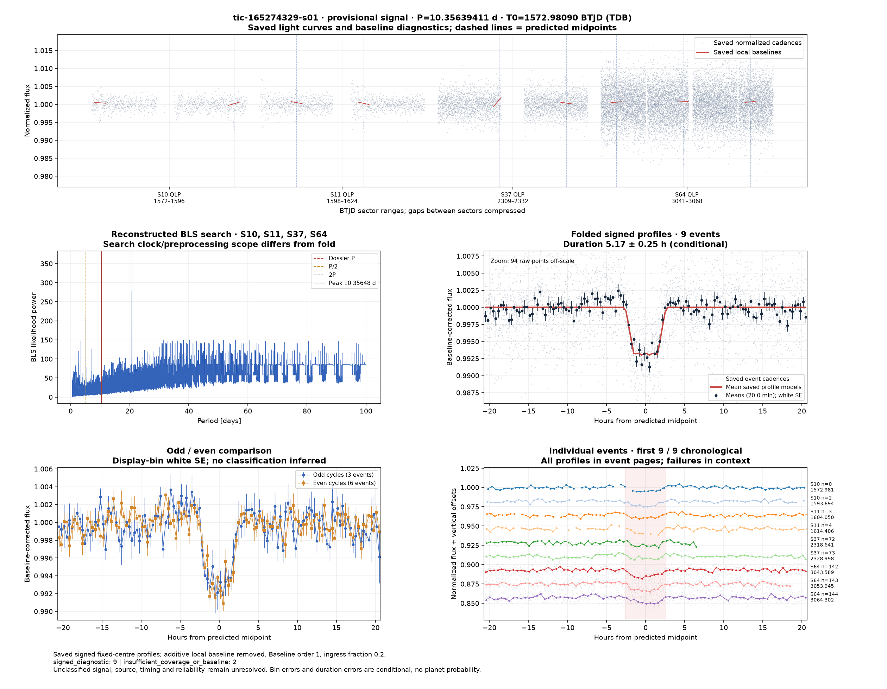](../candidates/tic-165274329-s01/evidence/figures/diagnostic.png) [tic-165274329-s01](../candidates/tic-165274329-s01/README.md) | [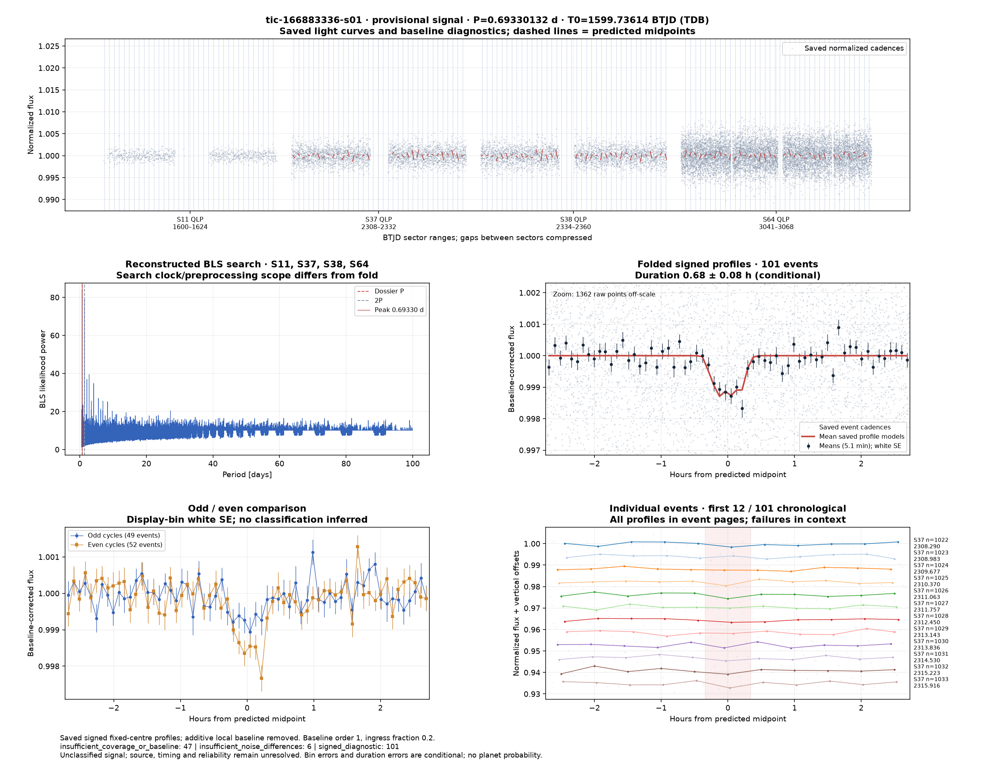](../candidates/tic-166883336-s01/evidence/figures/diagnostic.png) [tic-166883336-s01](../candidates/tic-166883336-s01/README.md) |
| [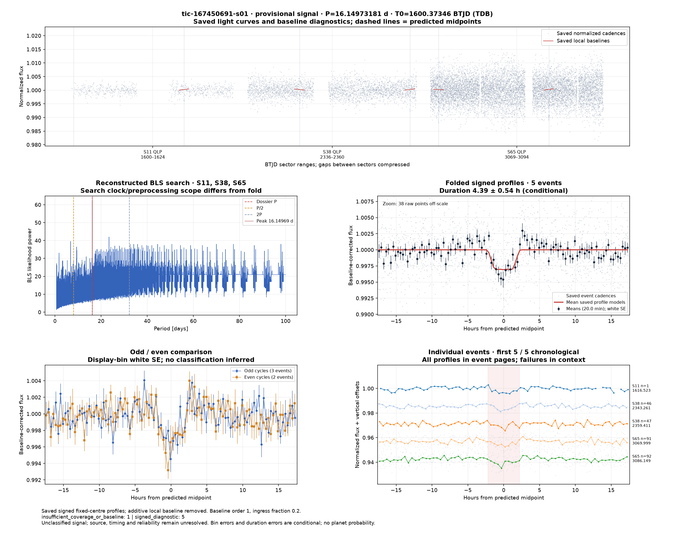](../candidates/tic-167450691-s01/evidence/figures/diagnostic.png) [tic-167450691-s01](../candidates/tic-167450691-s01/README.md) | [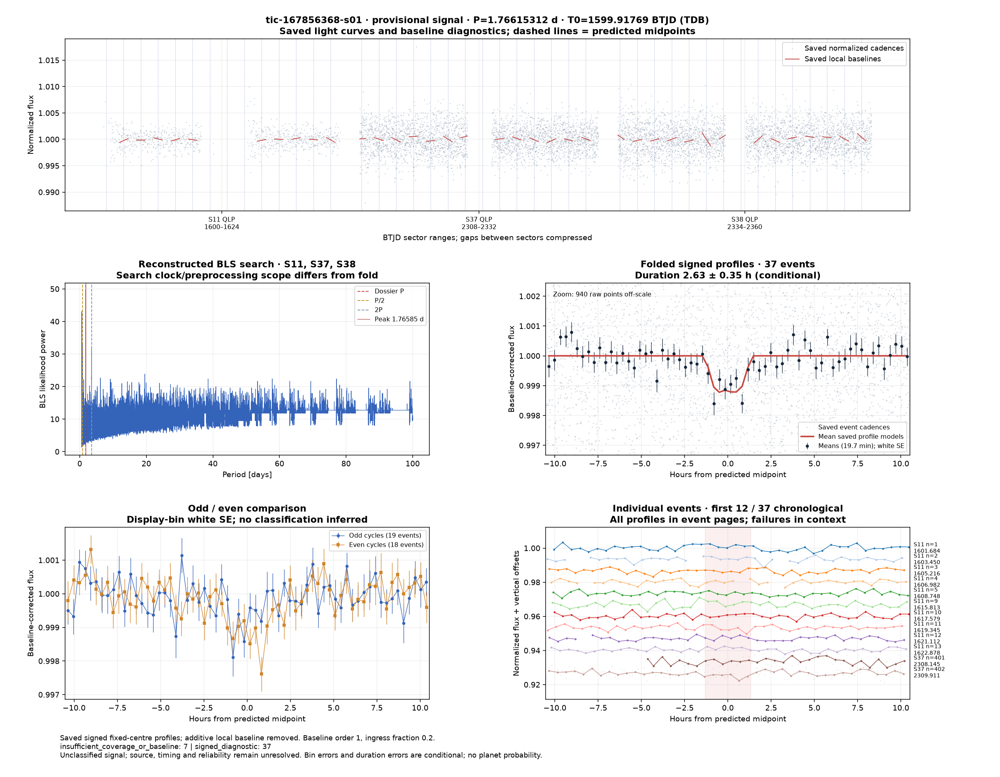](../candidates/tic-167856368-s01/evidence/figures/diagnostic.png) [tic-167856368-s01](../candidates/tic-167856368-s01/README.md) |  [tic-1688320944-s01](../candidates/tic-1688320944-s01/README.md) |
|  [tic-172943975-s01](../candidates/tic-172943975-s01/README.md) | [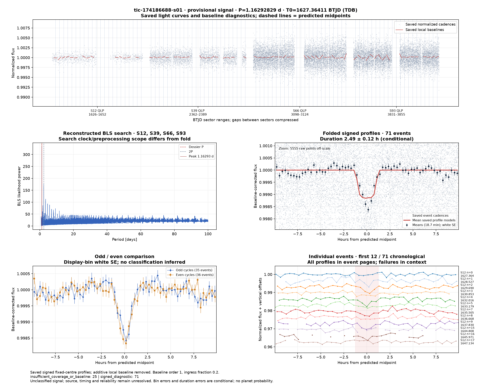](../candidates/tic-174186688-s01/evidence/figures/diagnostic.png) [tic-174186688-s01](../candidates/tic-174186688-s01/README.md) |  [tic-178361782-s01](../candidates/tic-178361782-s01/README.md) |
| [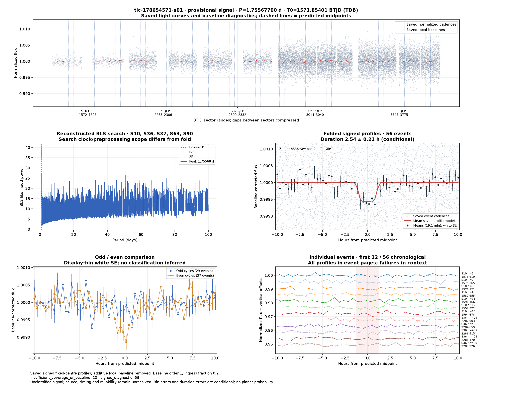](../candidates/tic-178654571-s01/evidence/figures/diagnostic.png) [tic-178654571-s01](../candidates/tic-178654571-s01/README.md) |  [tic-179297560-s01](../candidates/tic-179297560-s01/README.md) | [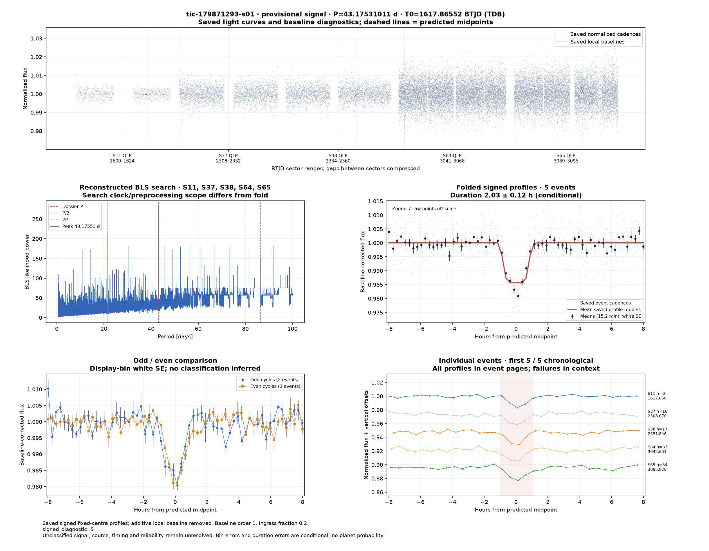](../candidates/tic-179871293-s01/evidence/figures/diagnostic.png) [tic-179871293-s01](../candidates/tic-179871293-s01/README.md) |
| [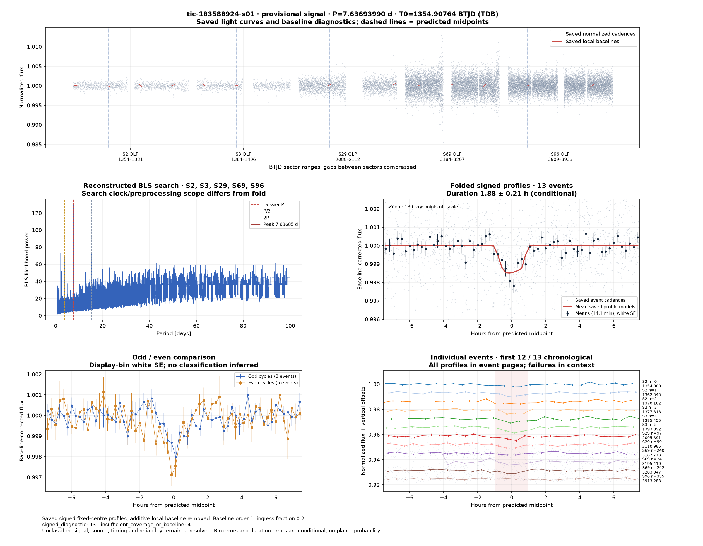](../candidates/tic-183588924-s01/evidence/figures/diagnostic.png) [tic-183588924-s01](../candidates/tic-183588924-s01/README.md) |  [tic-188129917-s01](../candidates/tic-188129917-s01/README.md) |  [tic-189339098-s01](../candidates/tic-189339098-s01/README.md) |
|  [tic-189439662-s01](../candidates/tic-189439662-s01/README.md) | [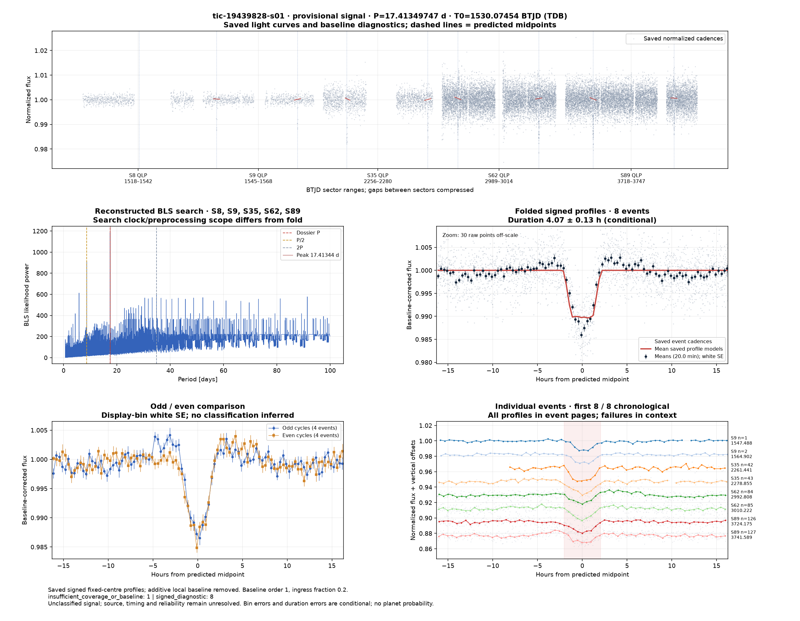](../candidates/tic-19439828-s01/evidence/figures/diagnostic.png) [tic-19439828-s01](../candidates/tic-19439828-s01/README.md) |  [tic-19899732-s01](../candidates/tic-19899732-s01/README.md) |
|  [tic-207520598-s01](../candidates/tic-207520598-s01/README.md) |  [tic-208432222-s01](../candidates/tic-208432222-s01/README.md) |  [tic-208666173-s01](../candidates/tic-208666173-s01/README.md) |
