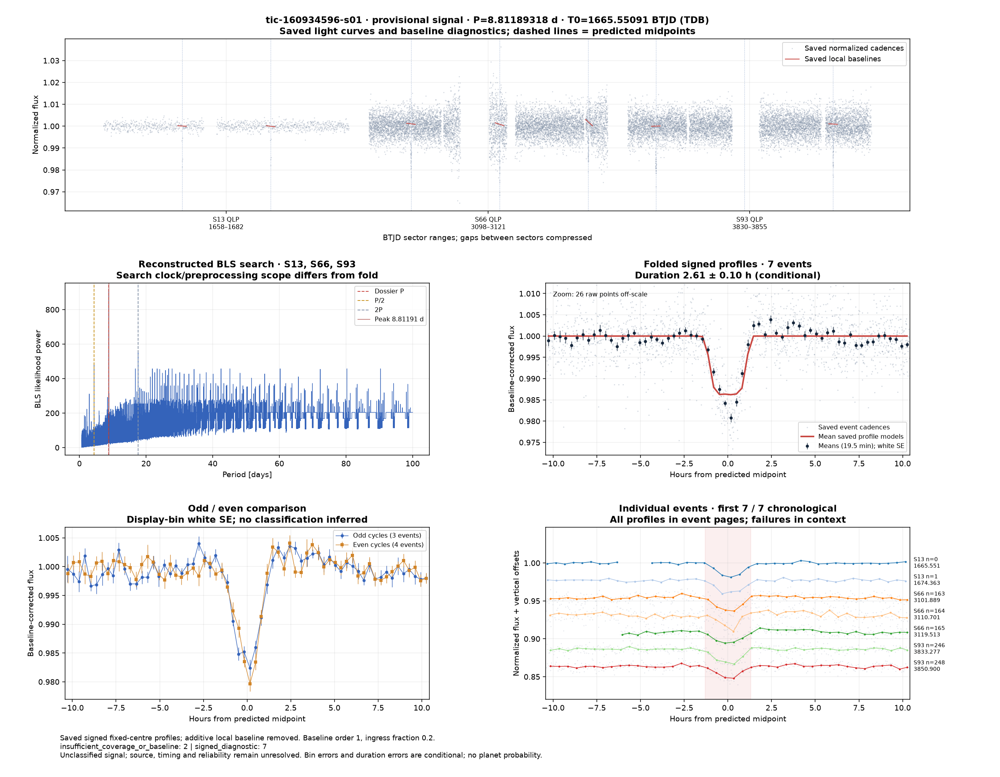
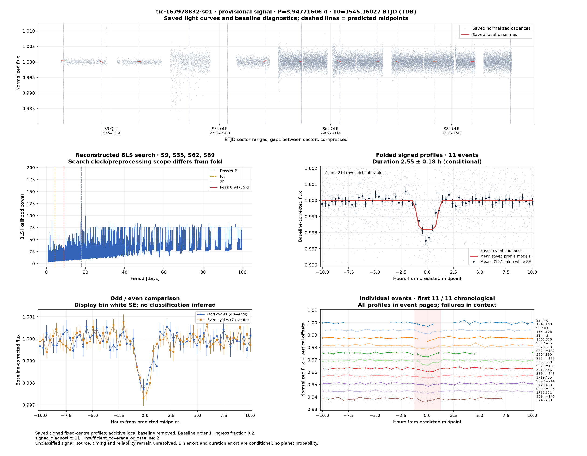
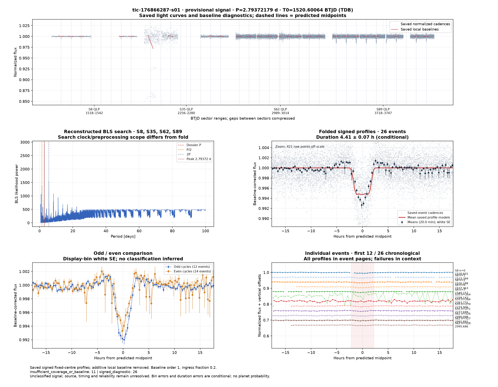

# Candidate diagnostics — page 3

[Gallery index](README.md). Each image opens its full-resolution PNG.

| | | |
|---|---|---|
|  [tic-148952208-s01](../candidates/tic-148952208-s01/README.md) |  [tic-149640591-s01](../candidates/tic-149640591-s01/README.md) |  [tic-151437417-s01](../candidates/tic-151437417-s01/README.md) |
|  [tic-154438521-s01](../candidates/tic-154438521-s01/README.md) |  [tic-158159741-s01](../candidates/tic-158159741-s01/README.md) |  [tic-158499026-s01](../candidates/tic-158499026-s01/README.md) |
|  [tic-158620278-s01](../candidates/tic-158620278-s01/README.md) |  [tic-158712138-s01](../candidates/tic-158712138-s01/README.md) |  [tic-160191676-s01](../candidates/tic-160191676-s01/README.md) |
|  [tic-160934596-s01](../candidates/tic-160934596-s01/README.md) |  [tic-161357250-s01](../candidates/tic-161357250-s01/README.md) |  [tic-161786522-s01](../candidates/tic-161786522-s01/README.md) |
|  [tic-162524082-s01](../candidates/tic-162524082-s01/README.md) |  [tic-162620520-s01](../candidates/tic-162620520-s01/README.md) |  [tic-163031959-s01](../candidates/tic-163031959-s01/README.md) |
|  [tic-165274329-s01](../candidates/tic-165274329-s01/README.md) |  [tic-166883336-s01](../candidates/tic-166883336-s01/README.md) |  [tic-167450691-s01](../candidates/tic-167450691-s01/README.md) |
|  [tic-167856368-s01](../candidates/tic-167856368-s01/README.md) |  [tic-167978832-s01](../candidates/tic-167978832-s01/README.md) |  [tic-1688320944-s01](../candidates/tic-1688320944-s01/README.md) |
|  [tic-172943975-s01](../candidates/tic-172943975-s01/README.md) |  [tic-174186688-s01](../candidates/tic-174186688-s01/README.md) |  [tic-176866287-s01](../candidates/tic-176866287-s01/README.md) |
