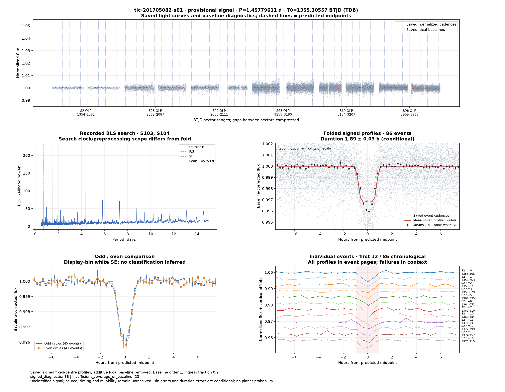
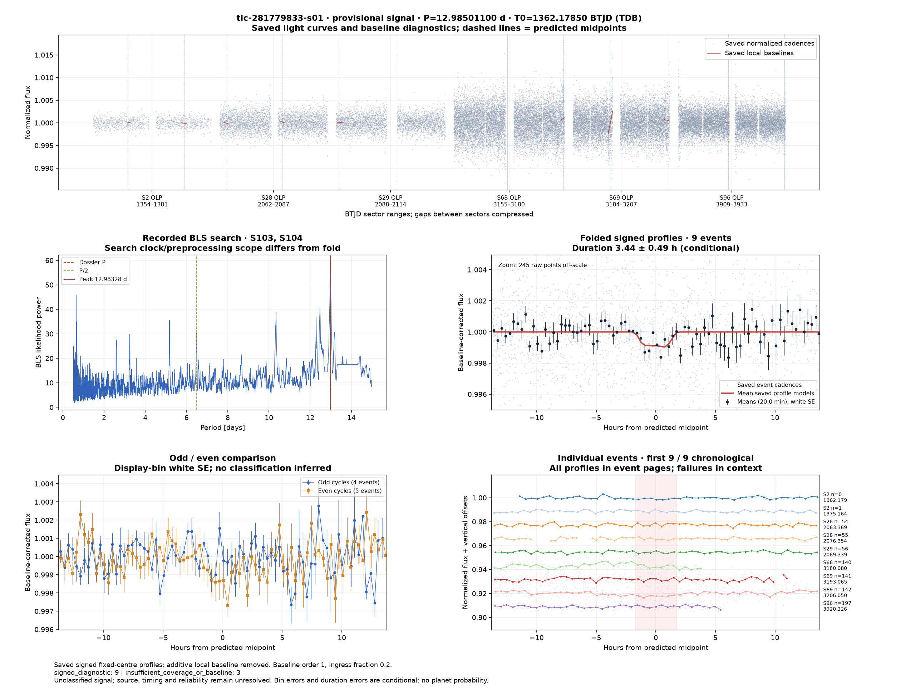

# Candidate diagnostics — page 3

[Gallery index](README.md). Each image opens its full-resolution PNG.

| | | |
|---|---|---|
|  [tic-260569590-s01](../candidates/tic-260569590-s01/README.md) |  [tic-260841561-s01](../candidates/tic-260841561-s01/README.md) |  [tic-261102618-s01](../candidates/tic-261102618-s01/README.md) |
|  [tic-261119502-s01](../candidates/tic-261119502-s01/README.md) |  [tic-265566507-s01](../candidates/tic-265566507-s01/README.md) |  [tic-268187402-s01](../candidates/tic-268187402-s01/README.md) |
|  [tic-268201230-s01](../candidates/tic-268201230-s01/README.md) |  [tic-271609681-s01](../candidates/tic-271609681-s01/README.md) |  [tic-276645751-s01](../candidates/tic-276645751-s01/README.md) |
|  [tic-277514841-s01](../candidates/tic-277514841-s01/README.md) |  [tic-277962250-s01](../candidates/tic-277962250-s01/README.md) |  [tic-281705082-s01](../candidates/tic-281705082-s01/README.md) |
|  [tic-281779833-s01](../candidates/tic-281779833-s01/README.md) |  [tic-282413282-s01](../candidates/tic-282413282-s01/README.md) |  [tic-2835596-s01](../candidates/tic-2835596-s01/README.md) |
|  [tic-286763467-s01](../candidates/tic-286763467-s01/README.md) |  [tic-290342858-s01](../candidates/tic-290342858-s01/README.md) |  [tic-292291978-s01](../candidates/tic-292291978-s01/README.md) |
|  [tic-294235592-s01](../candidates/tic-294235592-s01/README.md) |  [tic-295376786-s01](../candidates/tic-295376786-s01/README.md) |  [tic-295478570-s01](../candidates/tic-295478570-s01/README.md) |
|  [tic-297093620-s01](../candidates/tic-297093620-s01/README.md) |  [tic-298913278-s01](../candidates/tic-298913278-s01/README.md) |  [tic-303515275-s01](../candidates/tic-303515275-s01/README.md) |
