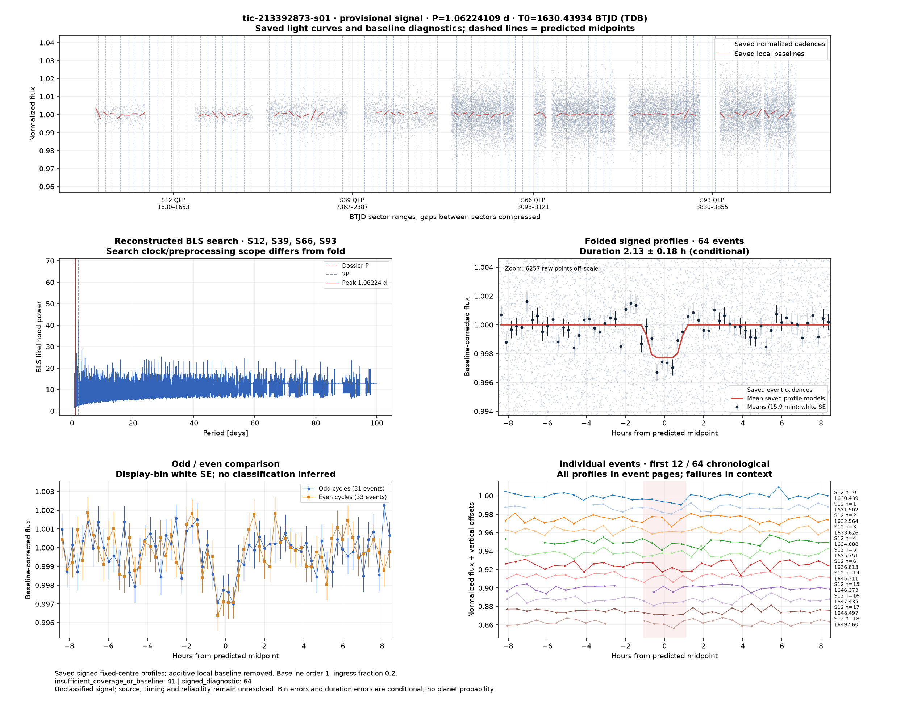
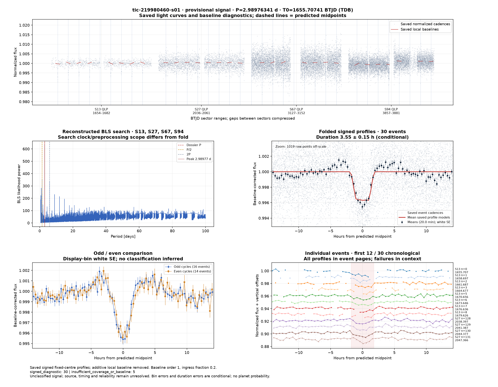
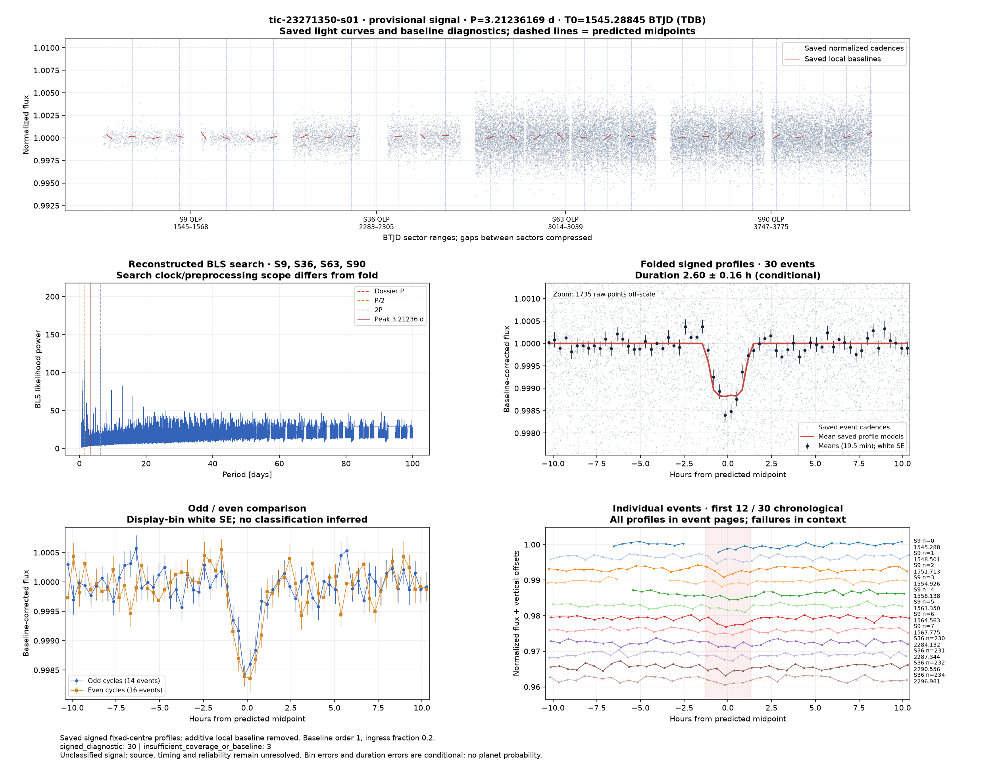
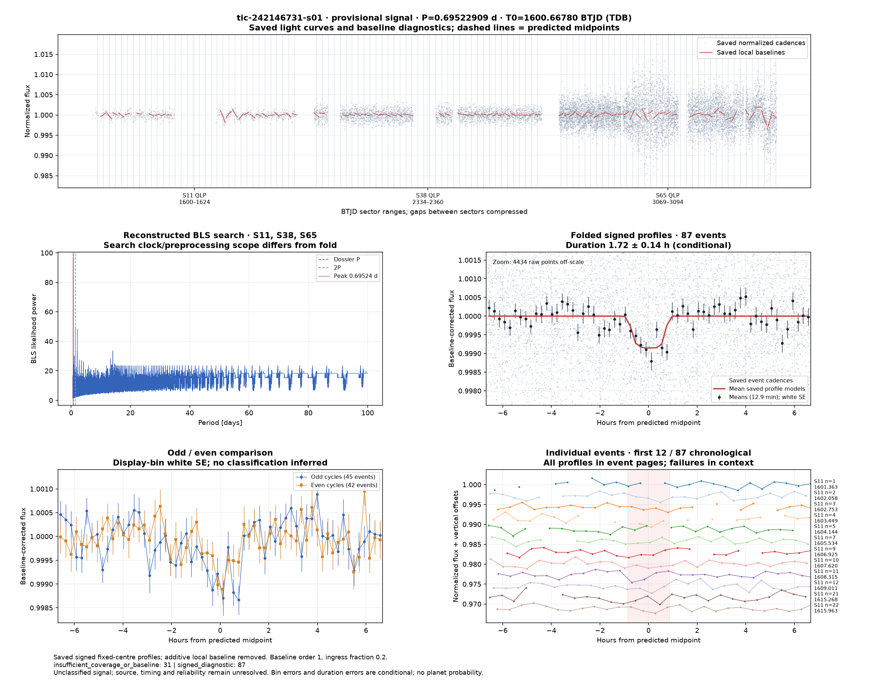

# Candidate diagnostics — page 4

[Gallery index](README.md). Each image opens its full-resolution PNG.

| | | |
|---|---|---|
|  [tic-209241947-s01](../candidates/tic-209241947-s01/README.md) |  [tic-213392873-s01](../candidates/tic-213392873-s01/README.md) |  [tic-215091718-s01](../candidates/tic-215091718-s01/README.md) |
|  [tic-216669784-s01](../candidates/tic-216669784-s01/README.md) |  [tic-216780294-s01](../candidates/tic-216780294-s01/README.md) |  [tic-21694454-s01](../candidates/tic-21694454-s01/README.md) |
|  [tic-21731440-s01](../candidates/tic-21731440-s01/README.md) |  [tic-219382845-s01](../candidates/tic-219382845-s01/README.md) |  [tic-219452141-s01](../candidates/tic-219452141-s01/README.md) |
|  [tic-219980460-s01](../candidates/tic-219980460-s01/README.md) |  [tic-22093252-s01](../candidates/tic-22093252-s01/README.md) |  [tic-221238153-s01](../candidates/tic-221238153-s01/README.md) |
|  [tic-221425588-s01](../candidates/tic-221425588-s01/README.md) |  [tic-222224160-s01](../candidates/tic-222224160-s01/README.md) |  [tic-22649420-s01](../candidates/tic-22649420-s01/README.md) |
|  [tic-22775266-s01](../candidates/tic-22775266-s01/README.md) |  [tic-228614509-s01](../candidates/tic-228614509-s01/README.md) |  [tic-229215712-s01](../candidates/tic-229215712-s01/README.md) |
|  [tic-23205275-s01](../candidates/tic-23205275-s01/README.md) |  [tic-23205280-s01](../candidates/tic-23205280-s01/README.md) |  [tic-23271350-s01](../candidates/tic-23271350-s01/README.md) |
|  [tic-242146731-s01](../candidates/tic-242146731-s01/README.md) |  [tic-242498653-s01](../candidates/tic-242498653-s01/README.md) |  [tic-243500407-s01](../candidates/tic-243500407-s01/README.md) |
