# Candidate diagnostics — page 4

[Gallery index](README.md). Each image opens its full-resolution PNG.

| | | |
|---|---|---|
|  [tic-222224160-s01](../candidates/tic-222224160-s01/README.md) |  [tic-22649420-s01](../candidates/tic-22649420-s01/README.md) | [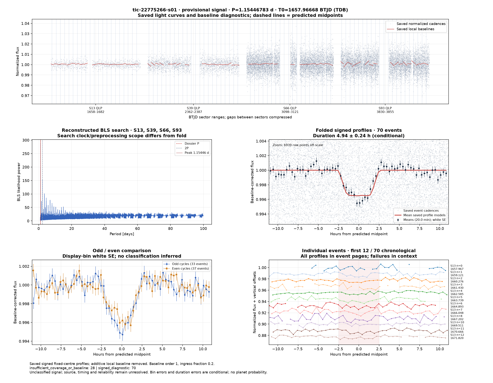](../candidates/tic-22775266-s01/evidence/figures/diagnostic.png) [tic-22775266-s01](../candidates/tic-22775266-s01/README.md) |
| [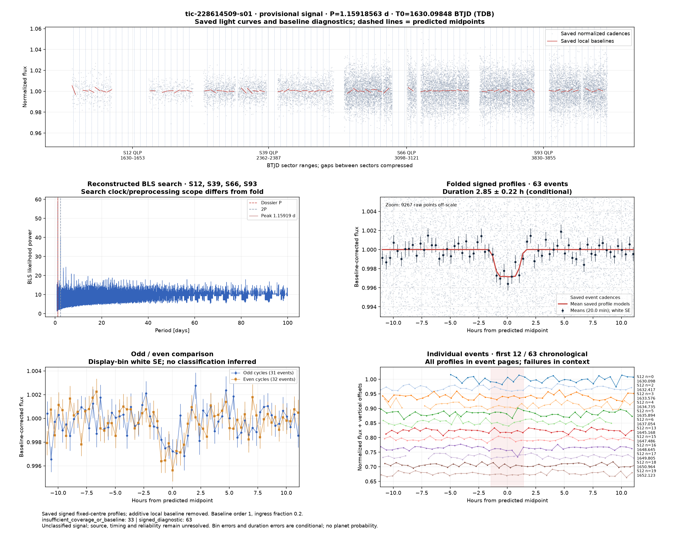](../candidates/tic-228614509-s01/evidence/figures/diagnostic.png) [tic-228614509-s01](../candidates/tic-228614509-s01/README.md) | [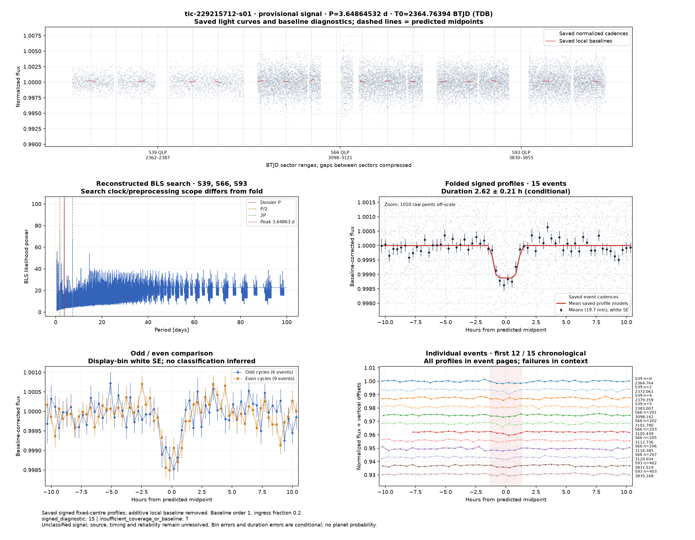](../candidates/tic-229215712-s01/evidence/figures/diagnostic.png) [tic-229215712-s01](../candidates/tic-229215712-s01/README.md) |  [tic-23205275-s01](../candidates/tic-23205275-s01/README.md) |
|  [tic-23205280-s01](../candidates/tic-23205280-s01/README.md) | [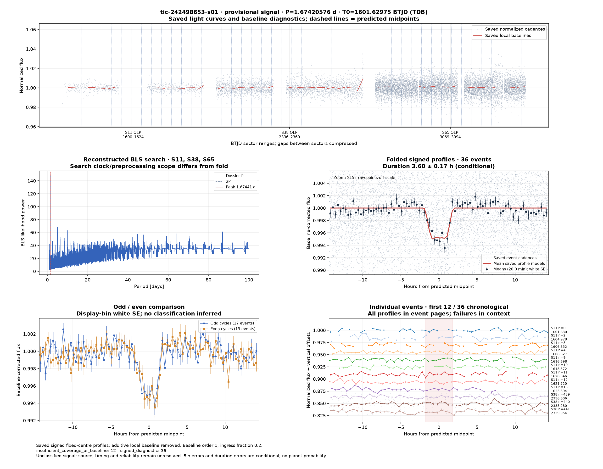](../candidates/tic-242498653-s01/evidence/figures/diagnostic.png) [tic-242498653-s01](../candidates/tic-242498653-s01/README.md) |  [tic-243500407-s01](../candidates/tic-243500407-s01/README.md) |
| [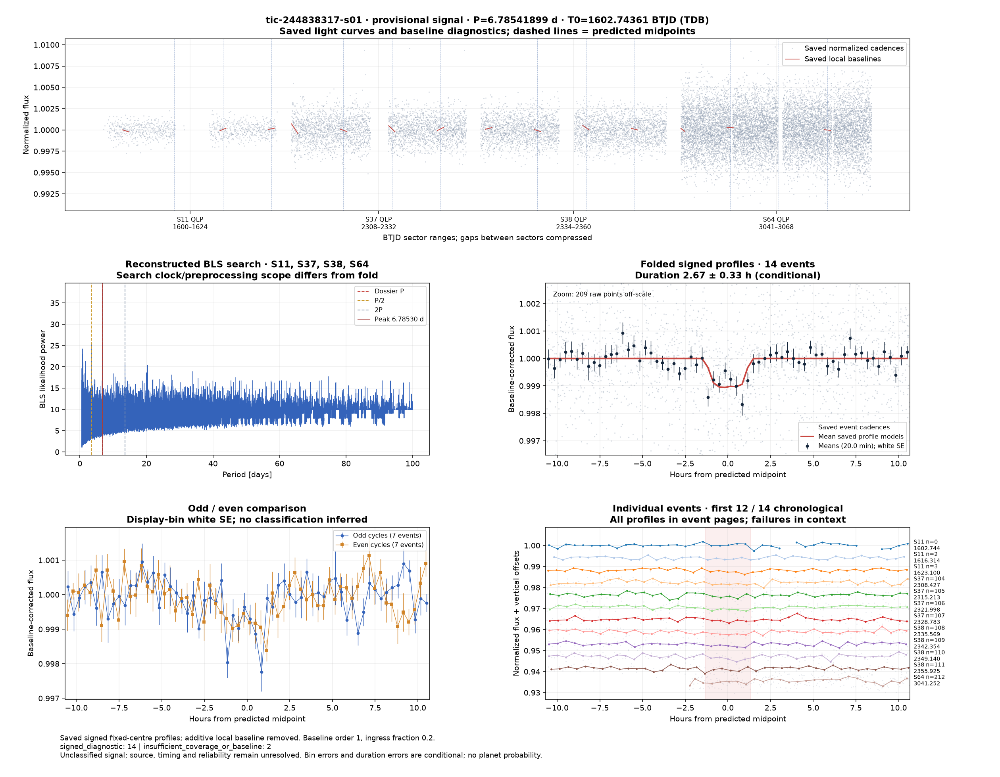](../candidates/tic-244838317-s01/evidence/figures/diagnostic.png) [tic-244838317-s01](../candidates/tic-244838317-s01/README.md) |  [tic-245101439-s01](../candidates/tic-245101439-s01/README.md) |  [tic-246327562-s01](../candidates/tic-246327562-s01/README.md) |
|  [tic-246469763-s01](../candidates/tic-246469763-s01/README.md) | [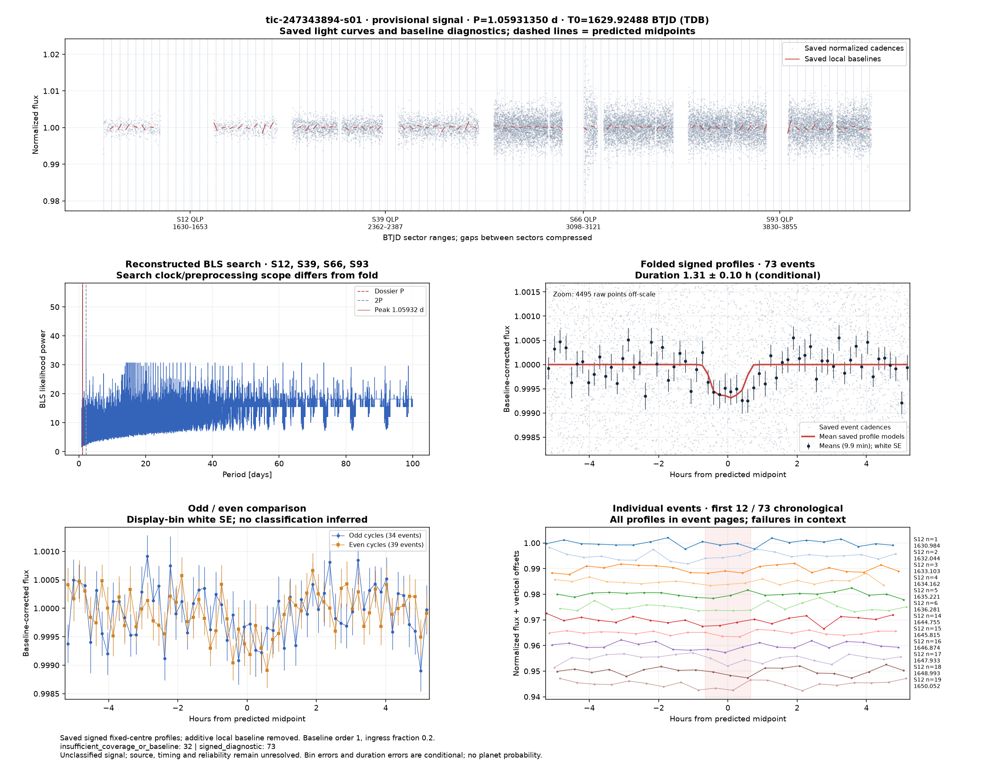](../candidates/tic-247343894-s01/evidence/figures/diagnostic.png) [tic-247343894-s01](../candidates/tic-247343894-s01/README.md) | [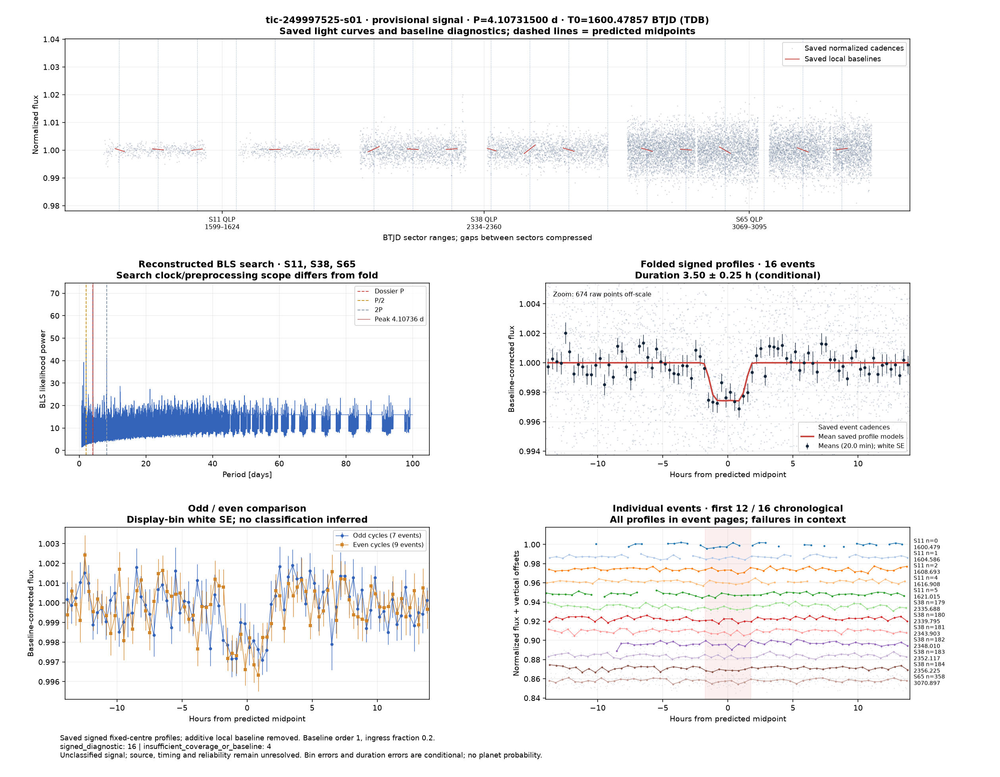](../candidates/tic-249997525-s01/evidence/figures/diagnostic.png) [tic-249997525-s01](../candidates/tic-249997525-s01/README.md) |
| [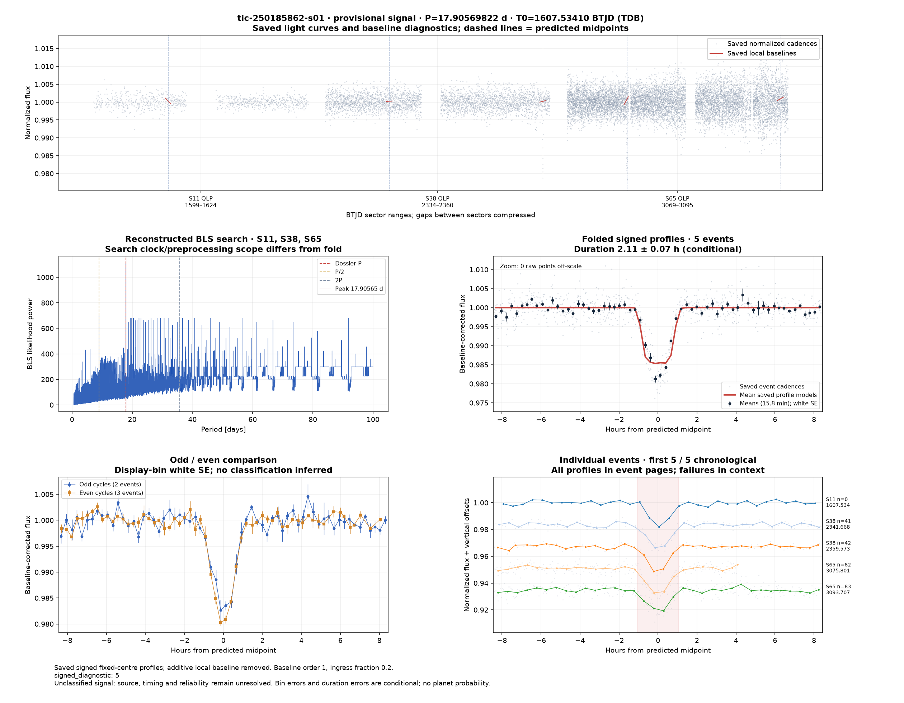](../candidates/tic-250185862-s01/evidence/figures/diagnostic.png) [tic-250185862-s01](../candidates/tic-250185862-s01/README.md) |  [tic-253145639-s01](../candidates/tic-253145639-s01/README.md) |  [tic-253324605-s01](../candidates/tic-253324605-s01/README.md) |
|  [tic-253347253-s01](../candidates/tic-253347253-s01/README.md) |  [tic-253384622-s01](../candidates/tic-253384622-s01/README.md) |  [tic-258714787-s01](../candidates/tic-258714787-s01/README.md) |
| [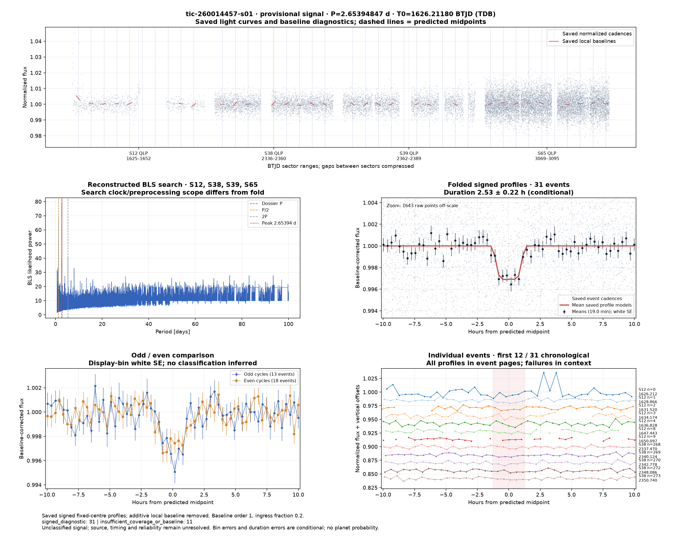](../candidates/tic-260014457-s01/evidence/figures/diagnostic.png) [tic-260014457-s01](../candidates/tic-260014457-s01/README.md) | [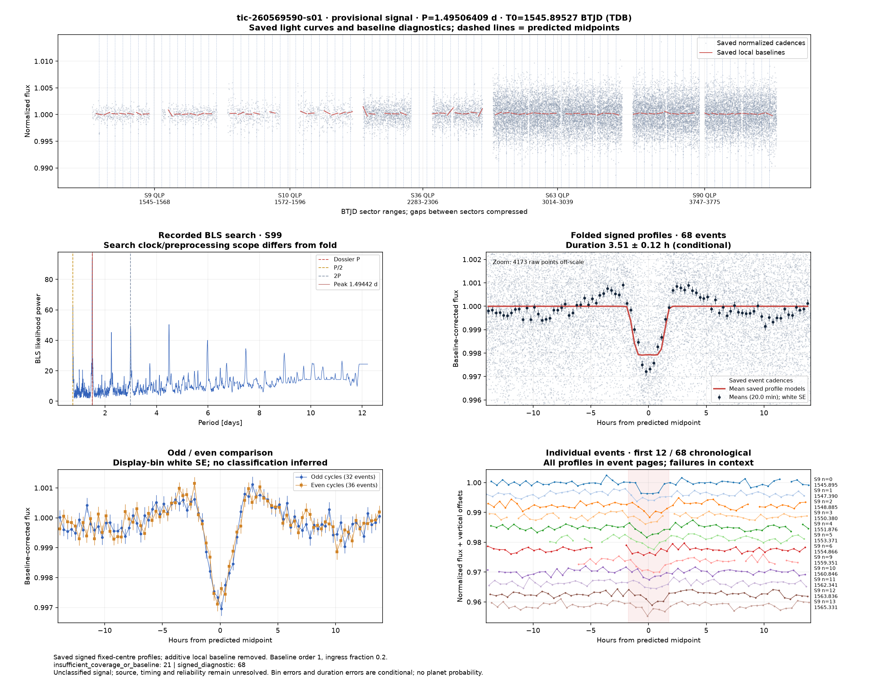](../candidates/tic-260569590-s01/evidence/figures/diagnostic.png) [tic-260569590-s01](../candidates/tic-260569590-s01/README.md) | [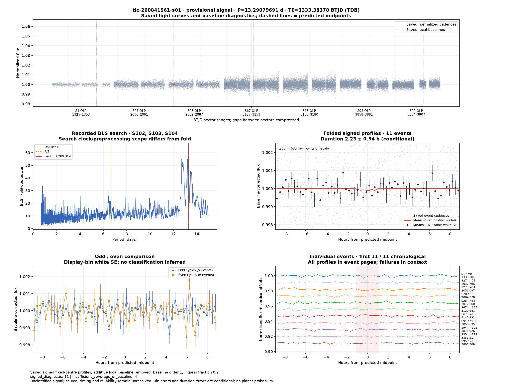](../candidates/tic-260841561-s01/evidence/figures/diagnostic.png) [tic-260841561-s01](../candidates/tic-260841561-s01/README.md) |
