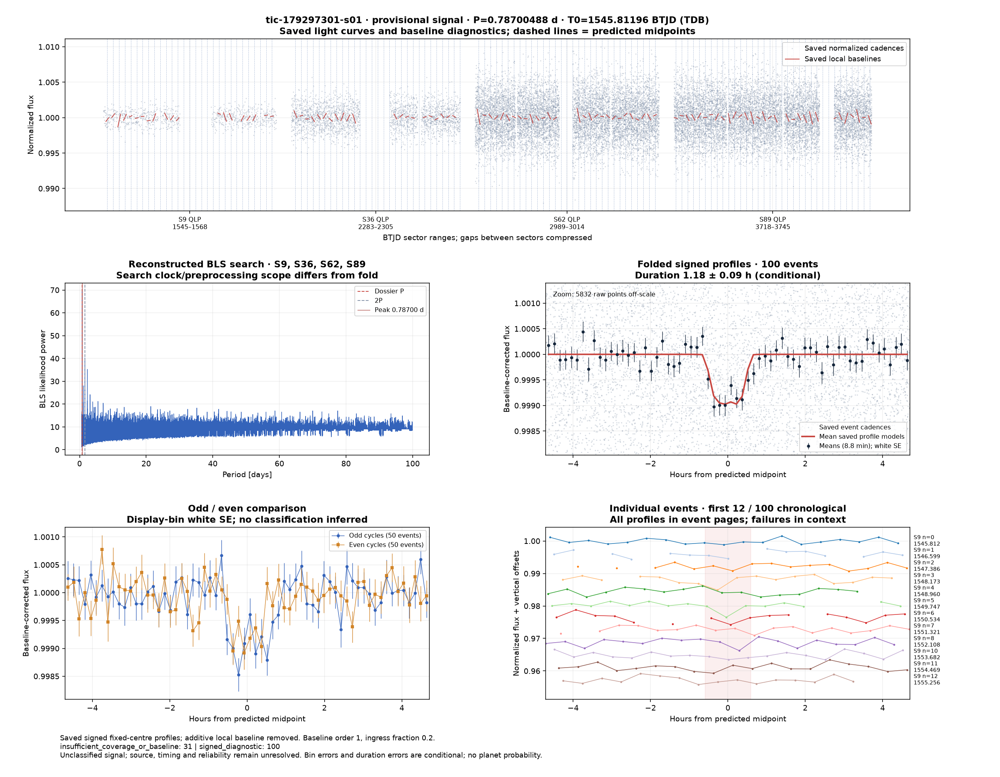
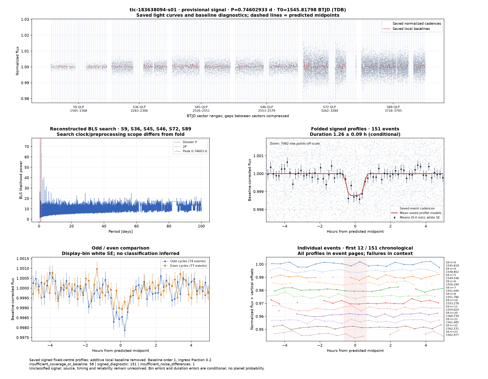
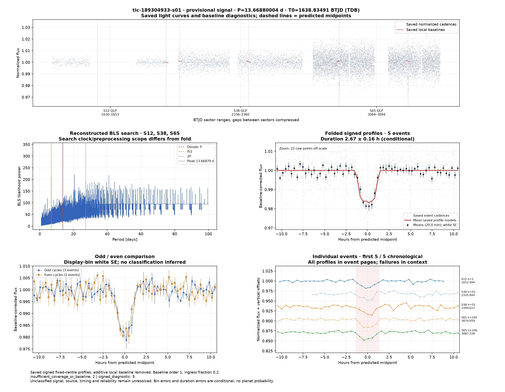
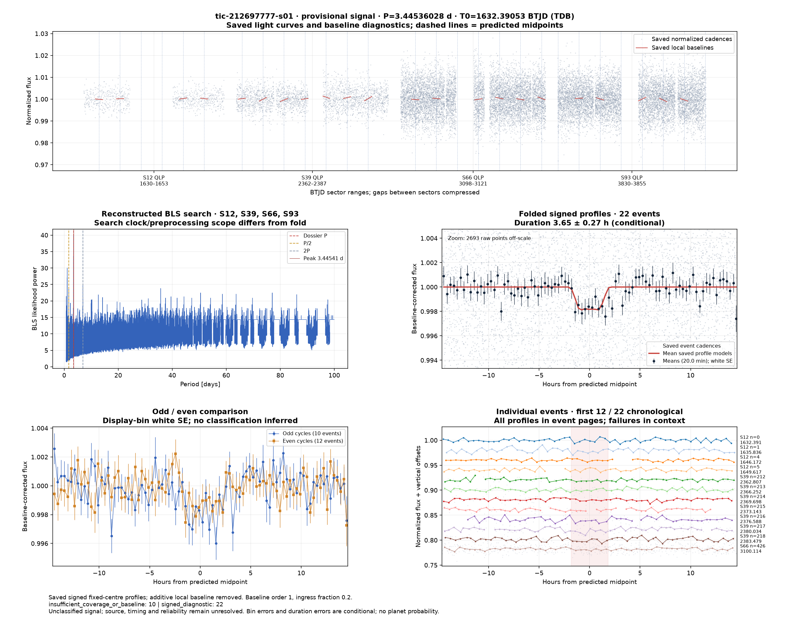

# Candidate diagnostics — page 4

[Gallery index](README.md). Each image opens its full-resolution PNG.

| | | |
|---|---|---|
|  [tic-178361782-s01](../candidates/tic-178361782-s01/README.md) |  [tic-178654571-s01](../candidates/tic-178654571-s01/README.md) |  [tic-179297301-s01](../candidates/tic-179297301-s01/README.md) |
|  [tic-179297560-s01](../candidates/tic-179297560-s01/README.md) |  [tic-179871293-s01](../candidates/tic-179871293-s01/README.md) |  [tic-183588924-s01](../candidates/tic-183588924-s01/README.md) |
|  [tic-183638094-s01](../candidates/tic-183638094-s01/README.md) |  [tic-188129917-s01](../candidates/tic-188129917-s01/README.md) |  [tic-189304933-s01](../candidates/tic-189304933-s01/README.md) |
|  [tic-189339098-s01](../candidates/tic-189339098-s01/README.md) |  [tic-189439662-s01](../candidates/tic-189439662-s01/README.md) |  [tic-19439828-s01](../candidates/tic-19439828-s01/README.md) |
|  [tic-19899732-s01](../candidates/tic-19899732-s01/README.md) |  [tic-207520598-s01](../candidates/tic-207520598-s01/README.md) |  [tic-208432222-s01](../candidates/tic-208432222-s01/README.md) |
|  [tic-208666173-s01](../candidates/tic-208666173-s01/README.md) |  [tic-209241947-s01](../candidates/tic-209241947-s01/README.md) |  [tic-212697777-s01](../candidates/tic-212697777-s01/README.md) |
|  [tic-213392873-s01](../candidates/tic-213392873-s01/README.md) |  [tic-215091718-s01](../candidates/tic-215091718-s01/README.md) |  [tic-216669784-s01](../candidates/tic-216669784-s01/README.md) |
|  [tic-216780294-s01](../candidates/tic-216780294-s01/README.md) |  [tic-21694454-s01](../candidates/tic-21694454-s01/README.md) |  [tic-21731440-s01](../candidates/tic-21731440-s01/README.md) |
