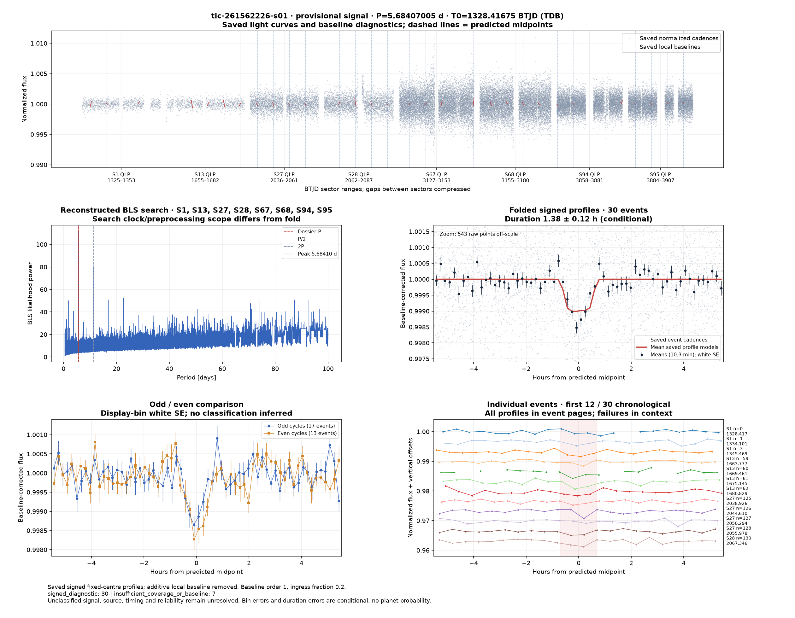
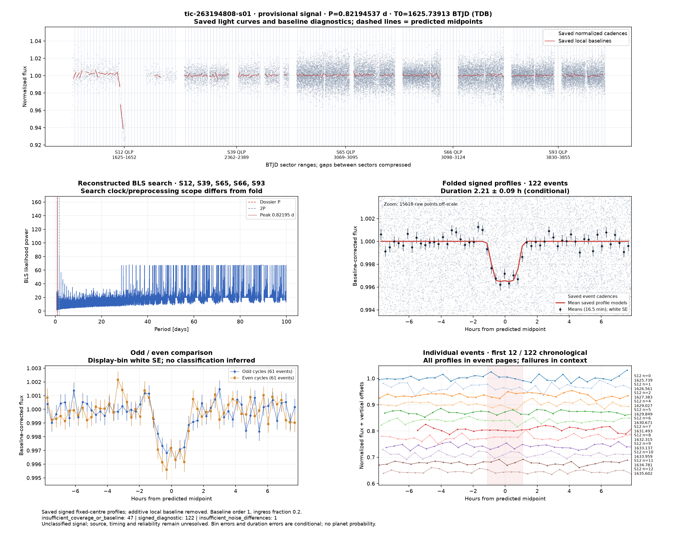

# Candidate diagnostics — page 5

[Gallery index](README.md). Each image opens its full-resolution PNG.

| | | |
|---|---|---|
|  [tic-244838317-s01](../candidates/tic-244838317-s01/README.md) |  [tic-245101439-s01](../candidates/tic-245101439-s01/README.md) |  [tic-246327562-s01](../candidates/tic-246327562-s01/README.md) |
|  [tic-246469763-s01](../candidates/tic-246469763-s01/README.md) |  [tic-247343894-s01](../candidates/tic-247343894-s01/README.md) |  [tic-249997525-s01](../candidates/tic-249997525-s01/README.md) |
|  [tic-250185862-s01](../candidates/tic-250185862-s01/README.md) |  [tic-253145639-s01](../candidates/tic-253145639-s01/README.md) |  [tic-253324605-s01](../candidates/tic-253324605-s01/README.md) |
|  [tic-253347253-s01](../candidates/tic-253347253-s01/README.md) |  [tic-253384622-s01](../candidates/tic-253384622-s01/README.md) |  [tic-258714787-s01](../candidates/tic-258714787-s01/README.md) |
|  [tic-260014457-s01](../candidates/tic-260014457-s01/README.md) |  [tic-260569590-s01](../candidates/tic-260569590-s01/README.md) |  [tic-260841561-s01](../candidates/tic-260841561-s01/README.md) |
|  [tic-260944669-s01](../candidates/tic-260944669-s01/README.md) |  [tic-260947188-s01](../candidates/tic-260947188-s01/README.md) |  [tic-261102618-s01](../candidates/tic-261102618-s01/README.md) |
|  [tic-261119502-s01](../candidates/tic-261119502-s01/README.md) |  [tic-261562226-s01](../candidates/tic-261562226-s01/README.md) |  [tic-261707476-s01](../candidates/tic-261707476-s01/README.md) |
|  [tic-262093857-s01](../candidates/tic-262093857-s01/README.md) |  [tic-263194808-s01](../candidates/tic-263194808-s01/README.md) |  [tic-263718099-s01](../candidates/tic-263718099-s01/README.md) |
