# Candidate diagnostics — page 6

[Gallery index](README.md). Each image opens its full-resolution PNG.

| | | |
|---|---|---|
| [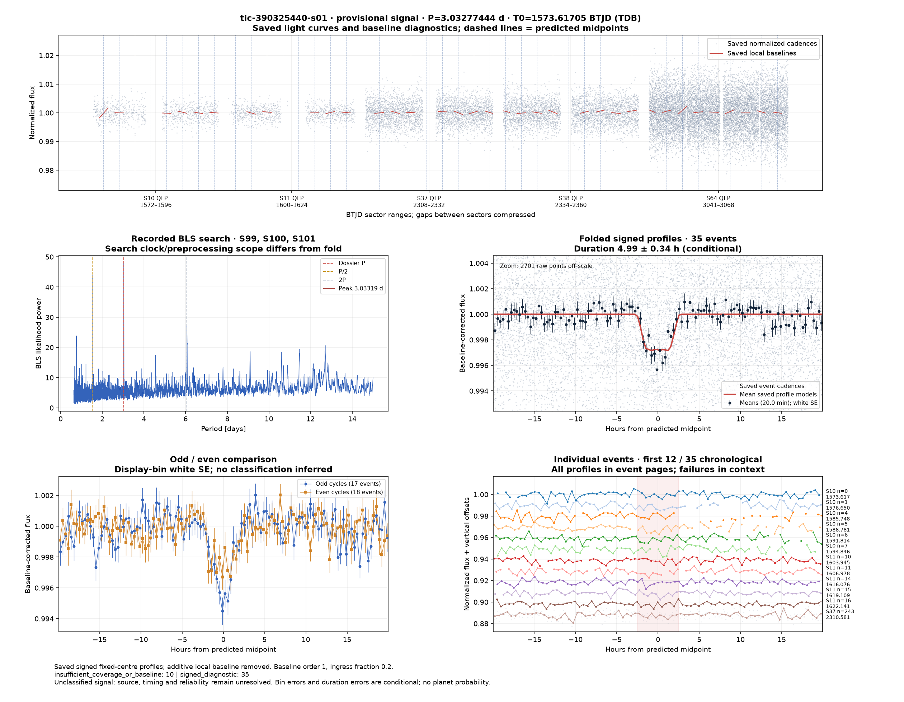](../candidates/tic-390325440-s01/evidence/figures/diagnostic.png) [tic-390325440-s01](../candidates/tic-390325440-s01/README.md) | [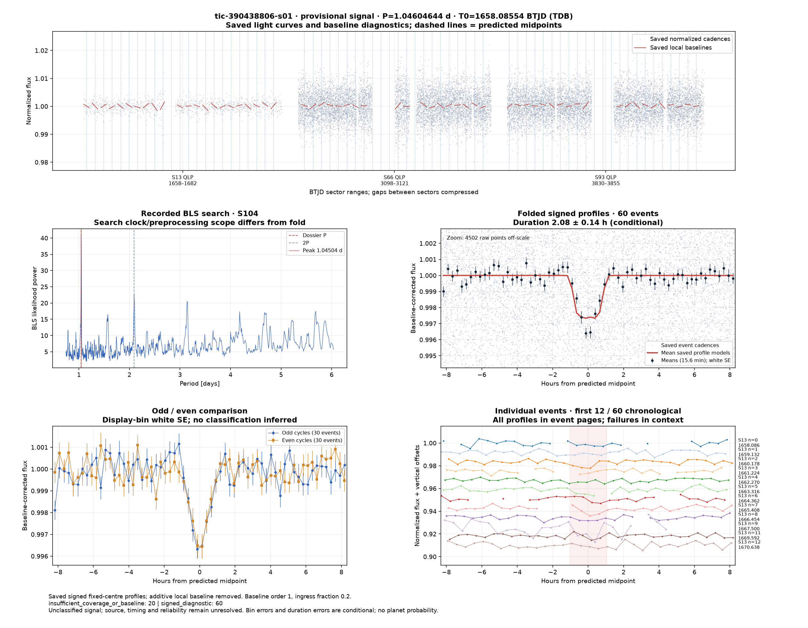](../candidates/tic-390438806-s01/evidence/figures/diagnostic.png) [tic-390438806-s01](../candidates/tic-390438806-s01/README.md) | [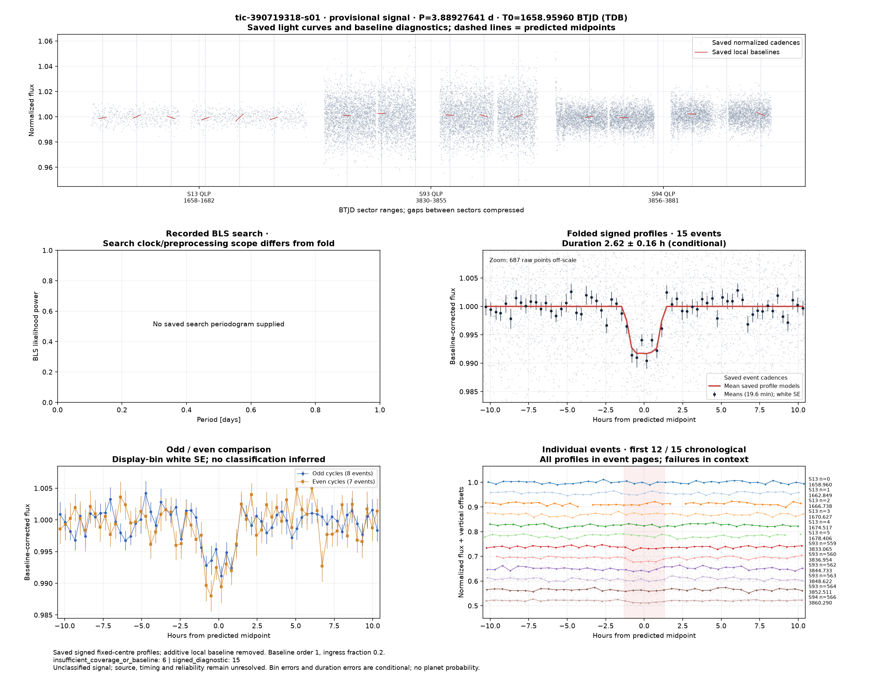](../candidates/tic-390719318-s01/evidence/figures/diagnostic.png) [tic-390719318-s01](../candidates/tic-390719318-s01/README.md) |
| [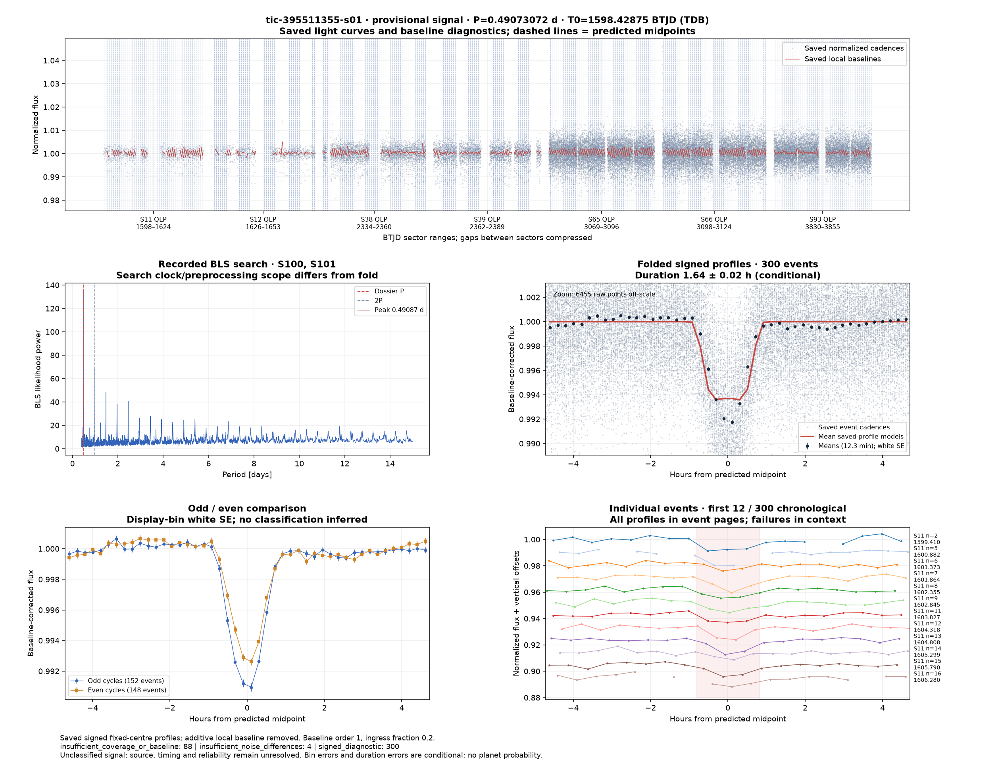](../candidates/tic-395511355-s01/evidence/figures/diagnostic.png) [tic-395511355-s01](../candidates/tic-395511355-s01/README.md) | [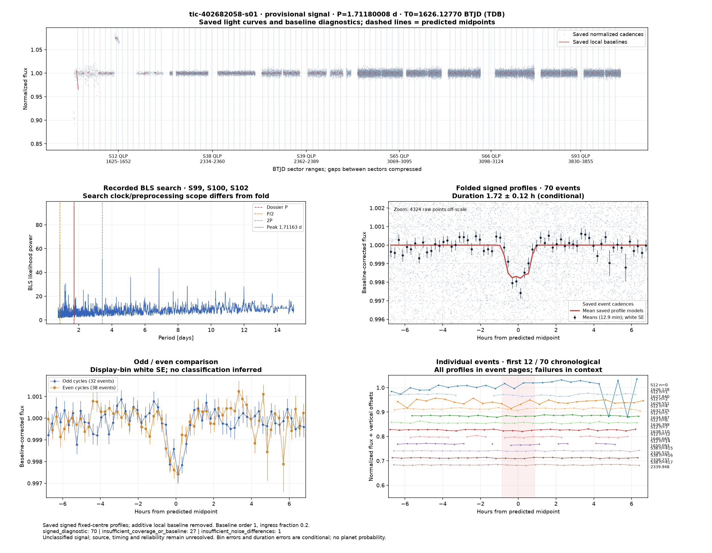](../candidates/tic-402682058-s01/evidence/figures/diagnostic.png) [tic-402682058-s01](../candidates/tic-402682058-s01/README.md) | [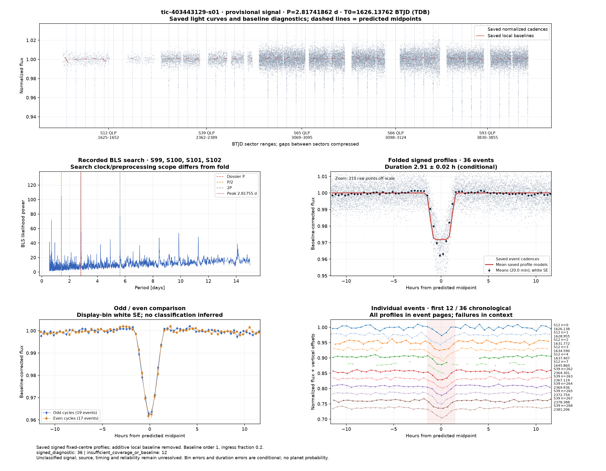](../candidates/tic-403443129-s01/evidence/figures/diagnostic.png) [tic-403443129-s01](../candidates/tic-403443129-s01/README.md) |
| [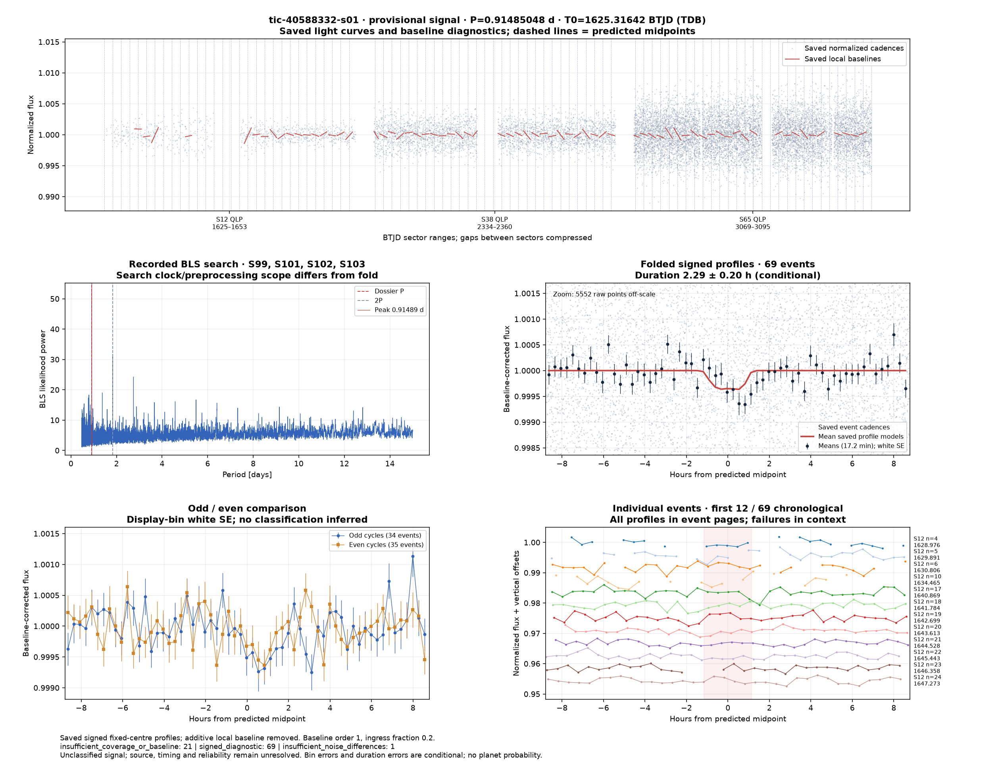](../candidates/tic-40588332-s01/evidence/figures/diagnostic.png) [tic-40588332-s01](../candidates/tic-40588332-s01/README.md) | [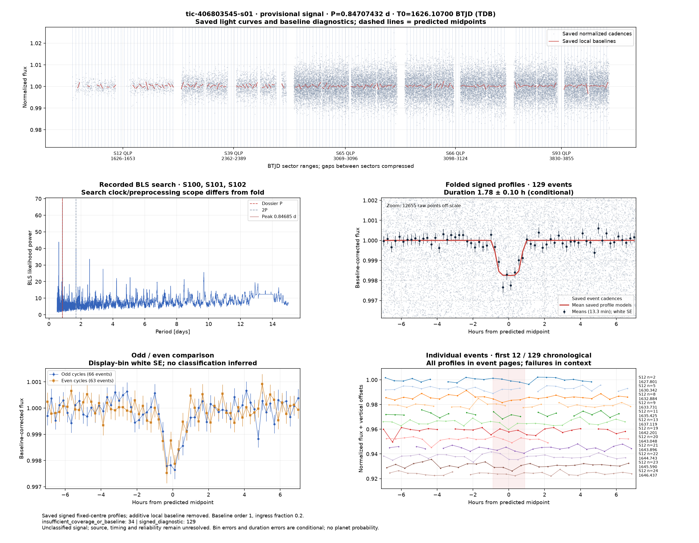](../candidates/tic-406803545-s01/evidence/figures/diagnostic.png) [tic-406803545-s01](../candidates/tic-406803545-s01/README.md) | [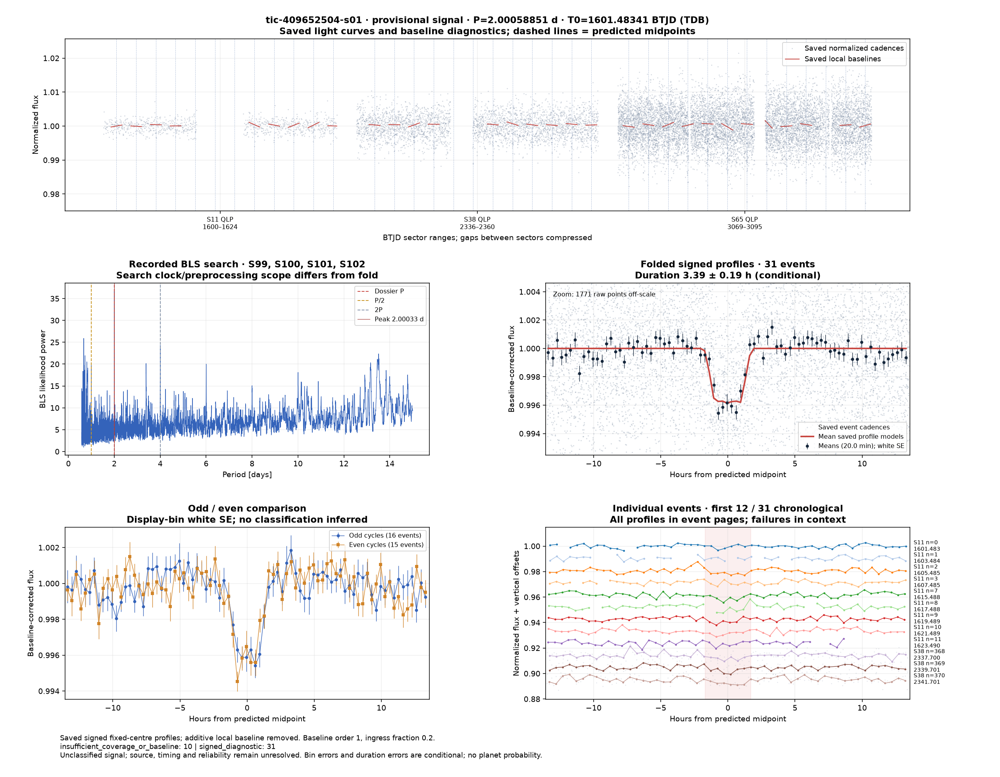](../candidates/tic-409652504-s01/evidence/figures/diagnostic.png) [tic-409652504-s01](../candidates/tic-409652504-s01/README.md) |
| [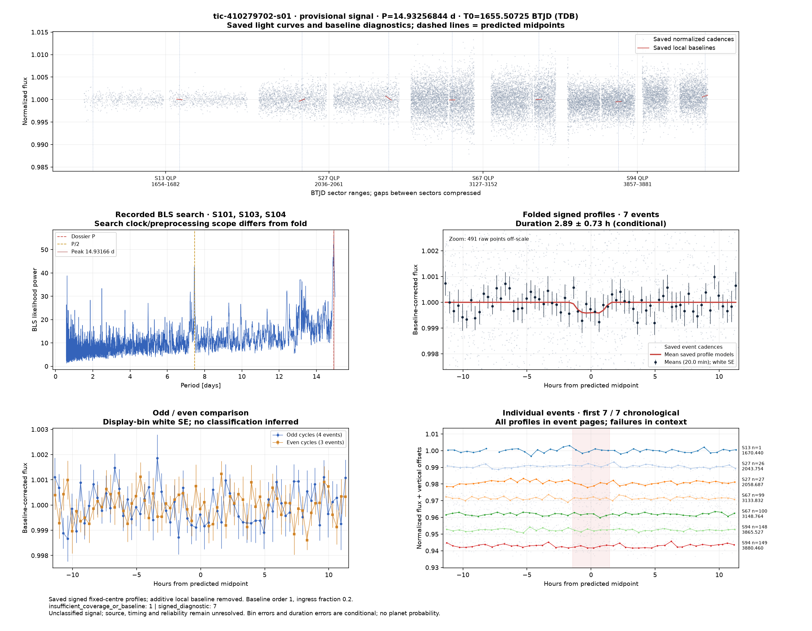](../candidates/tic-410279702-s01/evidence/figures/diagnostic.png) [tic-410279702-s01](../candidates/tic-410279702-s01/README.md) | [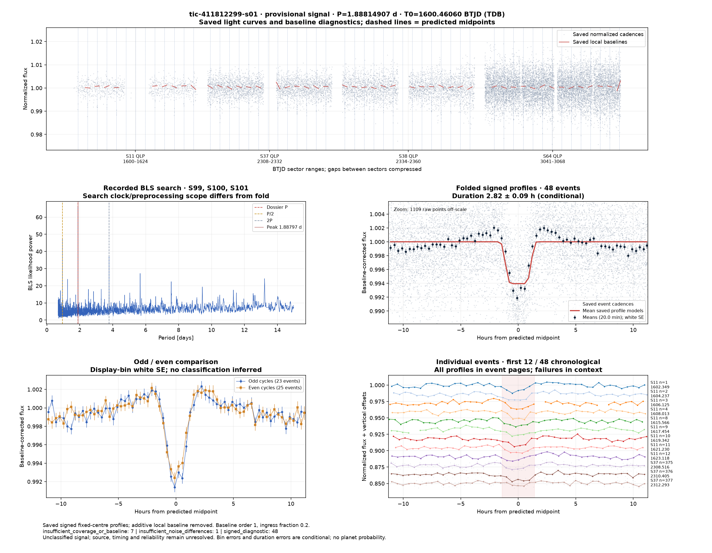](../candidates/tic-411812299-s01/evidence/figures/diagnostic.png) [tic-411812299-s01](../candidates/tic-411812299-s01/README.md) | [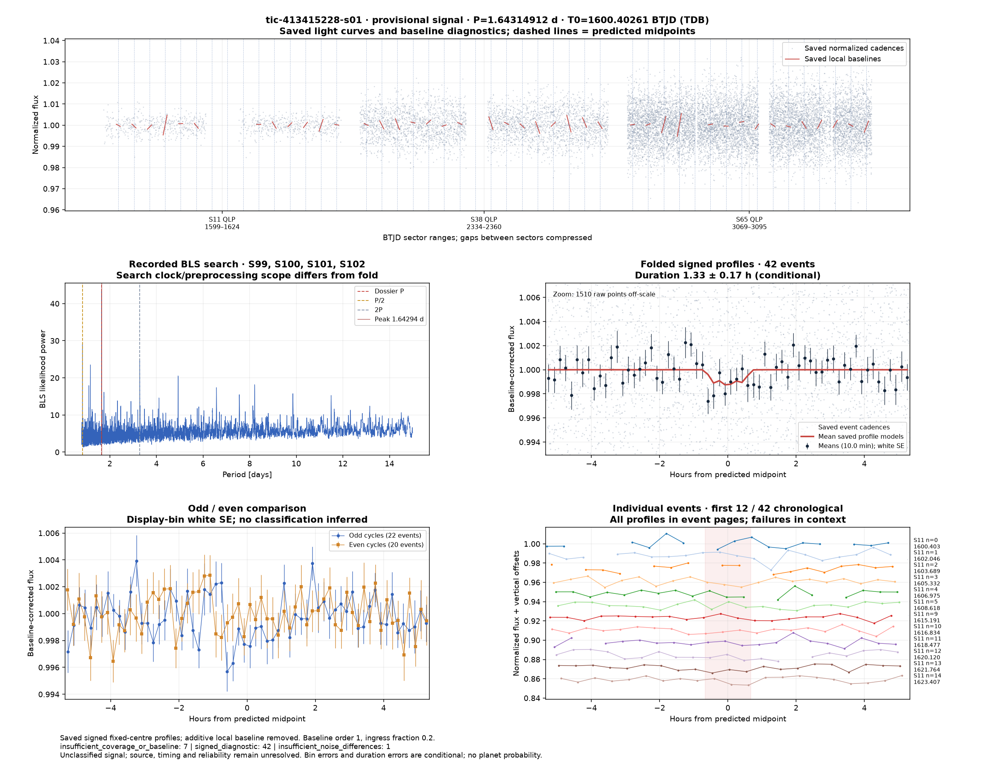](../candidates/tic-413415228-s01/evidence/figures/diagnostic.png) [tic-413415228-s01](../candidates/tic-413415228-s01/README.md) |
|  [tic-415107554-s01](../candidates/tic-415107554-s01/README.md) |  [tic-419165427-s01](../candidates/tic-419165427-s01/README.md) |  [tic-420357796-s01](../candidates/tic-420357796-s01/README.md) |
|  [tic-420631795-s01](../candidates/tic-420631795-s01/README.md) |  [tic-423023660-s01](../candidates/tic-423023660-s01/README.md) |  [tic-423516560-s01](../candidates/tic-423516560-s01/README.md) |
|  [tic-424768689-s01](../candidates/tic-424768689-s01/README.md) |  [tic-425933702-s01](../candidates/tic-425933702-s01/README.md) |  [tic-426426820-s01](../candidates/tic-426426820-s01/README.md) |
|  [tic-435985610-s01](../candidates/tic-435985610-s01/README.md) |  [tic-437928704-s01](../candidates/tic-437928704-s01/README.md) |  [tic-438599291-s01](../candidates/tic-438599291-s01/README.md) |
