# Candidate diagnostics — page 7

[Gallery index](README.md). Each image opens its full-resolution PNG.

| | | |
|---|---|---|
|  [tic-286763467-s01](../candidates/tic-286763467-s01/README.md) |  [tic-288765766-s01](../candidates/tic-288765766-s01/README.md) |  [tic-290342858-s01](../candidates/tic-290342858-s01/README.md) |
|  [tic-291096242-s01](../candidates/tic-291096242-s01/README.md) |  [tic-292125277-s01](../candidates/tic-292125277-s01/README.md) |  [tic-292291978-s01](../candidates/tic-292291978-s01/README.md) |
|  [tic-292547242-s01](../candidates/tic-292547242-s01/README.md) |  [tic-294235592-s01](../candidates/tic-294235592-s01/README.md) |  [tic-295255282-s01](../candidates/tic-295255282-s01/README.md) |
|  [tic-295376786-s01](../candidates/tic-295376786-s01/README.md) |  [tic-295478570-s01](../candidates/tic-295478570-s01/README.md) |  [tic-297061156-s01](../candidates/tic-297061156-s01/README.md) |
|  [tic-297093620-s01](../candidates/tic-297093620-s01/README.md) | [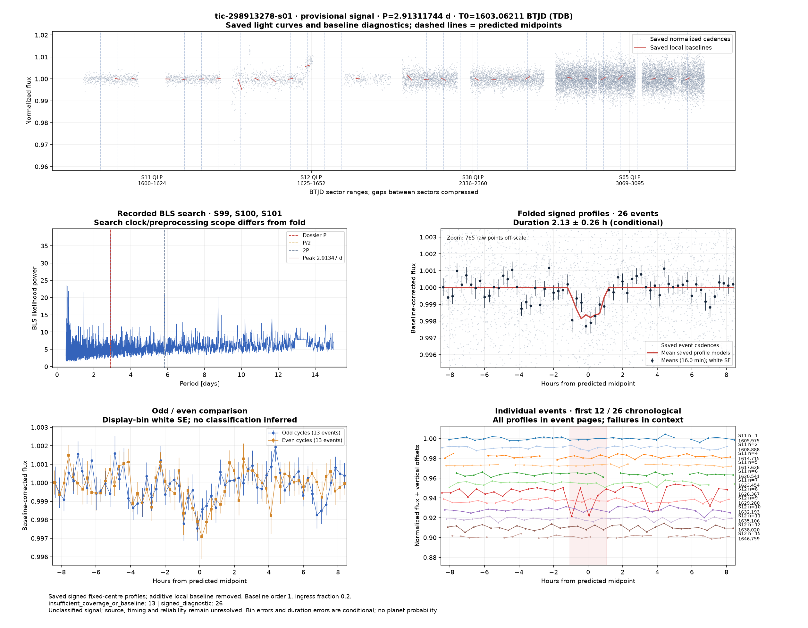](../candidates/tic-298913278-s01/evidence/figures/diagnostic.png) [tic-298913278-s01](../candidates/tic-298913278-s01/README.md) | [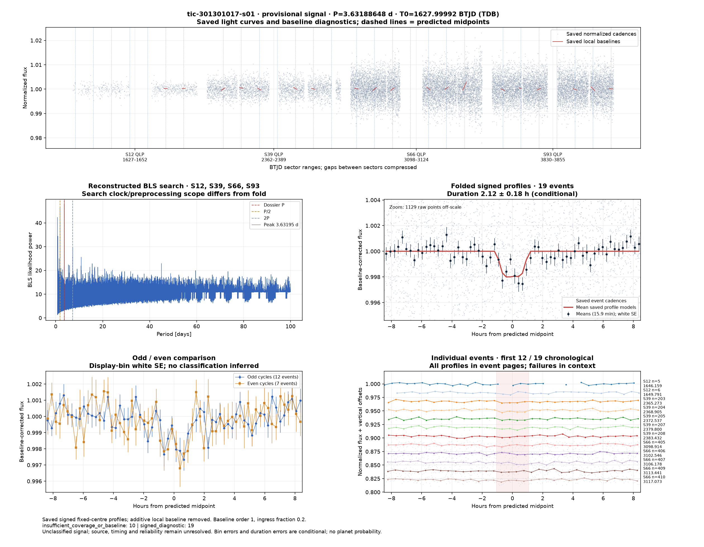](../candidates/tic-301301017-s01/evidence/figures/diagnostic.png) [tic-301301017-s01](../candidates/tic-301301017-s01/README.md) |
| [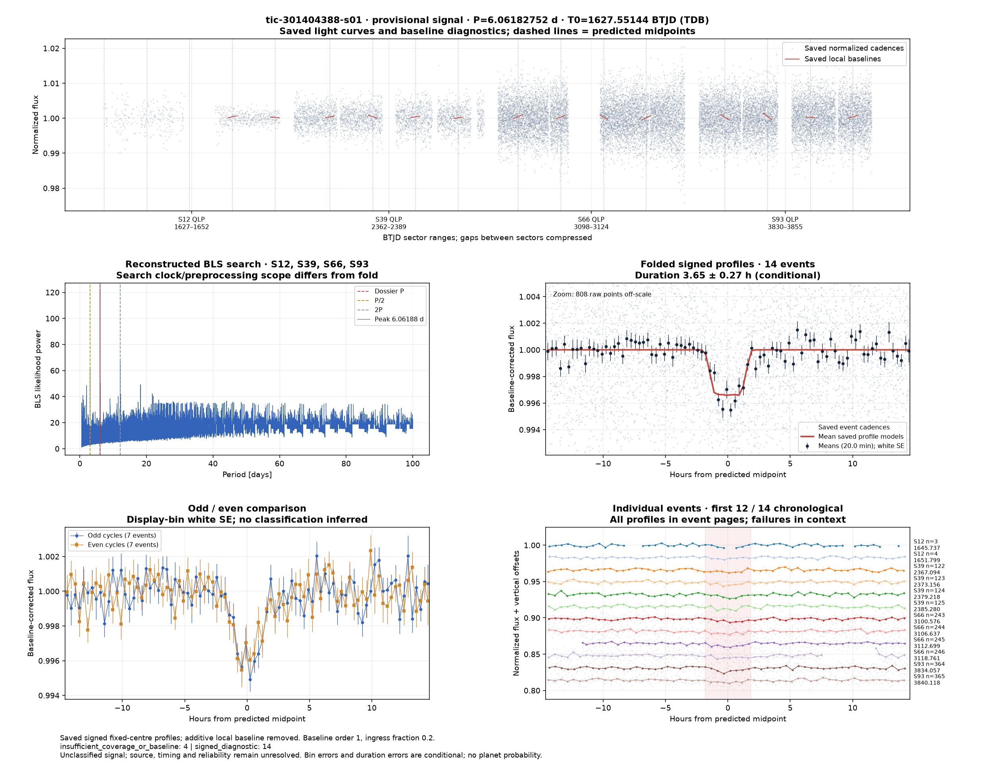](../candidates/tic-301404388-s01/evidence/figures/diagnostic.png) [tic-301404388-s01](../candidates/tic-301404388-s01/README.md) | [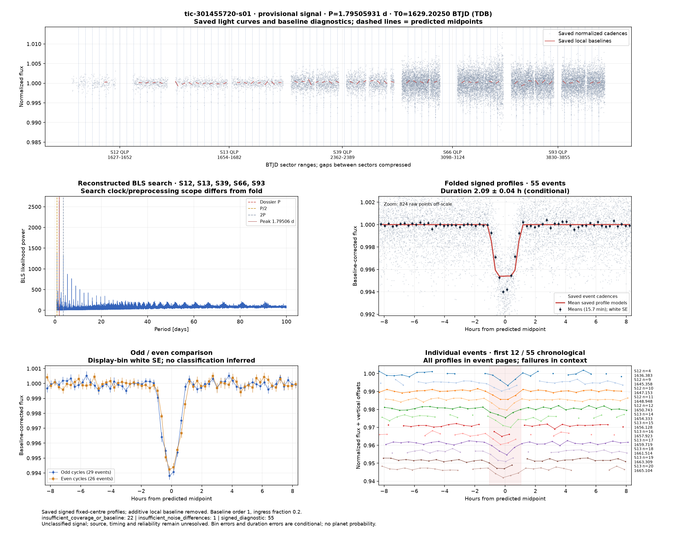](../candidates/tic-301455720-s01/evidence/figures/diagnostic.png) [tic-301455720-s01](../candidates/tic-301455720-s01/README.md) | [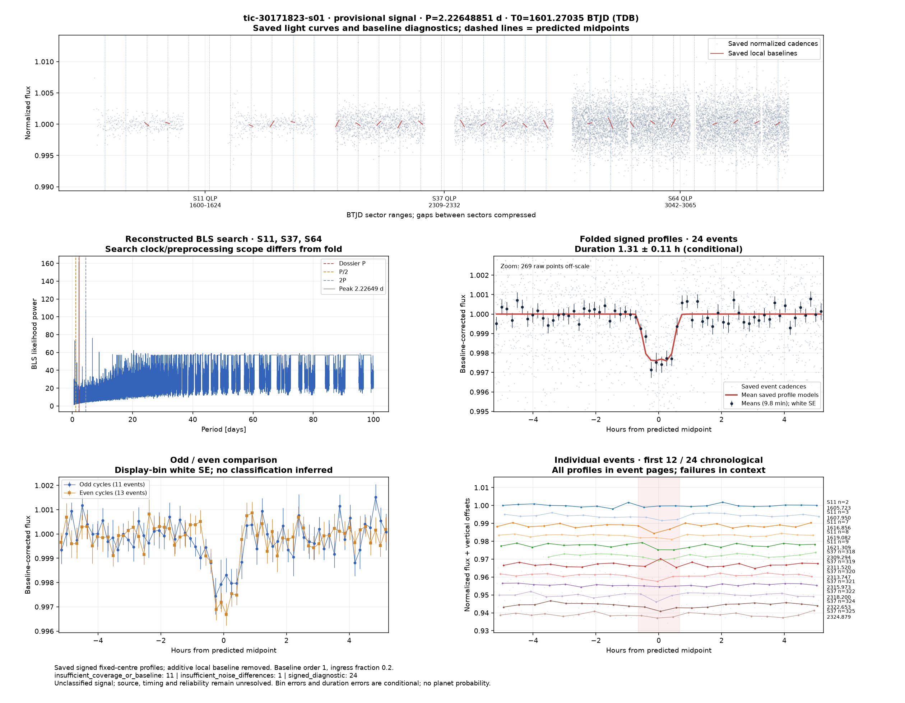](../candidates/tic-30171823-s01/evidence/figures/diagnostic.png) [tic-30171823-s01](../candidates/tic-30171823-s01/README.md) |
| [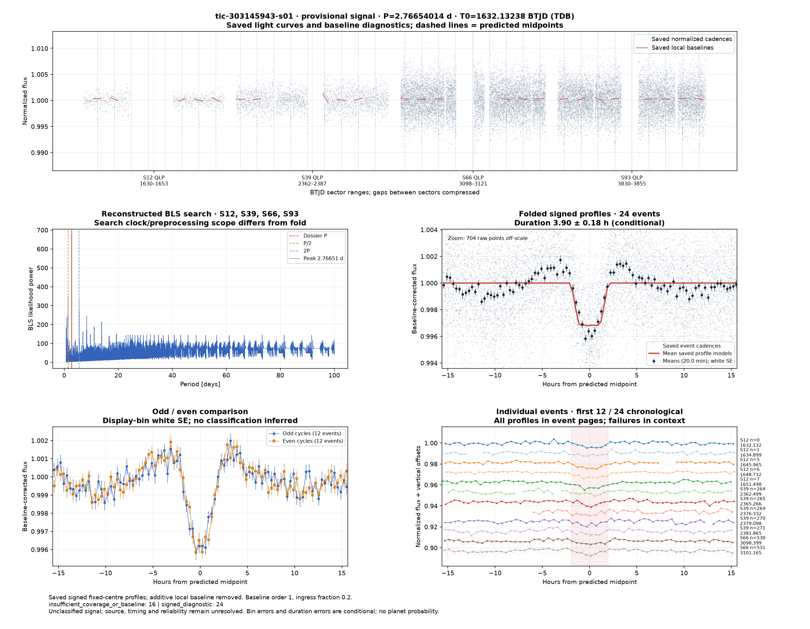](../candidates/tic-303145943-s01/evidence/figures/diagnostic.png) [tic-303145943-s01](../candidates/tic-303145943-s01/README.md) | [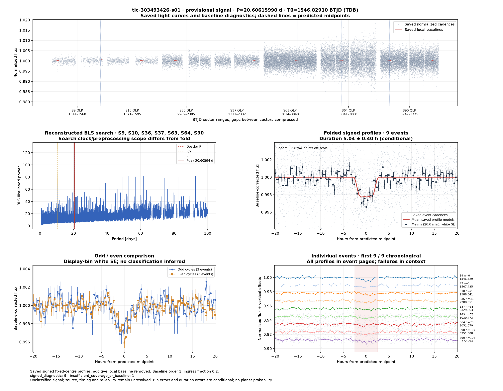](../candidates/tic-303493426-s01/evidence/figures/diagnostic.png) [tic-303493426-s01](../candidates/tic-303493426-s01/README.md) | [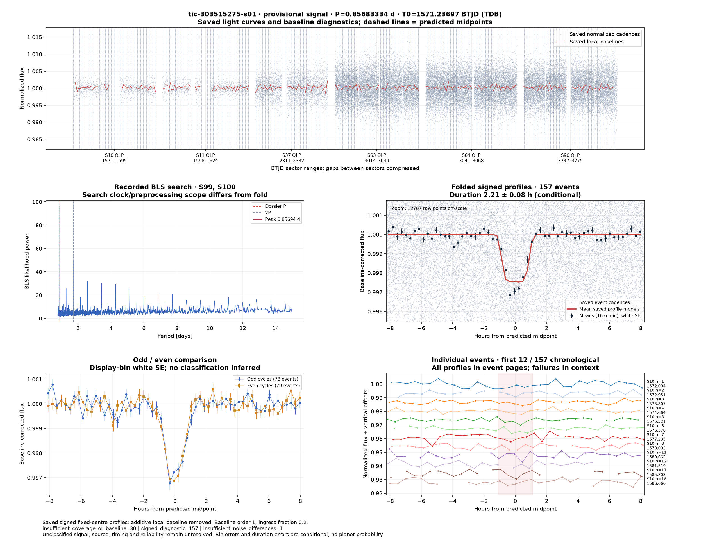](../candidates/tic-303515275-s01/evidence/figures/diagnostic.png) [tic-303515275-s01](../candidates/tic-303515275-s01/README.md) |
| [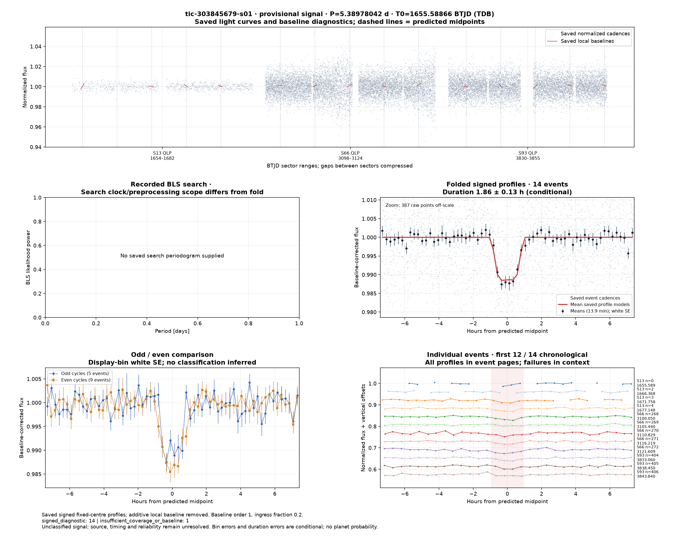](../candidates/tic-303845679-s01/evidence/figures/diagnostic.png) [tic-303845679-s01](../candidates/tic-303845679-s01/README.md) | [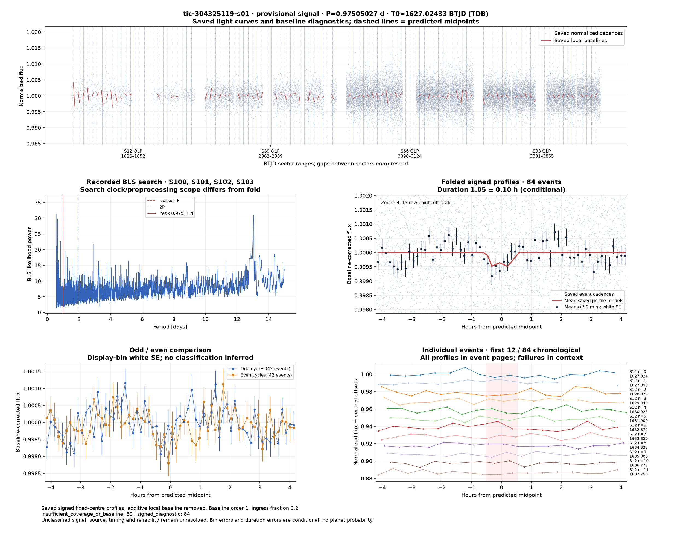](../candidates/tic-304325119-s01/evidence/figures/diagnostic.png) [tic-304325119-s01](../candidates/tic-304325119-s01/README.md) | [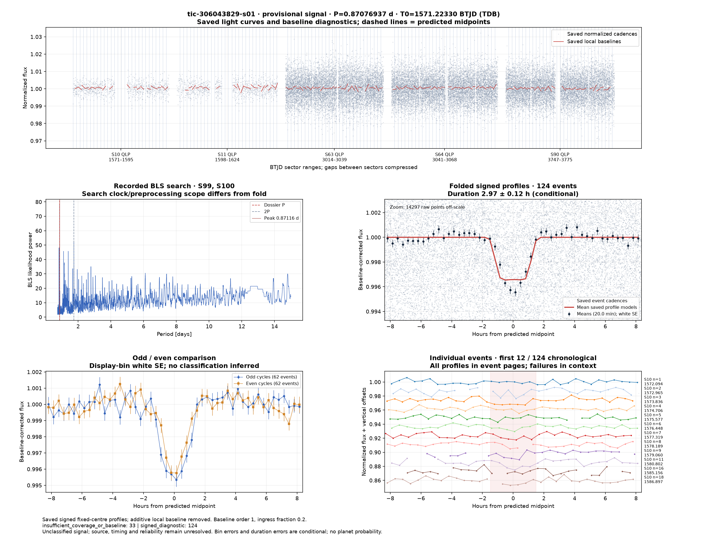](../candidates/tic-306043829-s01/evidence/figures/diagnostic.png) [tic-306043829-s01](../candidates/tic-306043829-s01/README.md) |
