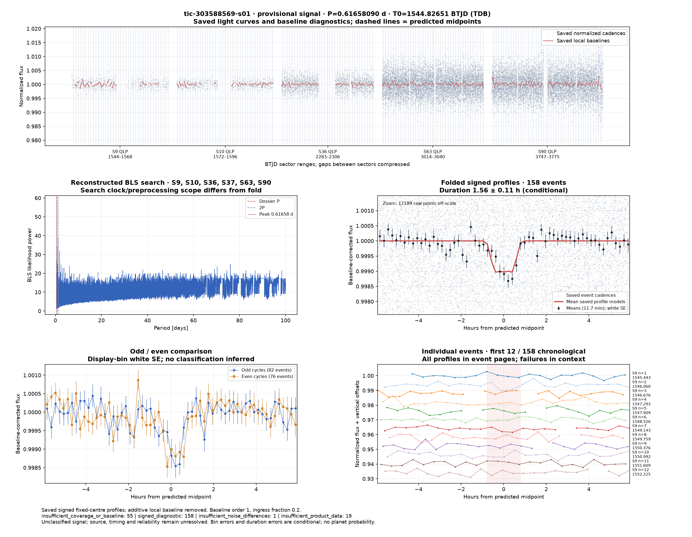
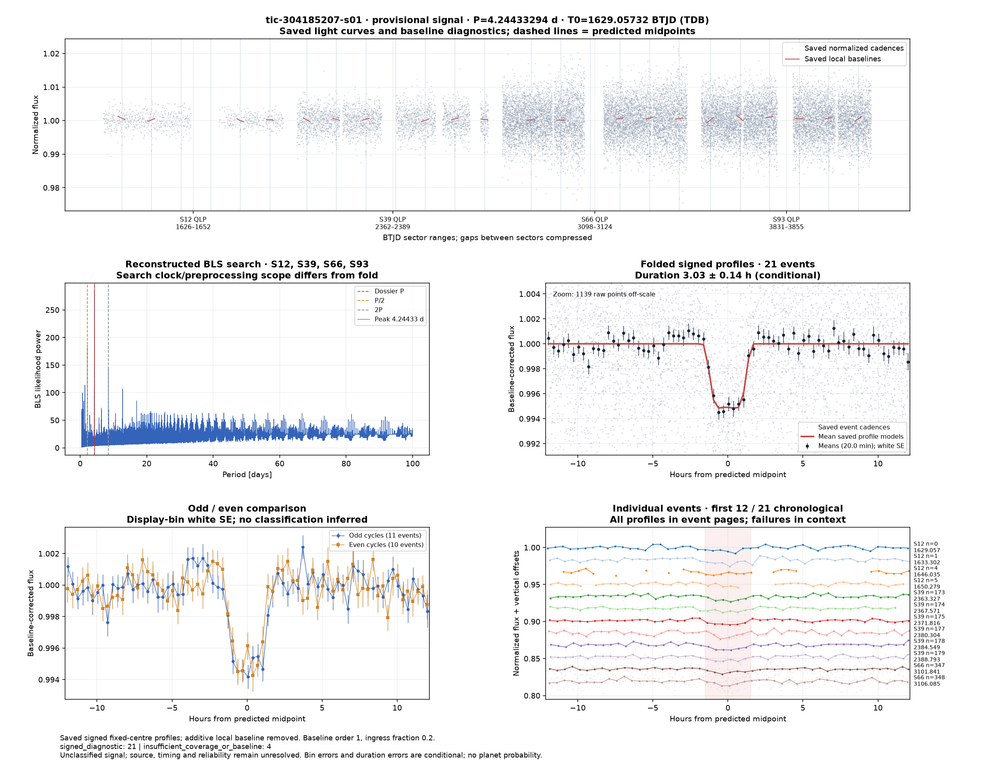
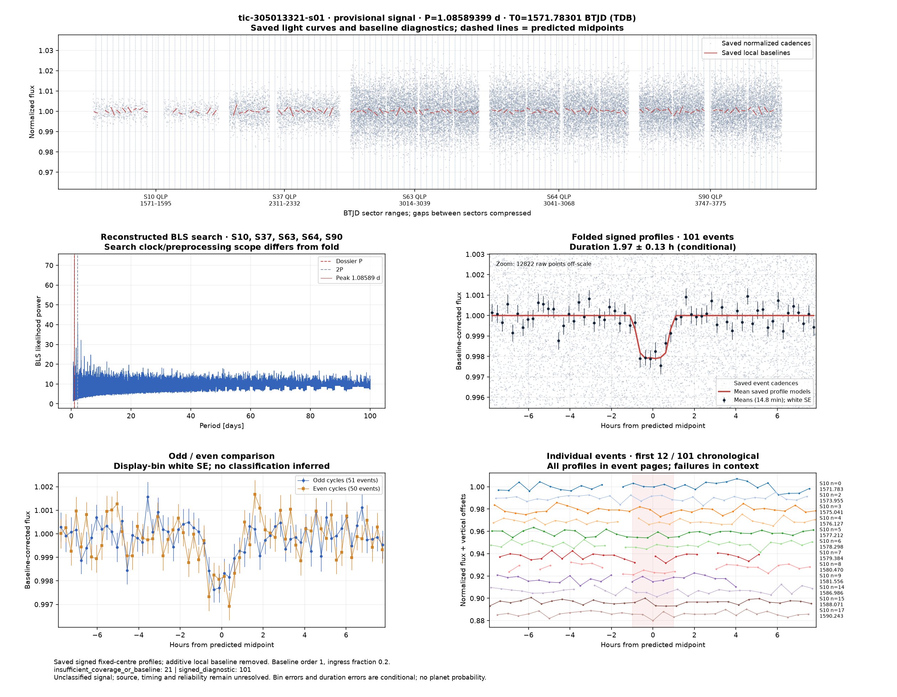
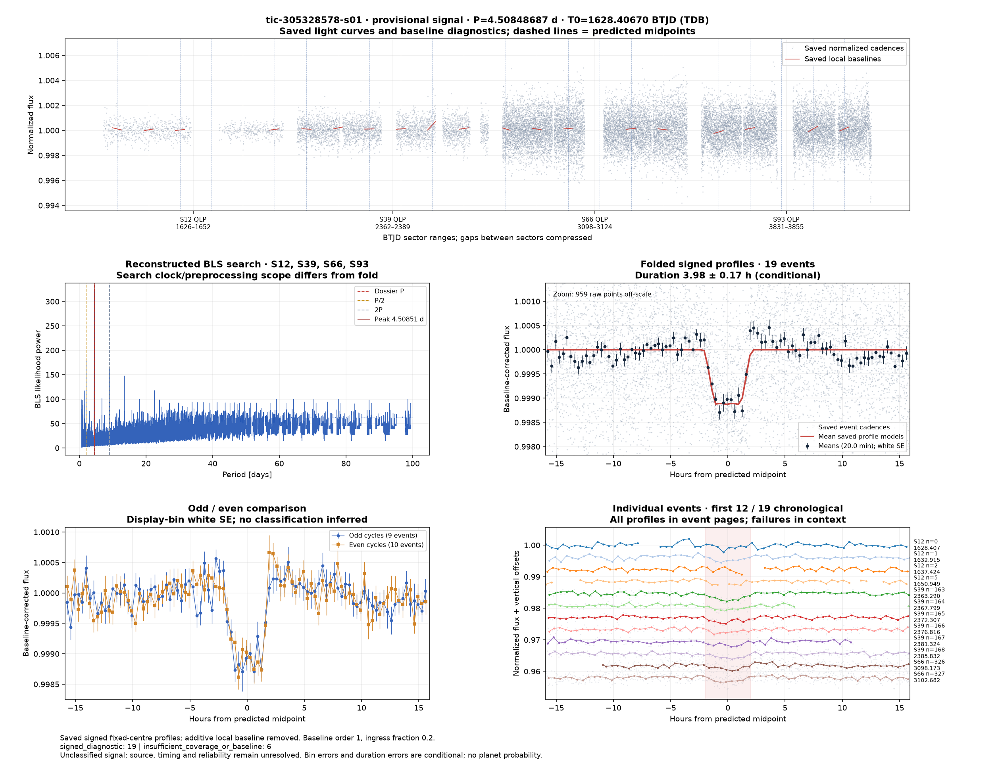
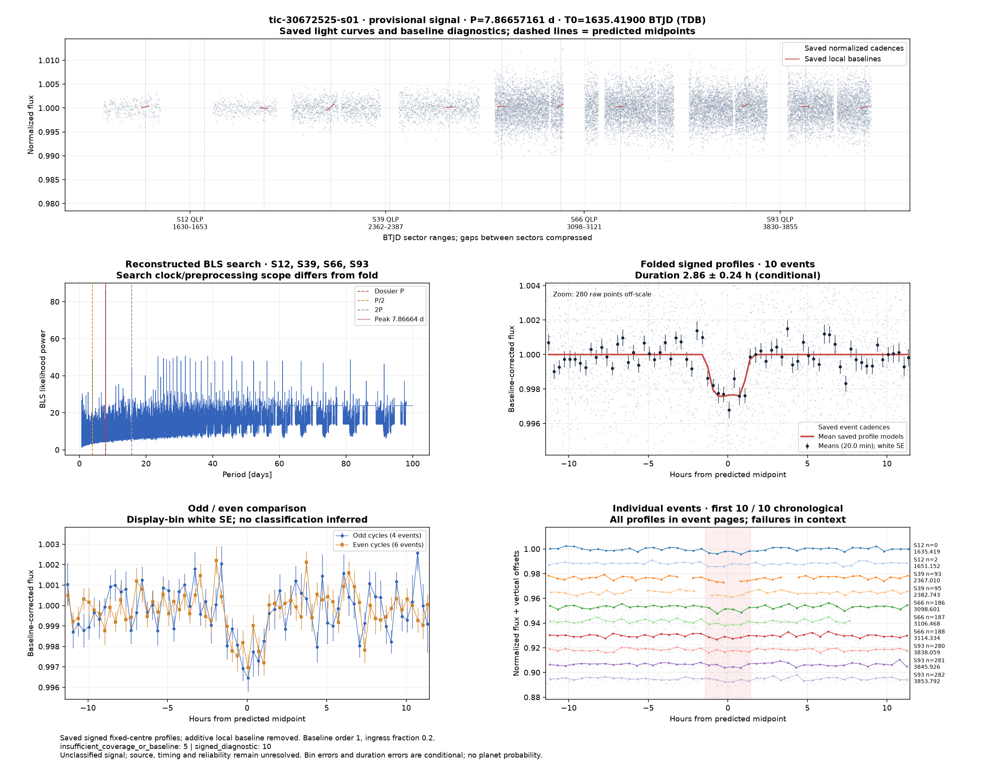
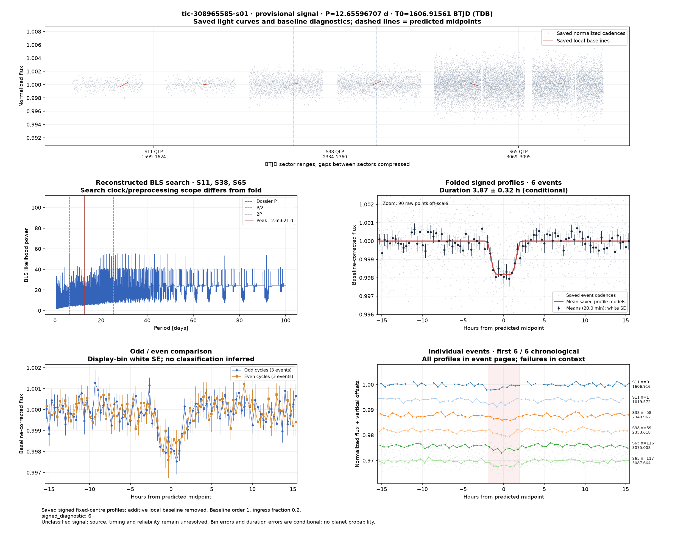
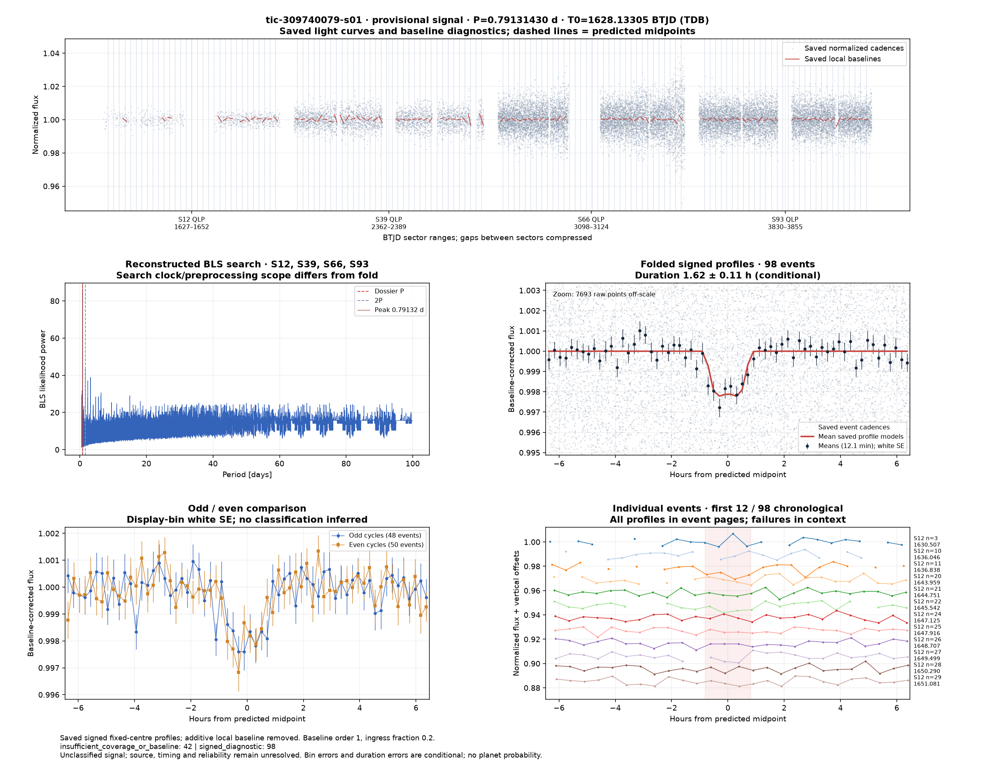

# Candidate diagnostics — page 9

[Gallery index](README.md). Each image opens its full-resolution PNG.

| | | |
|---|---|---|
|  [tic-298913278-s01](../candidates/tic-298913278-s01/README.md) |  [tic-301301017-s01](../candidates/tic-301301017-s01/README.md) |  [tic-301404388-s01](../candidates/tic-301404388-s01/README.md) |
|  [tic-301455720-s01](../candidates/tic-301455720-s01/README.md) |  [tic-30171823-s01](../candidates/tic-30171823-s01/README.md) |  [tic-303145943-s01](../candidates/tic-303145943-s01/README.md) |
|  [tic-303493426-s01](../candidates/tic-303493426-s01/README.md) |  [tic-303515275-s01](../candidates/tic-303515275-s01/README.md) |  [tic-303588569-s01](../candidates/tic-303588569-s01/README.md) |
|  [tic-303845679-s01](../candidates/tic-303845679-s01/README.md) |  [tic-304185207-s01](../candidates/tic-304185207-s01/README.md) |  [tic-304325119-s01](../candidates/tic-304325119-s01/README.md) |
|  [tic-305013321-s01](../candidates/tic-305013321-s01/README.md) |  [tic-305328578-s01](../candidates/tic-305328578-s01/README.md) |  [tic-306043829-s01](../candidates/tic-306043829-s01/README.md) |
|  [tic-306460615-s01](../candidates/tic-306460615-s01/README.md) |  [tic-30672525-s01](../candidates/tic-30672525-s01/README.md) |  [tic-306915668-s01](../candidates/tic-306915668-s01/README.md) |
|  [tic-307763824-s01](../candidates/tic-307763824-s01/README.md) |  [tic-308206159-s01](../candidates/tic-308206159-s01/README.md) |  [tic-308337104-s01](../candidates/tic-308337104-s01/README.md) |
|  [tic-308841804-s01](../candidates/tic-308841804-s01/README.md) |  [tic-308965585-s01](../candidates/tic-308965585-s01/README.md) |  [tic-309740079-s01](../candidates/tic-309740079-s01/README.md) |
