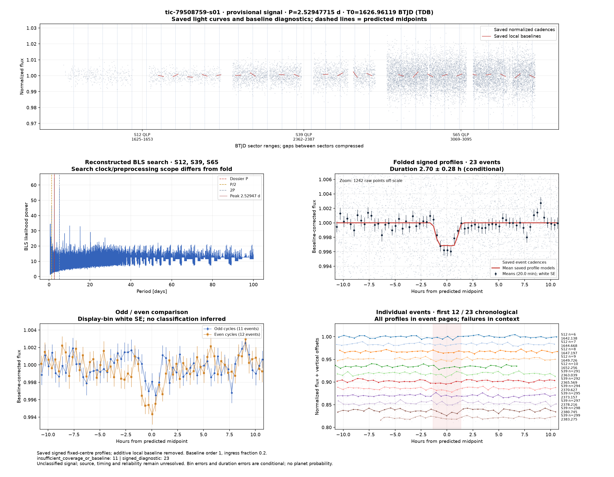

# Candidate diagnostics — page 10

[Gallery index](README.md). Each image opens its full-resolution PNG.

| | | |
|---|---|---|
|  [tic-466282981-s01](../candidates/tic-466282981-s01/README.md) |  [tic-46693311-s01](../candidates/tic-46693311-s01/README.md) |  [tic-467059462-s01](../candidates/tic-467059462-s01/README.md) |
|  [tic-467193799-s01](../candidates/tic-467193799-s01/README.md) |  [tic-467484344-s01](../candidates/tic-467484344-s01/README.md) |  [tic-467668175-s01](../candidates/tic-467668175-s01/README.md) |
|  [tic-46806792-s01](../candidates/tic-46806792-s01/README.md) |  [tic-468207990-s01](../candidates/tic-468207990-s01/README.md) |  [tic-48061356-s01](../candidates/tic-48061356-s01/README.md) |
|  [tic-50020789-s01](../candidates/tic-50020789-s01/README.md) |  [tic-5508653-s01](../candidates/tic-5508653-s01/README.md) |  [tic-58146626-s01](../candidates/tic-58146626-s01/README.md) |
|  [tic-58634613-s01](../candidates/tic-58634613-s01/README.md) |  [tic-59662756-s01](../candidates/tic-59662756-s01/README.md) |  [tic-68415069-s01](../candidates/tic-68415069-s01/README.md) |
|  [tic-69516308-s01](../candidates/tic-69516308-s01/README.md) |  [tic-70826687-s01](../candidates/tic-70826687-s01/README.md) |  [tic-71826274-s01](../candidates/tic-71826274-s01/README.md) |
|  [tic-72632902-s01](../candidates/tic-72632902-s01/README.md) |  [tic-73254448-s01](../candidates/tic-73254448-s01/README.md) |  [tic-73597516-s01](../candidates/tic-73597516-s01/README.md) |
|  [tic-74743490-s01](../candidates/tic-74743490-s01/README.md) |  [tic-7475565-s01](../candidates/tic-7475565-s01/README.md) |  [tic-79508759-s01](../candidates/tic-79508759-s01/README.md) |
