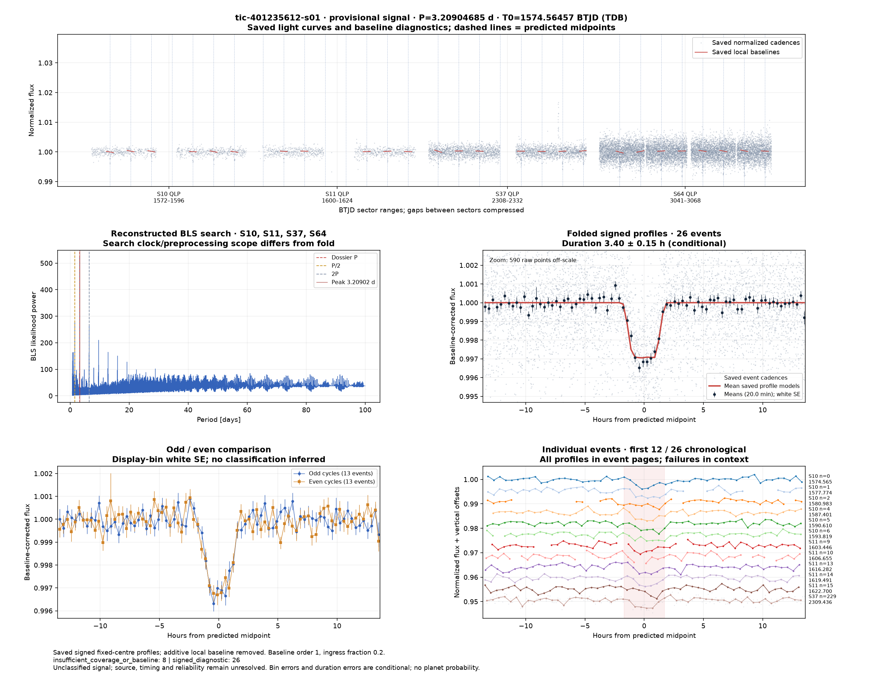
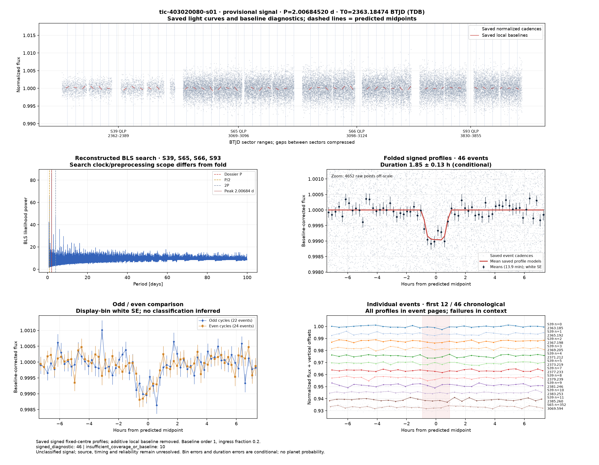
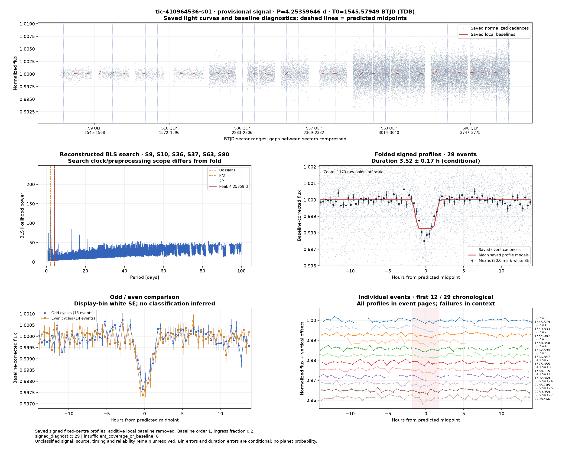
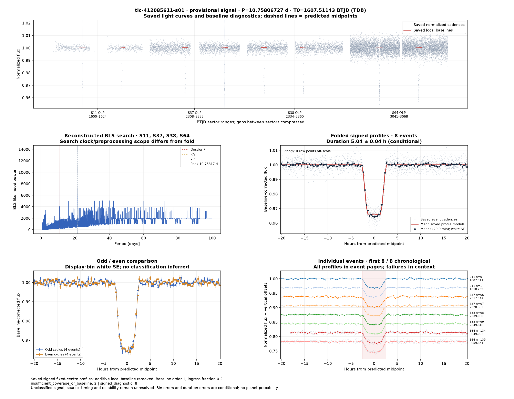

# Candidate diagnostics — page 11

[Gallery index](README.md). Each image opens its full-resolution PNG.

| | | |
|---|---|---|
|  [tic-395511355-s01](../candidates/tic-395511355-s01/README.md) |  [tic-401235612-s01](../candidates/tic-401235612-s01/README.md) |  [tic-402682058-s01](../candidates/tic-402682058-s01/README.md) |
|  [tic-403020080-s01](../candidates/tic-403020080-s01/README.md) |  [tic-403410606-s01](../candidates/tic-403410606-s01/README.md) |  [tic-403412642-s01](../candidates/tic-403412642-s01/README.md) |
|  [tic-403443129-s01](../candidates/tic-403443129-s01/README.md) |  [tic-40588332-s01](../candidates/tic-40588332-s01/README.md) |  [tic-406803545-s01](../candidates/tic-406803545-s01/README.md) |
|  [tic-409652504-s01](../candidates/tic-409652504-s01/README.md) |  [tic-410279702-s01](../candidates/tic-410279702-s01/README.md) |  [tic-410964536-s01](../candidates/tic-410964536-s01/README.md) |
|  [tic-411812299-s01](../candidates/tic-411812299-s01/README.md) |  [tic-412085611-s01](../candidates/tic-412085611-s01/README.md) |  [tic-413415228-s01](../candidates/tic-413415228-s01/README.md) |
|  [tic-414182199-s01](../candidates/tic-414182199-s01/README.md) |  [tic-415107554-s01](../candidates/tic-415107554-s01/README.md) |  [tic-4171261-s01](../candidates/tic-4171261-s01/README.md) |
|  [tic-419165427-s01](../candidates/tic-419165427-s01/README.md) |  [tic-419640929-s01](../candidates/tic-419640929-s01/README.md) |  [tic-420357796-s01](../candidates/tic-420357796-s01/README.md) |
|  [tic-420631795-s01](../candidates/tic-420631795-s01/README.md) |  [tic-423023660-s01](../candidates/tic-423023660-s01/README.md) |  [tic-423516560-s01](../candidates/tic-423516560-s01/README.md) |
