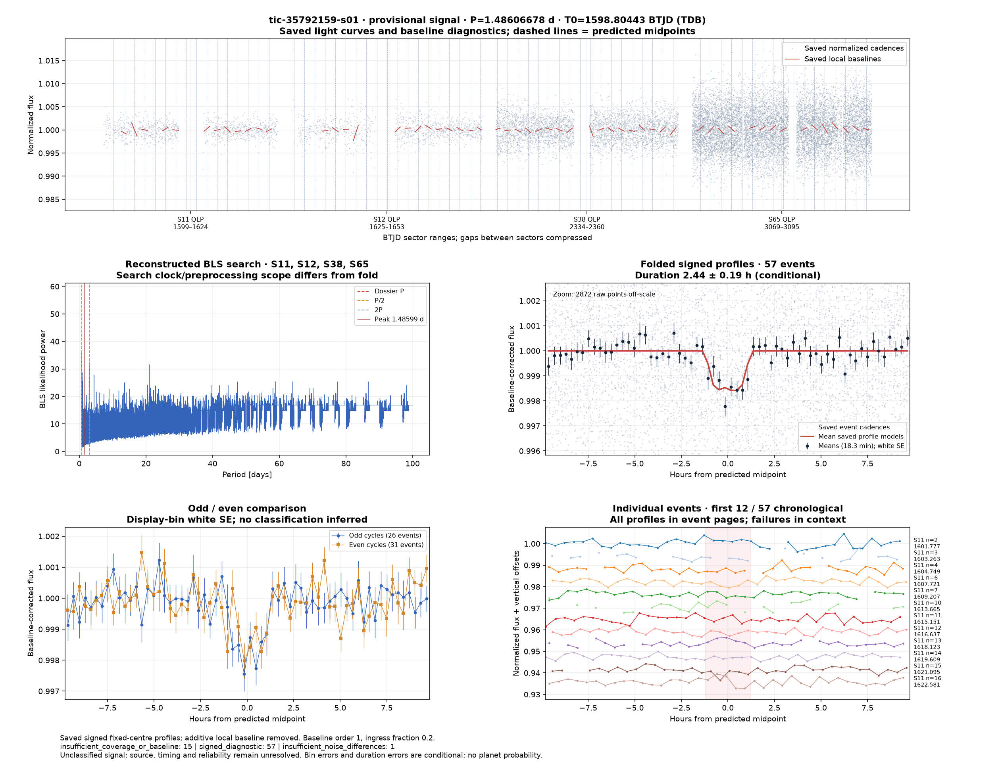
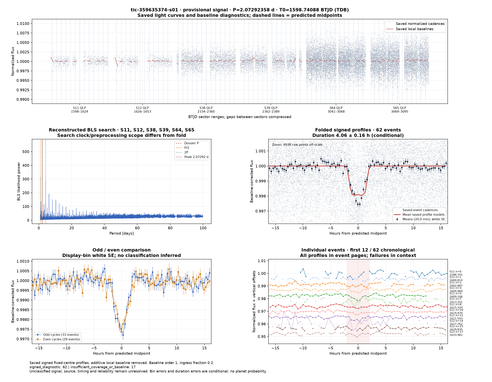
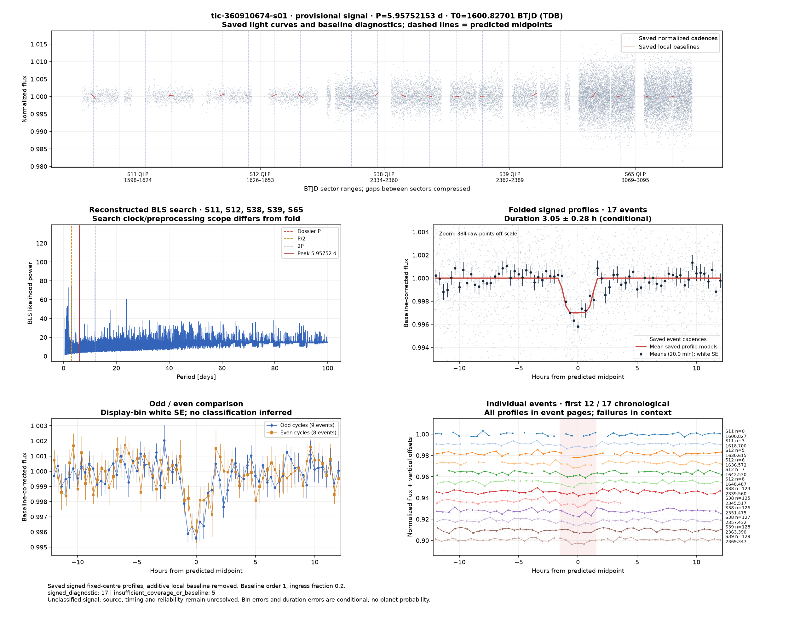
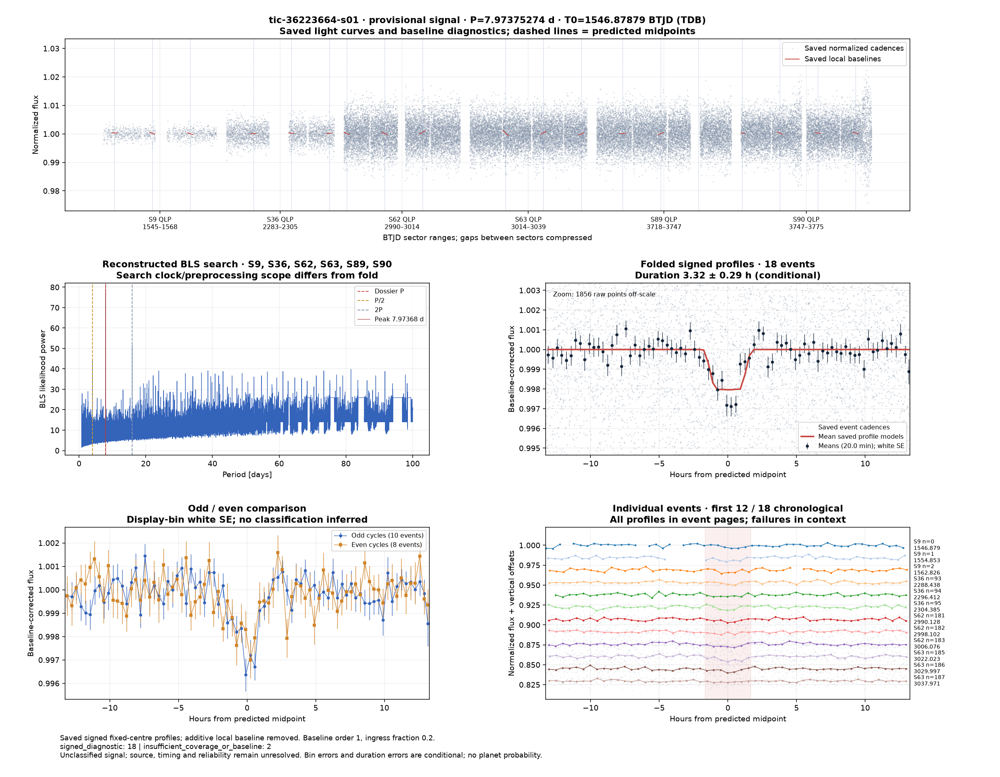
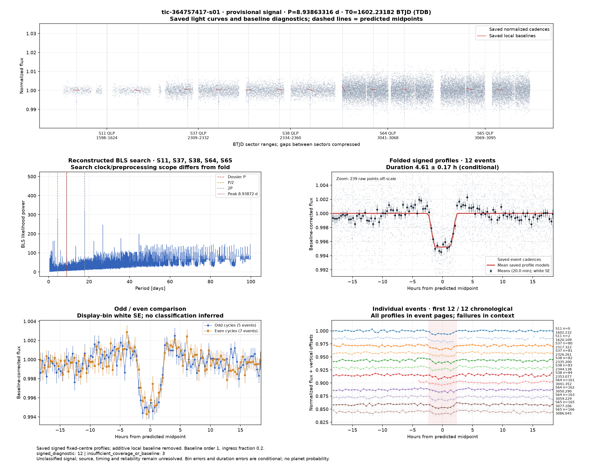
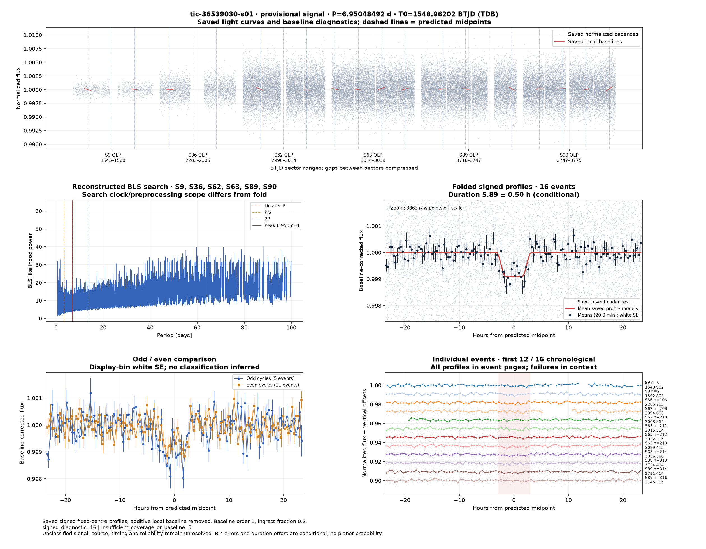
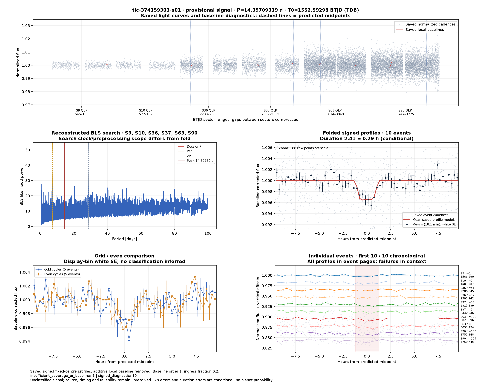
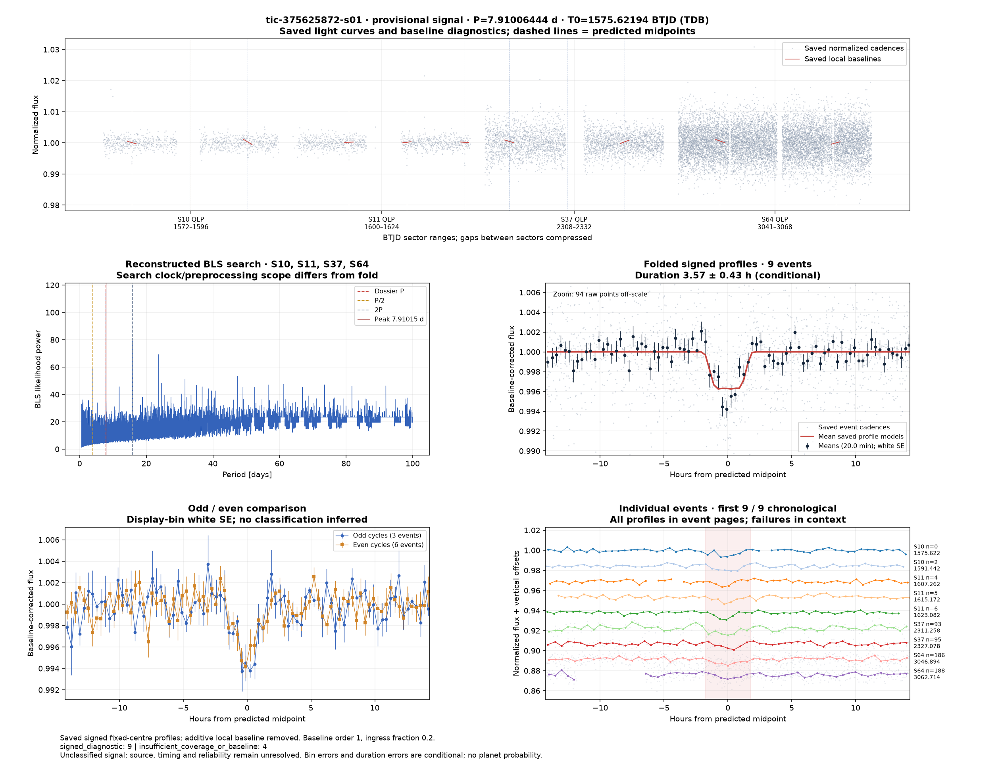

# Candidate diagnostics — page 12

[Gallery index](README.md). Each image opens its full-resolution PNG.

| | | |
|---|---|---|
|  [tic-34064739-s01](../candidates/tic-34064739-s01/README.md) |  [tic-34156876-s01](../candidates/tic-34156876-s01/README.md) |  [tic-341916921-s01](../candidates/tic-341916921-s01/README.md) |
|  [tic-356342689-s01](../candidates/tic-356342689-s01/README.md) |  [tic-35788575-s01](../candidates/tic-35788575-s01/README.md) |  [tic-35792159-s01](../candidates/tic-35792159-s01/README.md) |
|  [tic-358231727-s01](../candidates/tic-358231727-s01/README.md) |  [tic-359635374-s01](../candidates/tic-359635374-s01/README.md) |  [tic-360223723-s01](../candidates/tic-360223723-s01/README.md) |
|  [tic-360617400-s01](../candidates/tic-360617400-s01/README.md) |  [tic-360910674-s01](../candidates/tic-360910674-s01/README.md) |  [tic-36223664-s01](../candidates/tic-36223664-s01/README.md) |
|  [tic-362372394-s01](../candidates/tic-362372394-s01/README.md) |  [tic-362972109-s01](../candidates/tic-362972109-s01/README.md) |  [tic-364757417-s01](../candidates/tic-364757417-s01/README.md) |
|  [tic-364953731-s01](../candidates/tic-364953731-s01/README.md) |  [tic-365363321-s01](../candidates/tic-365363321-s01/README.md) |  [tic-36539030-s01](../candidates/tic-36539030-s01/README.md) |
|  [tic-365899880-s01](../candidates/tic-365899880-s01/README.md) |  [tic-370679537-s01](../candidates/tic-370679537-s01/README.md) |  [tic-374159303-s01](../candidates/tic-374159303-s01/README.md) |
|  [tic-375625872-s01](../candidates/tic-375625872-s01/README.md) |  [tic-380007573-s01](../candidates/tic-380007573-s01/README.md) |  [tic-384268936-s01](../candidates/tic-384268936-s01/README.md) |
