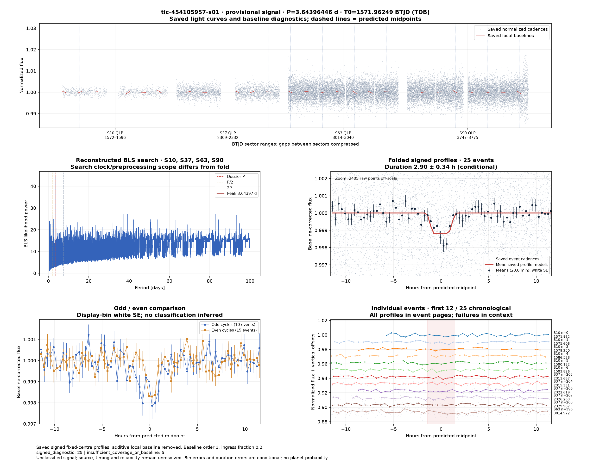
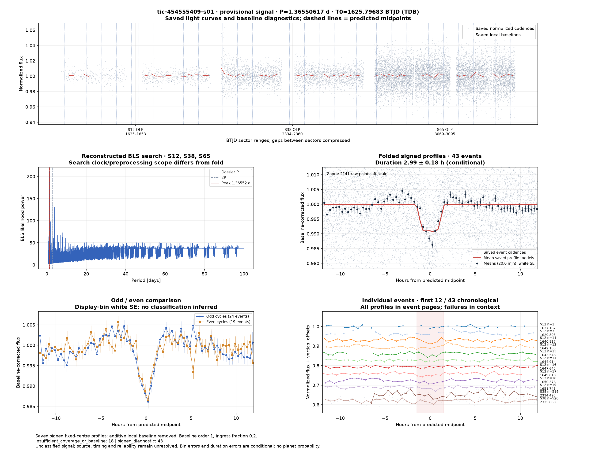
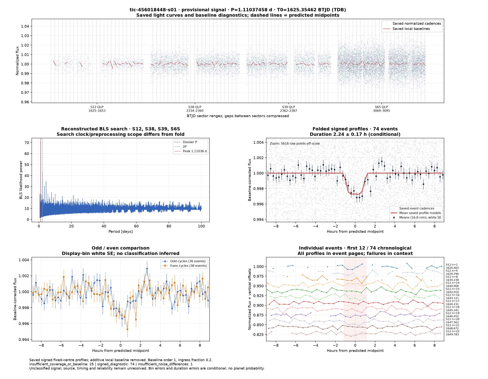
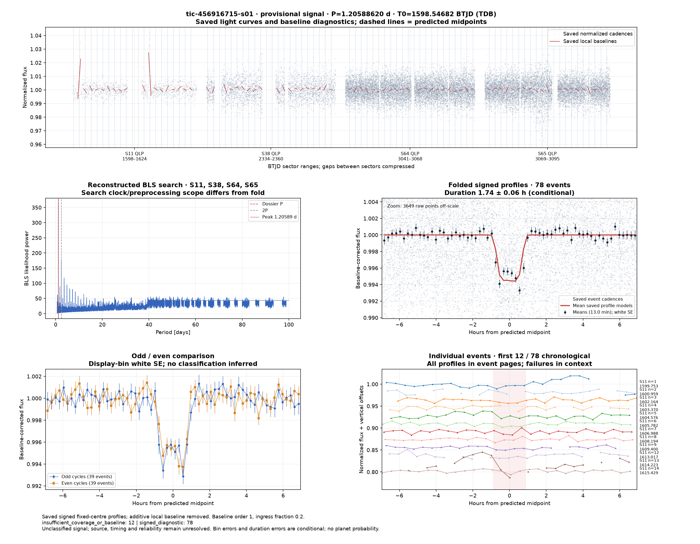
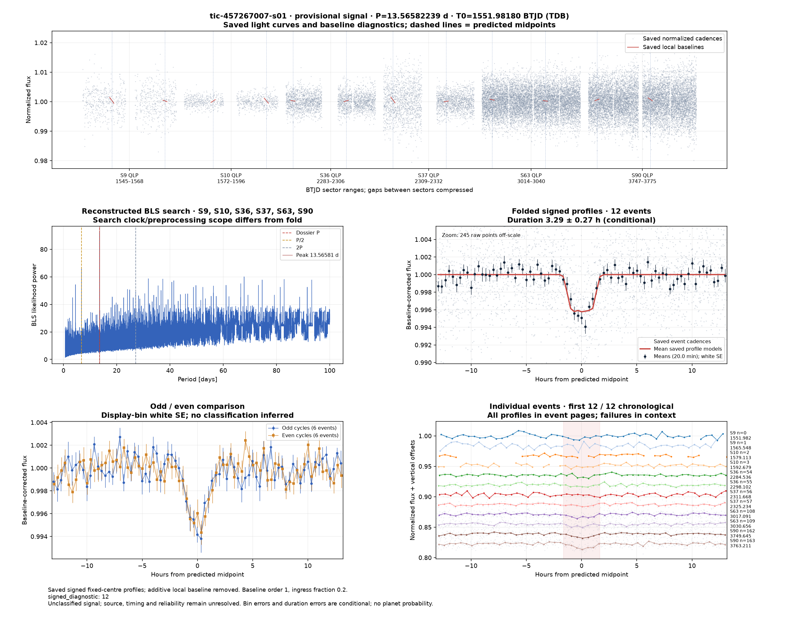
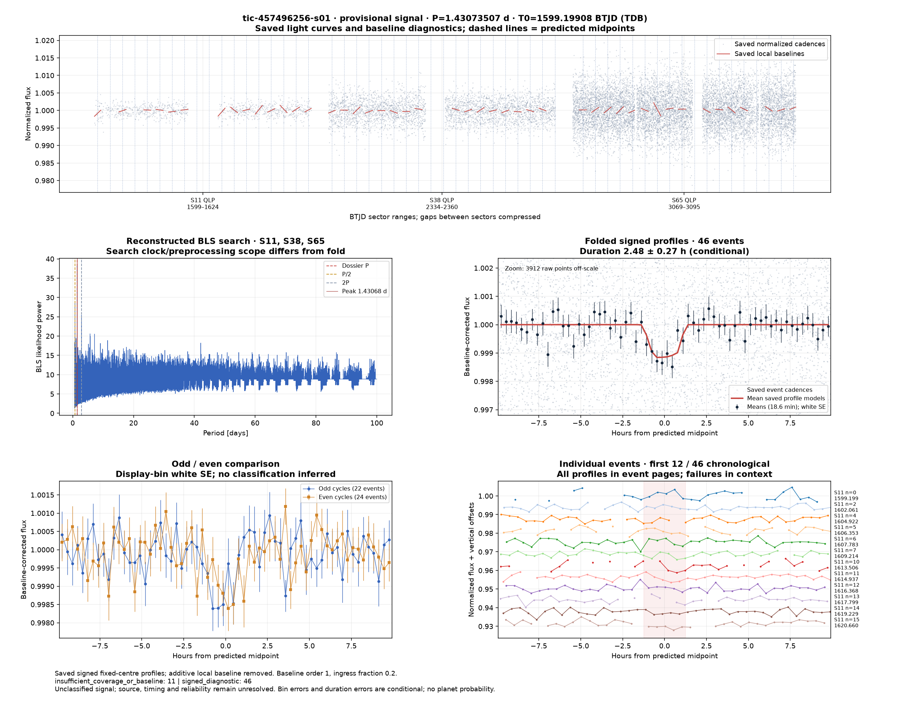
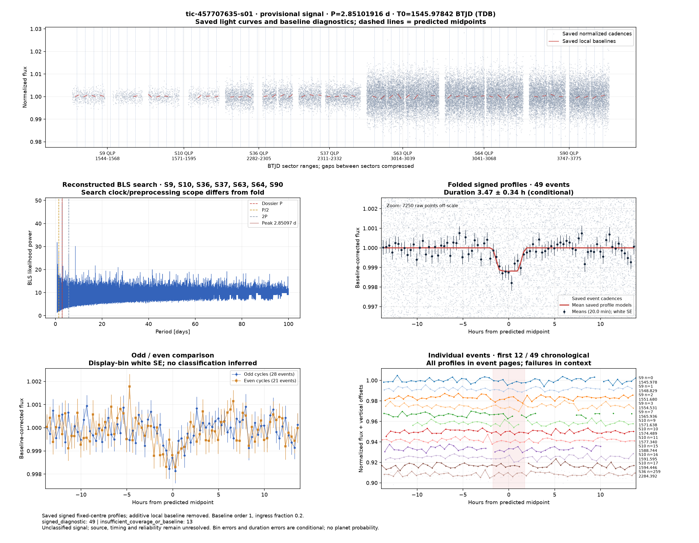
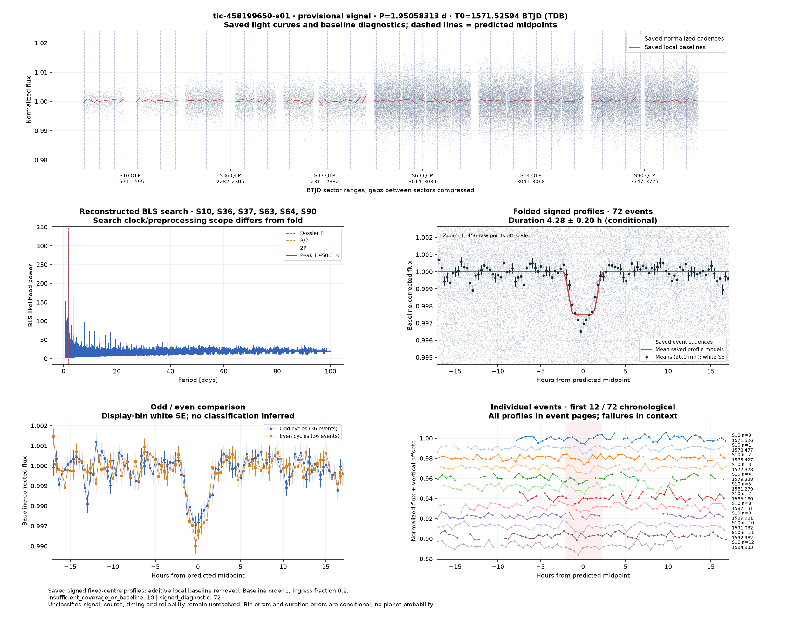
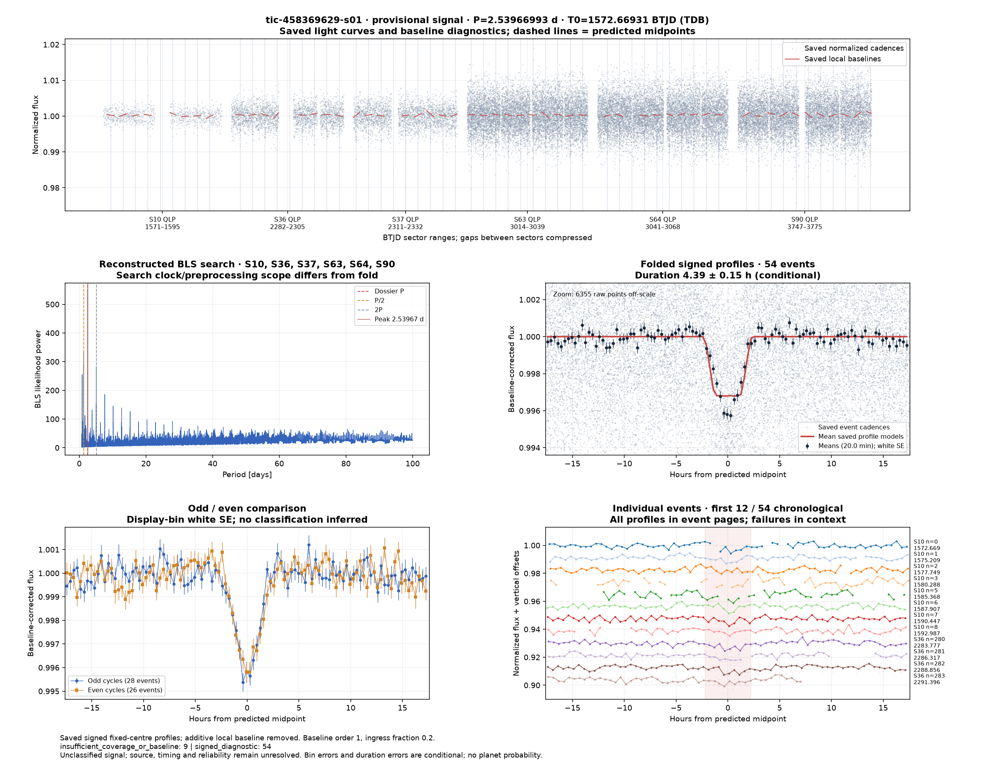

# Candidate diagnostics — page 13

[Gallery index](README.md). Each image opens its full-resolution PNG.

| | | |
|---|---|---|
|  [tic-450368185-s01](../candidates/tic-450368185-s01/README.md) |  [tic-450380114-s01](../candidates/tic-450380114-s01/README.md) |  [tic-450587004-s01](../candidates/tic-450587004-s01/README.md) |
|  [tic-450790574-s01](../candidates/tic-450790574-s01/README.md) |  [tic-450867025-s01](../candidates/tic-450867025-s01/README.md) |  [tic-451769585-s01](../candidates/tic-451769585-s01/README.md) |
|  [tic-451995827-s01](../candidates/tic-451995827-s01/README.md) |  [tic-45314794-s01](../candidates/tic-45314794-s01/README.md) |  [tic-453729192-s01](../candidates/tic-453729192-s01/README.md) |
|  [tic-454105957-s01](../candidates/tic-454105957-s01/README.md) |  [tic-454377816-s01](../candidates/tic-454377816-s01/README.md) |  [tic-454555409-s01](../candidates/tic-454555409-s01/README.md) |
|  [tic-454591748-s01](../candidates/tic-454591748-s01/README.md) |  [tic-455311098-s01](../candidates/tic-455311098-s01/README.md) |  [tic-455325214-s01](../candidates/tic-455325214-s01/README.md) |
|  [tic-455978103-s01](../candidates/tic-455978103-s01/README.md) |  [tic-456018448-s01](../candidates/tic-456018448-s01/README.md) |  [tic-456916715-s01](../candidates/tic-456916715-s01/README.md) |
|  [tic-457267007-s01](../candidates/tic-457267007-s01/README.md) |  [tic-457496256-s01](../candidates/tic-457496256-s01/README.md) |  [tic-457537281-s01](../candidates/tic-457537281-s01/README.md) |
|  [tic-457707635-s01](../candidates/tic-457707635-s01/README.md) |  [tic-458199650-s01](../candidates/tic-458199650-s01/README.md) |  [tic-458369629-s01](../candidates/tic-458369629-s01/README.md) |
