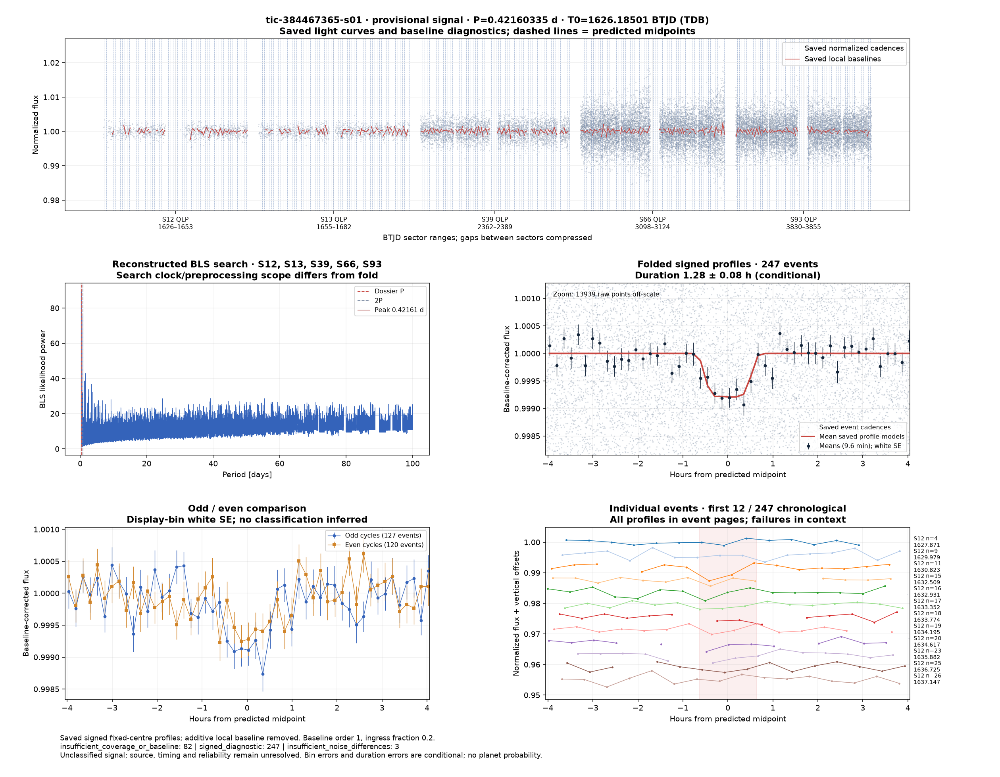
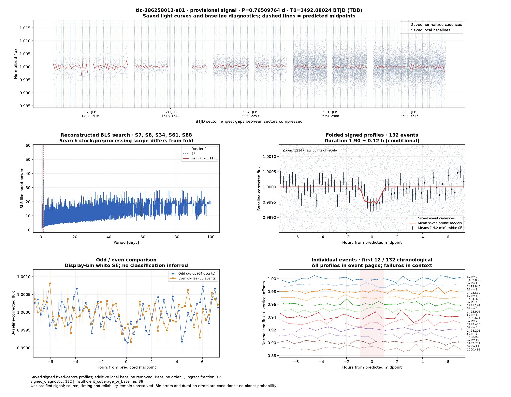
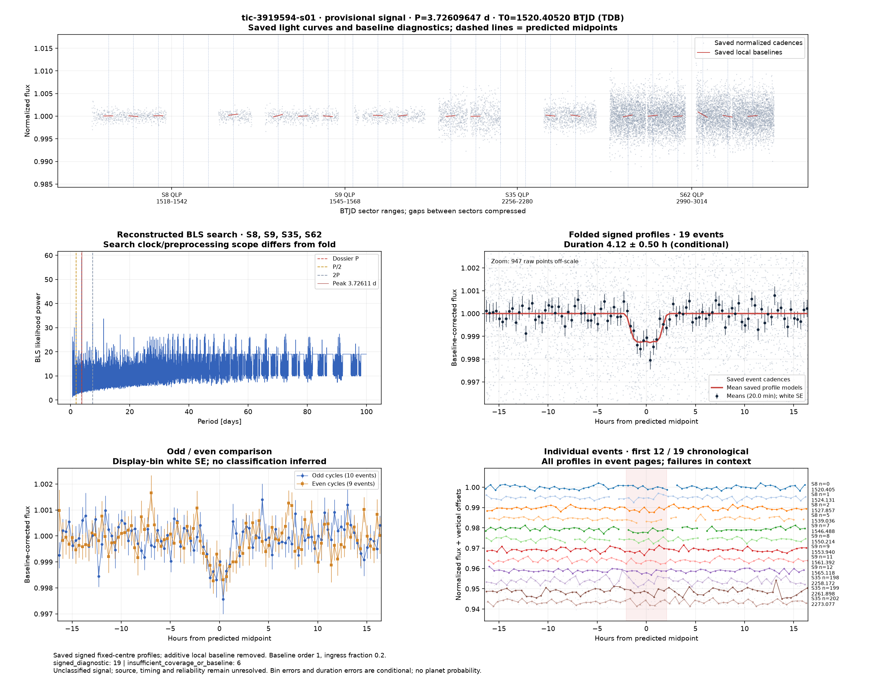

# Candidate diagnostics — page 13

[Gallery index](README.md). Each image opens its full-resolution PNG.

| | | |
|---|---|---|
|  [tic-384467365-s01](../candidates/tic-384467365-s01/README.md) |  [tic-38593803-s01](../candidates/tic-38593803-s01/README.md) |  [tic-386258012-s01](../candidates/tic-386258012-s01/README.md) |
|  [tic-386460347-s01](../candidates/tic-386460347-s01/README.md) |  [tic-387220183-s01](../candidates/tic-387220183-s01/README.md) |  [tic-390325440-s01](../candidates/tic-390325440-s01/README.md) |
|  [tic-390438806-s01](../candidates/tic-390438806-s01/README.md) |  [tic-390719318-s01](../candidates/tic-390719318-s01/README.md) |  [tic-3919594-s01](../candidates/tic-3919594-s01/README.md) |
|  [tic-395511355-s01](../candidates/tic-395511355-s01/README.md) |  [tic-401235612-s01](../candidates/tic-401235612-s01/README.md) |  [tic-402682058-s01](../candidates/tic-402682058-s01/README.md) |
|  [tic-403020080-s01](../candidates/tic-403020080-s01/README.md) |  [tic-403410606-s01](../candidates/tic-403410606-s01/README.md) |  [tic-403412642-s01](../candidates/tic-403412642-s01/README.md) |
|  [tic-403443129-s01](../candidates/tic-403443129-s01/README.md) |  [tic-40588332-s01](../candidates/tic-40588332-s01/README.md) |  [tic-406803545-s01](../candidates/tic-406803545-s01/README.md) |
|  [tic-409652504-s01](../candidates/tic-409652504-s01/README.md) |  [tic-410279702-s01](../candidates/tic-410279702-s01/README.md) |  [tic-410964536-s01](../candidates/tic-410964536-s01/README.md) |
|  [tic-411812299-s01](../candidates/tic-411812299-s01/README.md) |  [tic-412085611-s01](../candidates/tic-412085611-s01/README.md) |  [tic-413415228-s01](../candidates/tic-413415228-s01/README.md) |
