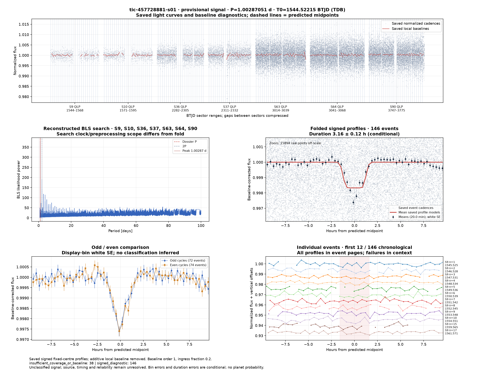
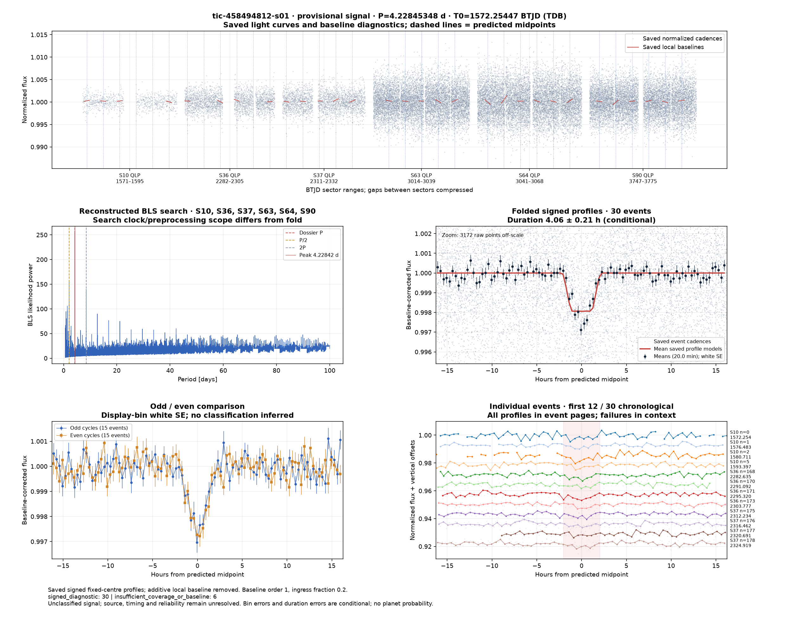
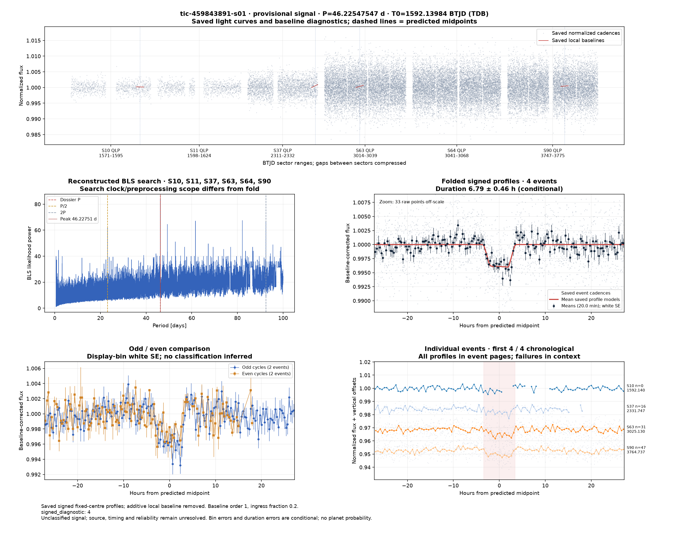
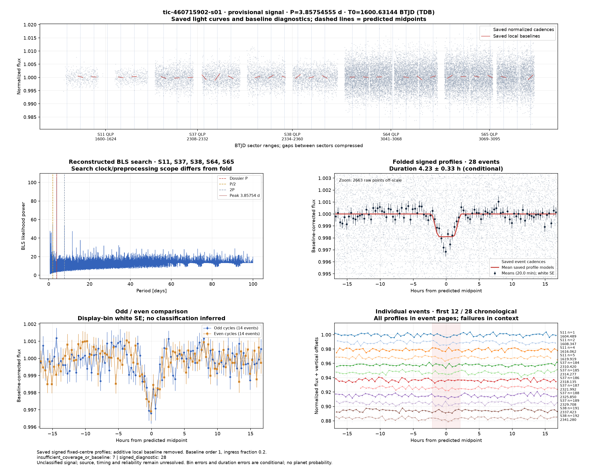

# Candidate diagnostics — page 16

[Gallery index](README.md). Each image opens its full-resolution PNG.

| | | |
|---|---|---|
|  [tic-454105957-s01](../candidates/tic-454105957-s01/README.md) |  [tic-454377816-s01](../candidates/tic-454377816-s01/README.md) |  [tic-454555409-s01](../candidates/tic-454555409-s01/README.md) |
|  [tic-454591748-s01](../candidates/tic-454591748-s01/README.md) |  [tic-455311098-s01](../candidates/tic-455311098-s01/README.md) |  [tic-455325214-s01](../candidates/tic-455325214-s01/README.md) |
|  [tic-455978103-s01](../candidates/tic-455978103-s01/README.md) |  [tic-456018448-s01](../candidates/tic-456018448-s01/README.md) |  [tic-456916715-s01](../candidates/tic-456916715-s01/README.md) |
|  [tic-457267007-s01](../candidates/tic-457267007-s01/README.md) |  [tic-457496256-s01](../candidates/tic-457496256-s01/README.md) |  [tic-457537281-s01](../candidates/tic-457537281-s01/README.md) |
|  [tic-457707635-s01](../candidates/tic-457707635-s01/README.md) |  [tic-457728881-s01](../candidates/tic-457728881-s01/README.md) |  [tic-458199650-s01](../candidates/tic-458199650-s01/README.md) |
|  [tic-458369629-s01](../candidates/tic-458369629-s01/README.md) |  [tic-458494812-s01](../candidates/tic-458494812-s01/README.md) |  [tic-459646247-s01](../candidates/tic-459646247-s01/README.md) |
|  [tic-4597091-s01](../candidates/tic-4597091-s01/README.md) |  [tic-459843891-s01](../candidates/tic-459843891-s01/README.md) |  [tic-460125662-s01](../candidates/tic-460125662-s01/README.md) |
|  [tic-460225650-s01](../candidates/tic-460225650-s01/README.md) |  [tic-460715902-s01](../candidates/tic-460715902-s01/README.md) |  [tic-463186778-s01](../candidates/tic-463186778-s01/README.md) |
