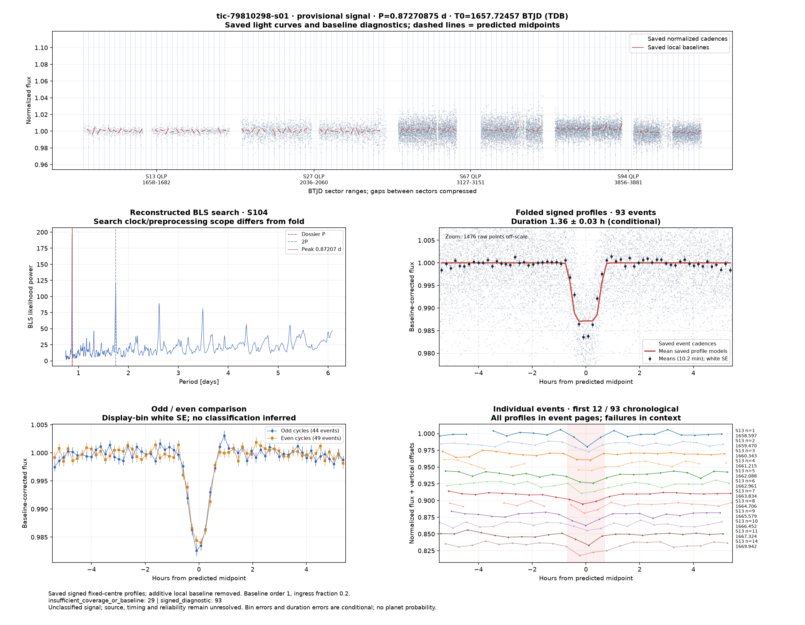
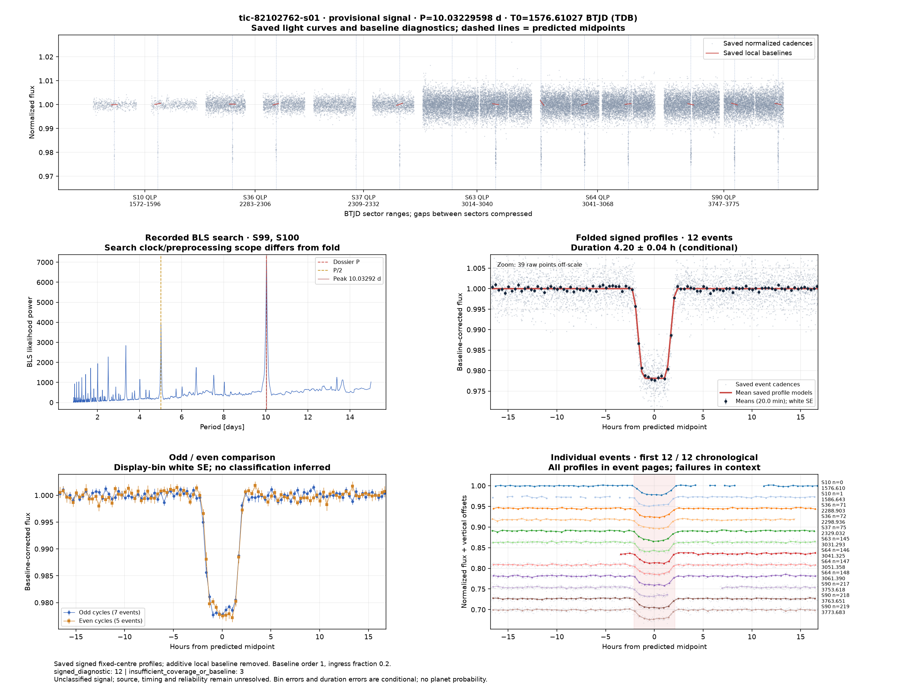
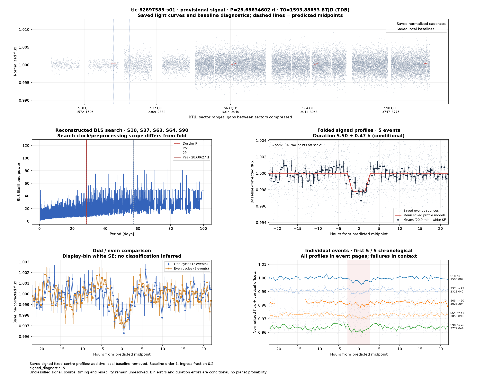
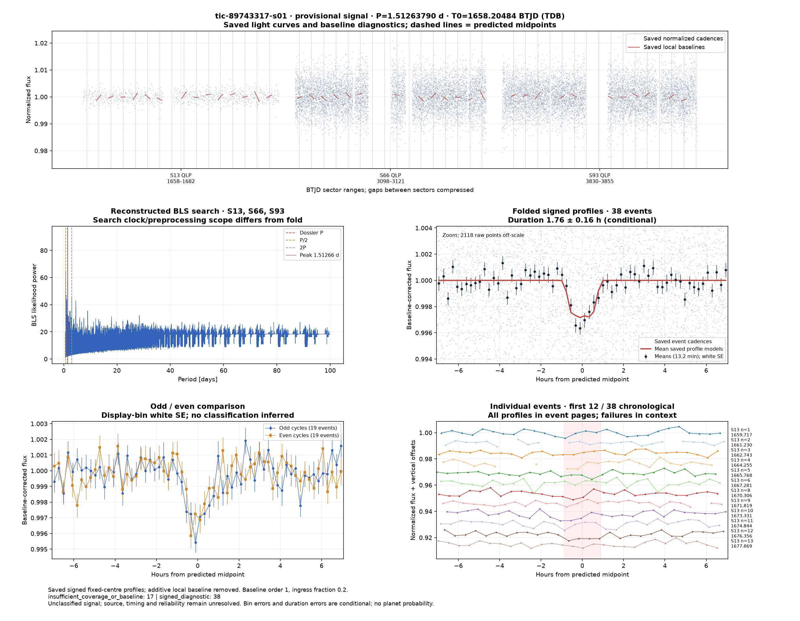
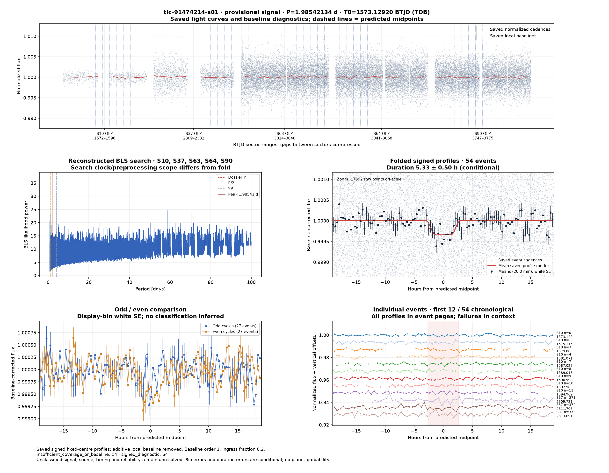
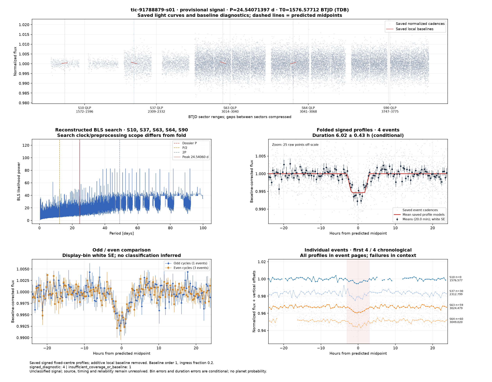
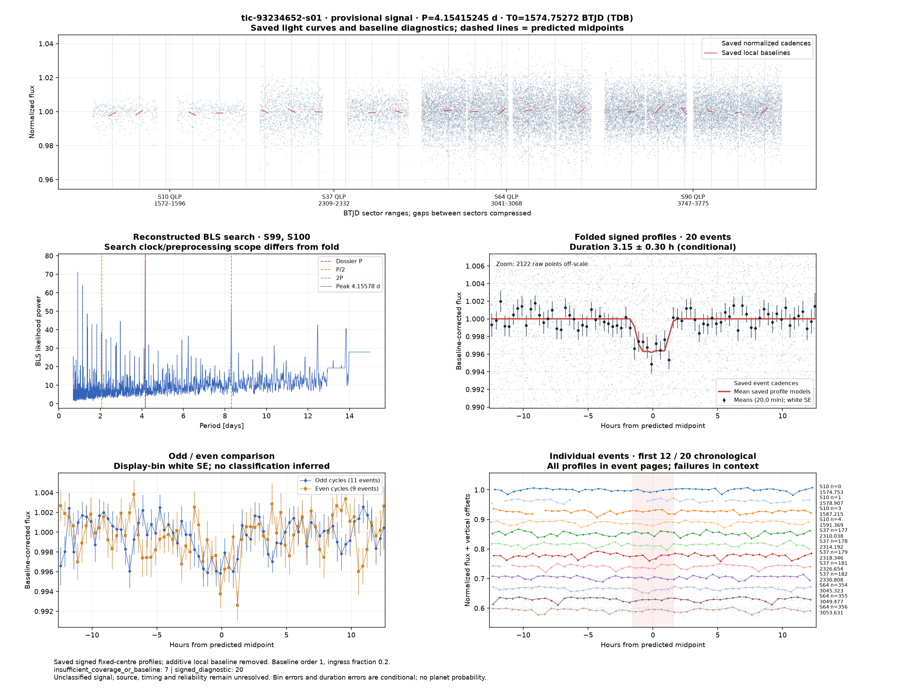
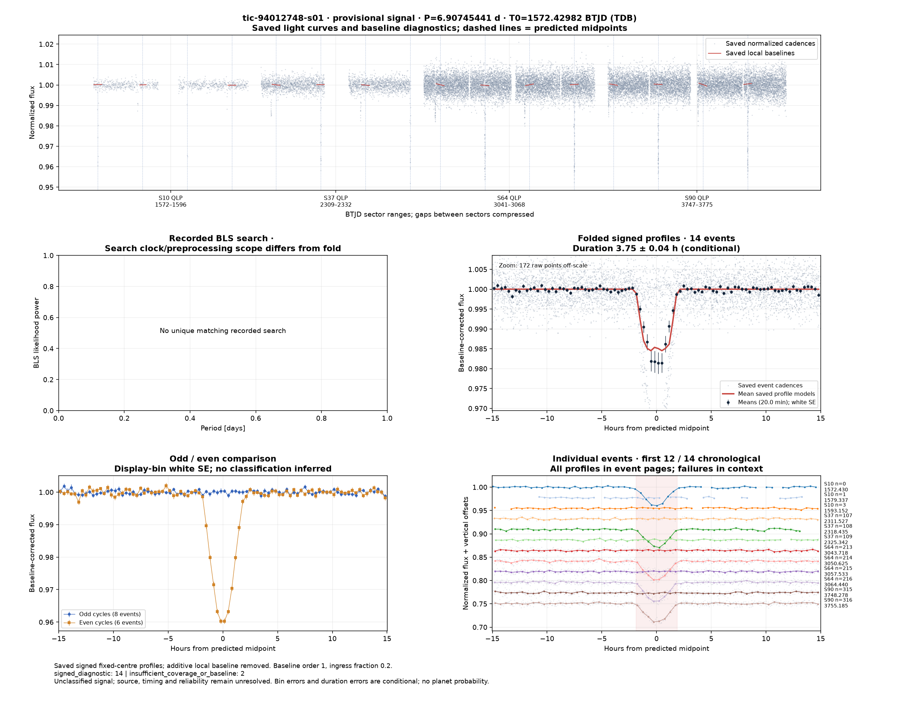

# Candidate diagnostics — page 16

[Gallery index](README.md). Each image opens its full-resolution PNG.

| | | |
|---|---|---|
|  [tic-79810298-s01](../candidates/tic-79810298-s01/README.md) |  [tic-82102762-s01](../candidates/tic-82102762-s01/README.md) |  [tic-82697585-s01](../candidates/tic-82697585-s01/README.md) |
|  [tic-89743317-s01](../candidates/tic-89743317-s01/README.md) |  [tic-91474214-s01](../candidates/tic-91474214-s01/README.md) |  [tic-91788879-s01](../candidates/tic-91788879-s01/README.md) |
|  [tic-93234652-s01](../candidates/tic-93234652-s01/README.md) |  [tic-94012748-s01](../candidates/tic-94012748-s01/README.md) |  |
